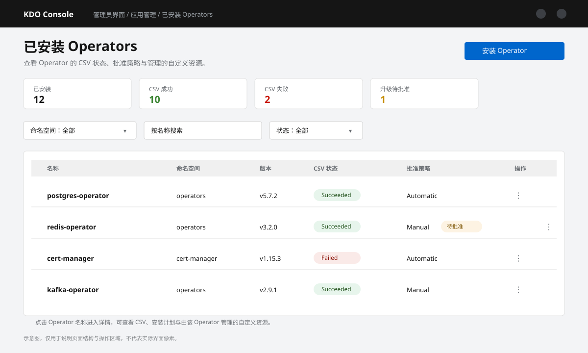
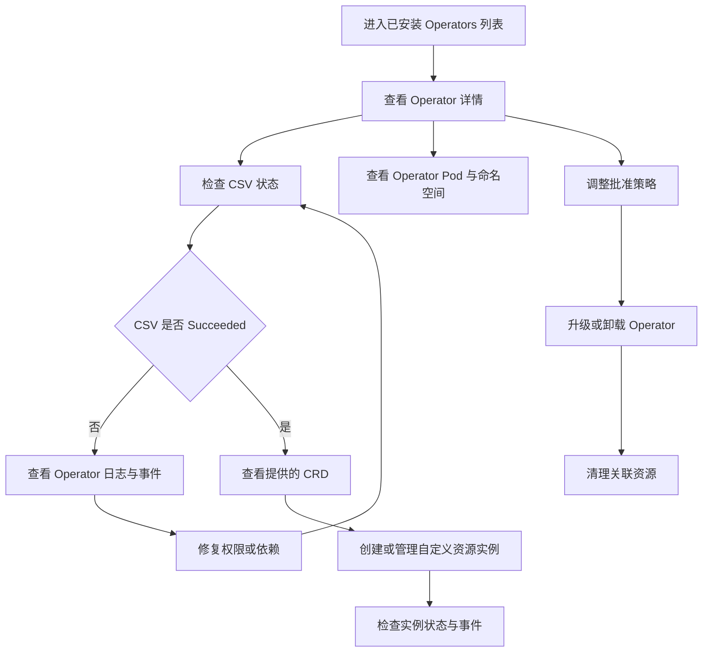

1. TOC
{:toc}

## 介绍

{: .note }
本页展示集群中已安装的 Operator，可查看 CSV 状态、批准策略以及由该 Operator 管理的自定义资源。

*图：已安装 Operators 列表与 CSV 状态。*

## Operator 生命周期

CSV 状态为 `Succeeded` 只表示 Operator 自身部署成功；自定义资源是否正常，还需要结合实例的 `status` 与事件判断。

