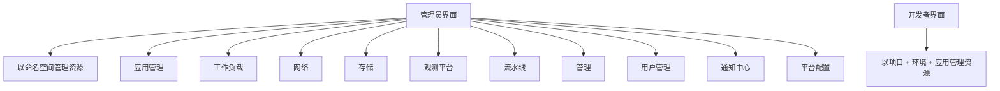

### 管理员界面

{: .note }
管理员界面主要面向管理员和资深Kubernetes用户使用，需要对Kubernetes有一定的运维知识。
明显的区别，管理员是通过命名空间（Namespace）的方式管理资源，而开发者是通过项目+环境+应用的模型来管理资源。

## 导航结构

管理员与开发者面对同一套集群资源，但入口与资源组织方式不同：管理员直接操作命名空间级对象，开发者围绕项目、环境和应用展开。
