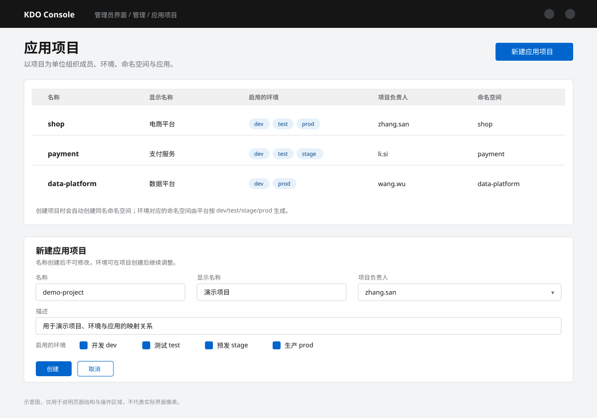
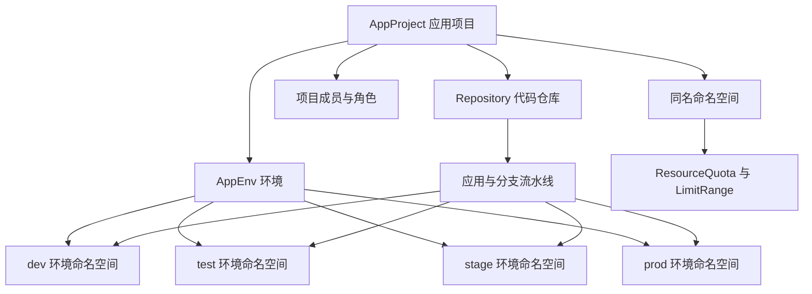

### [访问应用项目详情](/docs/devops/project-manage#项目管理)

**AppProject** 是 KDO 的项目模型：创建项目时会生成同名命名空间，并按启用的环境创建对应的环境命名空间。项目成员、角色与资源配额都围绕这些命名空间生效。

*图：应用项目列表与新建应用项目表单。*

## 组件关系

项目的管理员可管理成员与环境，普通成员只能操作被授权的环境；每个环境命名空间独立承载应用、构建与工作负载。
