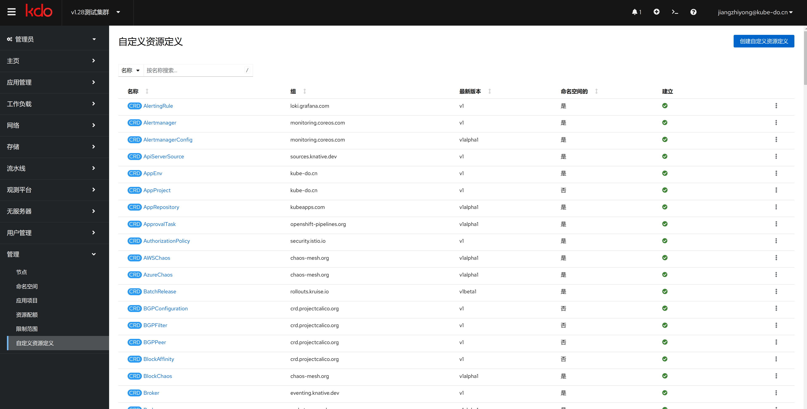
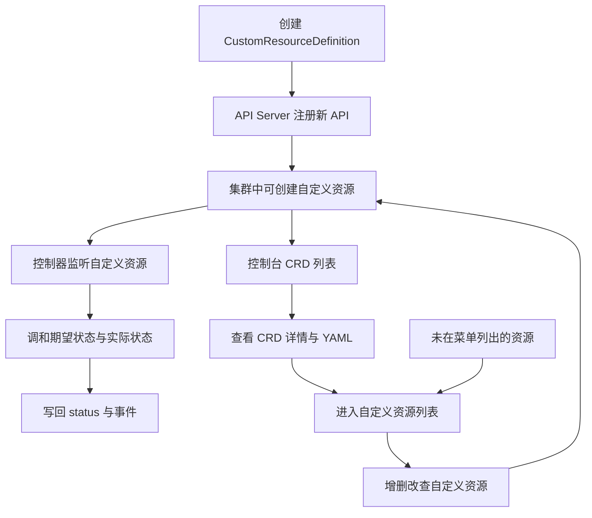
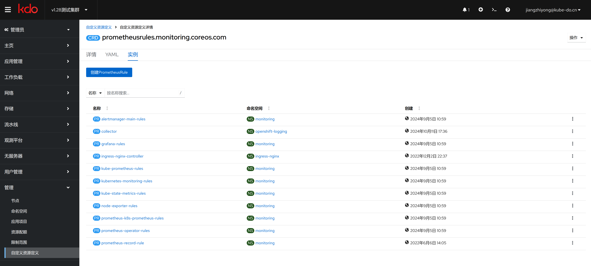

1. TOC
{:toc}

## 介绍

{: .note }
[Custom Resource Definitions (CRDs)](https://kubernetes.io/zh-cn/docs/concepts/extend-kubernetes/api-extension/custom-resources/) 是 Kubernetes 中用于扩展 API 的一种机制，允许用户定义自己的资源类型。
CRD 是一种 API 对象，它代表了一类自定义资源。 当你创建一个 CRD 时，Kubernetes API 服务器会自动为你提供存储和访问该类型的自定义资源的能力。
这使得开发者可以在不修改 Kubernetes 核心代码的情况下，轻松地为集群引入新的功能或抽象层。 KDO平台的很多组件都是通过CRD来实现的。

## CRD 与自定义资源的关系

CRD 定义的是资源类型，真正承载配置的是该类型下的自定义资源实例；删除 CRD 会同时移除集群中所有同类型的自定义资源。

## 操作CRD

{: .note }
由于诸多资源并未在KDO平台的菜单中列出，例如用于监控的`PrometheusRule`。
针对这种情况，我们可以通过访问`CRD（Custom Resource Definitions）`来实现对这些资源的增删改等管理操作。
这样，即使某些资源不在默认菜单内，我们也能够灵活地对其进行操作和管理。

