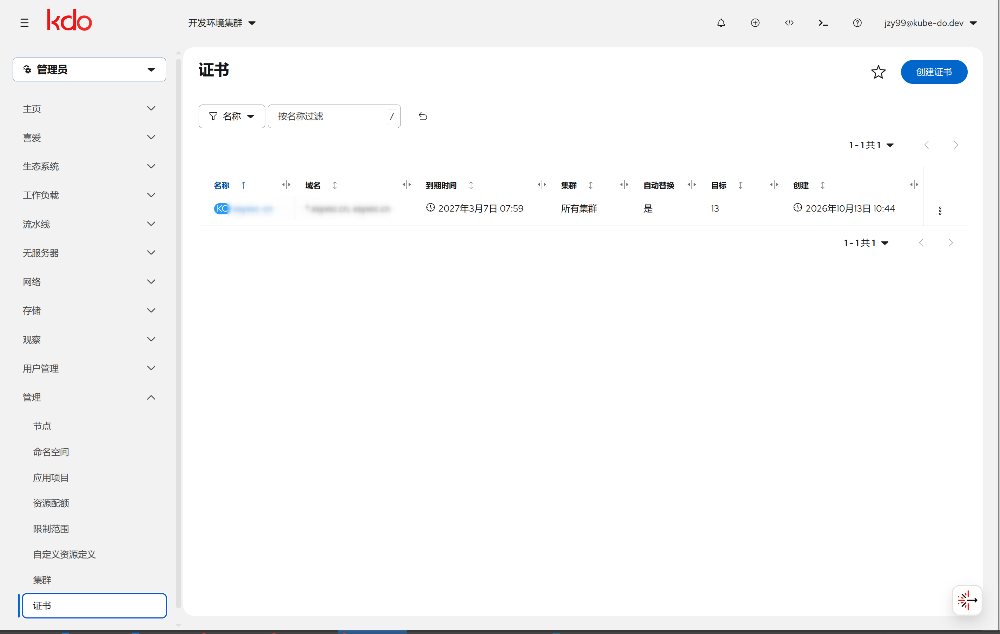
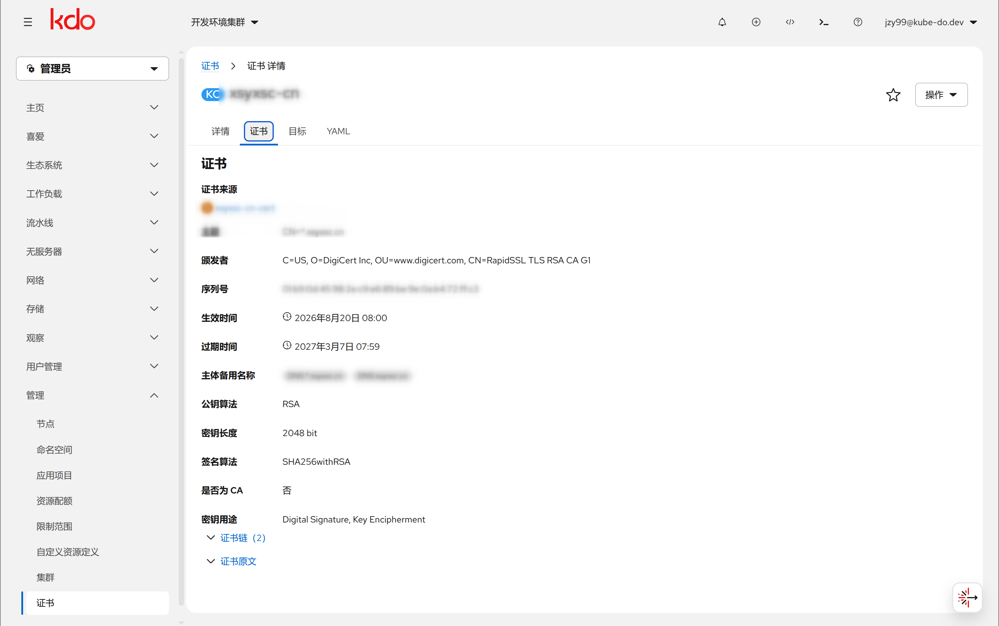
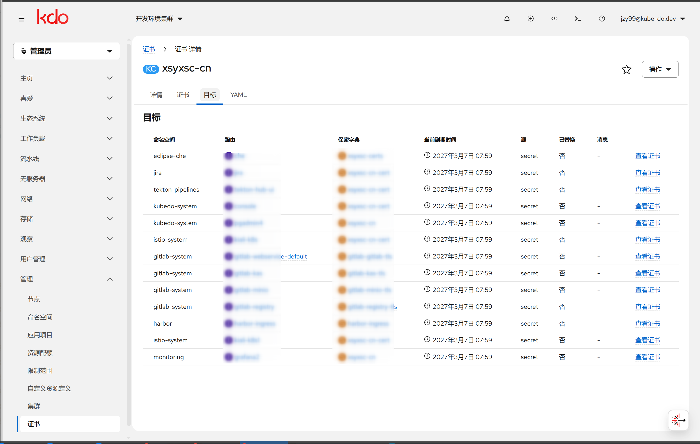

1. TOC
{:toc}

## 介绍

**证书管理（KdcCertificate）** 用于自动维护 Ingress 使用的 TLS 证书：把一份「权威证书」（保存在一个 `kubernetes.io/tls` Secret 中）自动分发到各集群、各命名空间的 Ingress TLS Secret，并在目标证书比来源证书更早过期时用来源证书替换，从而避免逐个命名空间手动更新。

- **证书来源**：主集群（管理集群）中一个 `kubernetes.io/tls` 类型的 Secret（`tls.crt` + `tls.key`）。
- **分发目标**：各集群中 Ingress 引用（`spec.tls[].secretName`）的 TLS Secret。
- **资源类型**：`kube-do.cn/v1` 的**集群级** CRD `KdcCertificate`，由 **KDC Controller** 调和，Console 提供列表、创建与详情界面。

入口：

| 页面 | 路径 | 说明 |
|------|------|------|
| 证书列表 | `/k8s/cluster/kube-do.cn~v1~KdcCertificate` | 管理员视角 → **管理 → 证书** |
| 证书详情 | 同上 + `/<name>` | 查看证书信息、Conditions 与分发目标 |



## 工作原理

1. 读取来源 Secret 的 `tls.crt`，解析证书链，校验**私钥与证书匹配**、证书 SAN **覆盖 `spec.domains`** 且未过期。
2. 依据 `spec.deliveryPolicy` 与 `spec.clusterRefs`，在各目标集群/命名空间中**发现 Ingress 的 TLS 条目**（主机名需被 `spec.domains` 覆盖），得到候选目标 Secret。
3. 计算每个目标 Secret **当前证书的到期时间**：优先直接读取并解析该 Secret 的 PEM；读取失败时回退到 **x509-certificate-exporter** 提供的 Prometheus 指标 `x509_cert_not_after`。
4. 当目标证书缺失、或目标到期时间早于来源证书到期时间时，把来源的 `tls.crt`/`tls.key` 写入目标 Secret（**只改这两个 key，不修改 Ingress**）。
5. 把每个目标的当前到期时间、数据来源（`secret`/`exporter`）、是否已替换及消息写入 `status.targets`，并每 **30 分钟**重新调和一次。

{: .note }
控制器只监听**管理集群**的 Ingress/Secret 事件；远端集群的变化依赖周期性调和（默认 30 分钟）。若希望远端更及时，可在成员集群通过 Ingress 表单选择证书后立即生成（见《路由(Ingress)》）。

## 前置条件

1. **来源 Secret**：主集群中存在一个 `kubernetes.io/tls` Secret，包含 `tls.crt`（可含证书链）与 `tls.key`，且证书覆盖 `spec.domains`、未过期。
2. **证书状态采集（可选，推荐）**：部署 [x509-certificate-exporter](https://github.com/enix/x509-certificate-exporter)，用于采集各 Secret 证书的到期时间。未部署时控制器直接读取目标 Secret 解析证书，仍可工作。

   ```bash
   helm install x509-certificate-exporter oci://quay.io/enix/charts/x509-certificate-exporter \
     --namespace monitoring --create-namespace \
     --set secretsExporter.enabled=true \
     --set 'secretsExporter.secretTypes={kubernetes.io/tls}' \
     --set 'secretsExporter.excludeNamespaces={kube-public,kube-node-lease}' \
     --set prometheusRules.create=true \
     --set serviceMonitor.enabled=true
   ```

3. **Console 监控地址**（使用 exporter 时）：在 Console 配置的 `monitoringInfo` 下增加 `x509Exporter`。

   ```yaml
   monitoringInfo:
     x509Exporter:
       prometheusURL: http://thanos-querier.monitoring.svc:9090
       metric: x509_cert_not_after
       namespaceLabel: secret_namespace
       secretLabel: secret_name
       clusterLabel: cluster
   ```

   | 字段 | 说明 |
   |------|------|
   | `prometheusURL` | Prometheus/Thanos 查询地址（未配置时回退到集群的 `clusterMeteringURL`） |
   | `metric` | 指标名，默认 `x509_cert_not_after` |
   | `namespaceLabel` | 命名空间标签，默认 `secret_namespace`（exporter v3 为 `namespace`） |
   | `secretLabel` | Secret 名标签，默认 `secret_name` |
   | `clusterLabel` | 集群标签（多集群聚合到一个 Prometheus 时用于区分集群） |

## KdcCertificate CRD 字段

### spec

| 字段 | 类型 | 必填 | 说明 |
|------|------|------|------|
| `domains` | []string | 是 | 证书覆盖的域名，支持通配符（如 `*.example.com`）。用于筛选 Ingress 主机名、校验来源证书 SAN |
| `sourceSecretRef.namespace` / `.name` | string | 是 | 主集群中的来源 TLS Secret |
| `clusterRefs` | []string | 否 | 目标集群列表；**为空表示所有集群（含管理集群）** |
| `secretName` | string | 否 | 兜底：仅当 Ingress TLS 条目未指定 `secretName` 时使用 |
| `deliveryPolicy.autoReplace` | bool | 否 | 是否自动替换，默认 `true`；关闭后仅记录状态 |
| `deliveryPolicy.includeNamespaces` | []string | 否 | 仅处理这些命名空间（白名单） |
| `deliveryPolicy.excludeNamespaces` | []string | 否 | 排除这些命名空间（黑名单） |
| `deliveryPolicy.namespaceSelector` | LabelSelector | 否 | 按标签选择命名空间（白名单） |
| `deliveryPolicy.ingressSelector` | LabelSelector | 否 | 仅处理匹配标签的 Ingress |
| `deliveryPolicy.replaceBeforeDays` | int32 | 否 | 兜底阈值：目标证书剩余天数低于该值且不早于来源证书时也替换 |

### status

| 字段 | 类型 | 说明 |
|------|------|------|
| `observedGeneration` | int64 | 已处理的 spec 版本 |
| `notAfter` | time | 来源证书（叶子）到期时间 |
| `domains` | []string | 来源证书的 SAN（为空时回退 `spec.domains`） |
| `conditions` | []Condition | `Ready`：`Synced`（全部成功）或 `PartialFailure`（部分集群失败） |
| `targets` | []Target | 每个分发目标的状态 |
| `lastSyncTime` | time | 最近一次调和时间 |

`targets[]` 字段：`cluster`、`namespace`、`ingress`、`secretName`、`currentNotAfter`（目标当前证书到期时间）、`source`（`secret`/`exporter`）、`replaced`（本次是否替换）、`message`。

**示例：**

```yaml
apiVersion: kube-do.cn/v1
kind: KdcCertificate
metadata:
  name: wildcard-example-com
spec:
  domains:
    - "*.example.com"
  sourceSecretRef:
    namespace: kubedo-system
    name: wildcard-example-com-tls
  # 省略 clusterRefs 表示对所有集群生效
  deliveryPolicy:
    autoReplace: true
    excludeNamespaces:
      - kube-public
```

## 控制台操作

### 证书列表

列表列：**名称 / 域名 / 到期时间 / 集群 / 自动替换 / 目标数 / 创建时间**。到期时间少于 30 天显示橙色、已过期显示红色。


### 创建证书

点击**创建证书**，表单字段：名称、域名（可添加多个，支持通配符）、来源命名空间、来源 Secret（仅列出 `kubernetes.io/tls` 类型）、集群（留空=所有集群）、Secret 名称（可选），以及可折叠的**分发策略**（自动替换、包含/排除命名空间、提前替换天数）。

选择来源 Secret 后，表单会依据证书内容**自动填充域名与名称**。

### 证书详情



- **详情**：域名、证书来源、Secret 名称、集群、到期时间、自动替换、分发策略、Conditions。
- **证书**：在线预览来源证书内容 —— Subject、Issuer、序列号、有效期、Subject Alternative Names、公钥/签名算法、密钥长度、是否 CA、KeyUsage，以及原始 PEM。


- **目标**：分发目标表格，含命名空间、Ingress、Secret、当前到期时间、来源、是否替换、消息；每行可**查看证书**（预览该目标 Secret 当前实际生效的证书）。

  

- **YAML**：查看/编辑原始 YAML。

## 权限与安全边界

- 控制器 RBAC：`kdccertificates`（含 `status`/`finalizers`）、`secrets`（读写）、`namespaces`、`configmaps`、`clusters`、`ingresses`（读）。
- 来源 Secret 中的**私钥不会被读取展示**：证书预览只读取并解析 `tls.crt`。
- 替换时**只写入目标 Secret 的 `tls.crt`/`tls.key`**，不修改 Ingress；并写入注解 `kube-do.cn/certificate`、`kube-do.cn/managed-by=kdc`、`kube-do.cn/certificate-not-after`。
- 删除 `KdcCertificate` **默认保留**已下发的目标 Secret（finalizer `kube-do.cn/kdccertificate-cleanup`）。
- 校验 Webhook（`mkdccertificate.kb.io` / `vkdccertificate.kb.io`）：创建/更新时校验 `domains` 非空、来源 Secret 存在且为 `kubernetes.io/tls`、私钥与证书匹配、SAN 覆盖域名、证书未过期、`clusterRefs` 合法；仅在 `sourceSecretRef`/`domains` 变化时做证书材料校验，避免无关编辑被阻断。

## 常见问题

### Q: 目标 Secret 没有被替换？

- 确认 Ingress TLS 条目的主机名被 `spec.domains` 覆盖（支持通配符，`*.example.com` 只匹配一级标签）。
- 确认目标证书确实比来源证书更早过期（对比状态中的 `currentNotAfter` 与 `notAfter`）。
- 确认 `deliveryPolicy.autoReplace` 未关闭，且命名空间/Ingress 未被选择器或排除列表过滤。
- 查看 `status.conditions` 与 `status.targets[].message`。

### Q: 成员集群的 Secret 没有及时更新？

控制器只监听管理集群的事件，远端集群变化依赖 30 分钟周期调和；也可在成员集群通过 Ingress 表单选择证书后立即生成（见《路由(Ingress)》）。

### Q: 未部署 x509-certificate-exporter 能否使用？

可以。控制器会直接读取并解析目标 Secret 的证书；exporter 指标仅作为读取失败时的回退。

### Q: 目标集群名写错了会怎样？

`clusterRefs` 中的未知集群会在 Webhook 校验时被拒绝（拒绝空串、重复项与不存在的集群名）。若集群在运行期不可用，该集群会被跳过并在 `conditions` 中体现为 `PartialFailure`。

## 命令行参考

```bash
# 列出所有证书
kubectl get kdccertificates.kube-do.cn

# 查看某个证书的 spec 与状态
kubectl get kdccertificate wildcard-example-com -o yaml

# 查看分发目标
kubectl get kdccertificate wildcard-example-com -o jsonpath='{.status.targets}'
```

## 相关链接

- [路由(Ingress)](/docs/dev/network-storage/ingresses/) — 创建/编辑路由时选择证书自动生成 TLS
- [集群管理(Cluster)](/docs/admin/management/clusters/) — 多集群纳管
- [x509-certificate-exporter](https://github.com/enix/x509-certificate-exporter)
- [管理首页](/docs/admin/management/)
