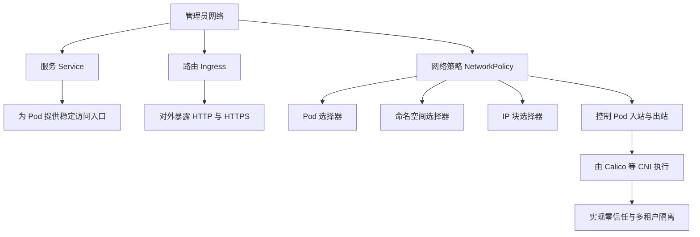

## 和开发者界面的区别

管理员的网络界面主要增加了网络策略页面。

## 管理员网络菜单
1. [服务](/docs/dev/network-storage/services/)
2. [路由](/docs/dev/network-storage/ingresses/)
3. [网络策略](/docs/admin/networking/networkpolicies/)

## 功能地图

服务与路由负责流量的接入和转发，网络策略负责决定哪些流量可以到达 Pod；两者配合构成完整的网络访问模型。
