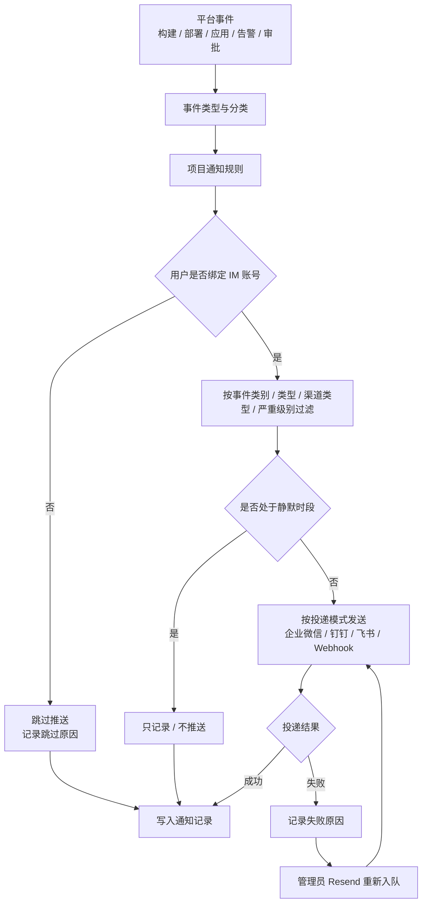

1. TOC
{:toc}

## 介绍

{: .note }
**通知中心**用于把平台事件（构建成功/失败、部署完成、告警、审批、环境异常等）按规则推送到企业微信、钉钉、飞书或 Webhook，并记录每次投递结果，便于追踪与补偿。

通知中心包含两部分：

- **管理员配置**：通知渠道、事件类型、平台公告、通知记录，入口为 **管理员界面 → Notifications**（`/notification-admin`）。
- **用户偏好**：每个用户绑定自己的 IM 账号，选择接收哪些事件，入口为右上角用户菜单 → **Notification settings**，或编辑用户弹窗中的通知设置。

{: .important }
通知中心依赖 KDO 通知服务与 `KUBEDO_ENABLED` 特性标志。标准 Kubernetes 环境未部署通知服务时，入口不会显示。

## 通知投递流程

投递结果会保留在**通知记录**中，便于排查凭据过期、网络不通或渠道配置错误等问题。

## 通知渠道

**Notification channels** 标签页管理所有通知出口。

### 渠道列表

| 列 | 说明 |
|------|------|
| Name | 渠道名称 |
| Provider | 企业微信、钉钉、飞书、Webhook |
| Delivery mode | 机器人（Bot）或应用（App）投递方式 |
| Scope | Platform（平台级）或 Project（项目级） |
| Secret | 凭据状态：Ready / Missing |
| Status | 渠道启用状态 |
| Last test | 最近一次测试结果 |
| Actions | Send test / Edit / Delete |

- 默认渠道会显示 **Default** 徽标；平台级渠道不能设为默认渠道。
- 删除渠道前会弹出确认框；删除后引用该渠道的规则需要重新选择。
- 点击 **Send test** 会向该渠道发送一条测试消息，用于验证凭据与网络连通性。

### 新建/编辑渠道

表单根据 Provider 与 Delivery mode 动态展示凭据字段：

| Provider | 常见凭据 |
|----------|----------|
| 企业微信（WeCom） | `wechat_api_url`、`wechat_api_secret`，或机器人 Webhook URL |
| 钉钉（DingTalk） | 机器人 Webhook、加签 Secret；或应用 AppKey/AppSecret/AgentId |
| 飞书（Feishu/Lark） | 机器人 Webhook、签名校验；或应用 App ID/App Secret |
| Webhook | 目标 URL、可选认证头/Token、TLS 校验选项 |

{: .warning }
凭据保存在 `kubedo-notification` 命名空间下由 Console 管理的 Secret 中，界面只显示 Secret 状态，不会回显密钥。修改渠道时留空密钥字段表示保持原值。

## 事件类型

**Event types** 标签页展示通知服务提供的事件类型及其分类，例如：

| 类别 | 示例事件 |
|------|----------|
| 构建 | 构建开始、构建成功、构建失败 |
| 部署 | 部署成功、部署失败、回滚 |
| 应用 | 环境创建、应用创建、应用删除 |
| 告警 | 告警触发、告警恢复 |
| 审批 | 审批待处理、审批通过、审批拒绝 |

该页面为只读视图，事件类型由通知服务定义。规则和用户偏好中可引用的事件以此列表为准。

## 平台公告

**Platform announcements** 用于发布平台级公告，并按通知渠道推送给用户。适合维护通知、版本升级、策略变更等场景。

## 通知记录

**Notification records** 记录每一次通知投递，可按项目、类别、事件类型、状态筛选，也支持按关键字搜索。

| 列 | 说明 |
|------|------|
| Time | 触发时间 |
| Status | 投递状态（成功、失败、部分失败、跳过等） |
| Severity | 事件严重级别 |
| Event type | 事件类型 |
| Project / Application / Environment | 关联的项目、应用与环境 |
| Branch / commit | 关联的分支与提交 |
| Recipients | 接收人 |
| Delivery | 渠道投递结果 |
| Failure reason | 失败原因 |

- 点击记录可打开详情抽屉，查看渠道、投递明细、失败投递数、跳过原因、标题等完整信息。
- **Resend** 会把通知重新入队，用于失败重试或补发。
- 通知内容中的链接会跳转到对应的项目、应用、流水线或资源页面。

## 用户通知偏好

每个用户可以配置自己的接收方式：

| 配置项 | 说明 |
|--------|------|
| IM binding status | 绑定状态（Bound / Not bound），显示 User ID、Open ID、Mobile、Email 等 |
| Enable notifications | 是否接收通知 |
| Event categories | 接收的事件类别；留空表示接收全部类别 |
| Event types | 接收的具体事件类型；无匹配时显示提示 |
| Channel types | 允许使用的渠道类型 |
| Severity threshold | 最低严重级别（No filter 表示不过滤） |
| Quiet hours | 静默时段（`HH:MM`），静默期内只记录不推送 |
| Digest | 汇总方式：Real time / No digest / Daily / Weekly |
| Send test | 向已绑定账号发送测试消息 |

编辑用户弹窗中也提供通知设置入口，管理员可协助用户完成绑定。

## 项目通知

项目详情页的 **Notifications** 标签页提供项目维度的通知健康度：

- 已启用规则数 / 总规则数；
- 最近 24 小时投递数与失败投递数；
- Ready 渠道数 / 总渠道数；
- 默认通知规则说明；
- 失败投递与渠道凭据的排查入口。

项目管理员可以在这里维护项目级通知规则；规则未命中时会回落到平台的默认规则。

## 常见问题

### 渠道显示 Secret Missing

表示该渠道引用的 Secret 不存在或缺少必需字段。重新编辑渠道并填写凭据，或检查 `kubedo-notification` 命名空间中的 Secret 是否被删除。

### 测试消息发送失败

依次检查：Webhook URL 是否可达、Token/Secret 是否正确、目标群机器人是否启用、TLS 证书是否受信任、集群是否允许访问外部网络。

### 用户收不到通知

检查用户偏好中的 **Enable notifications**、事件类别/类型、渠道类型、严重级别阈值与静默时段；再确认项目通知规则是否命中，以及通知记录中的投递状态。

### 通知记录显示跳过

常见原因是用户未绑定 IM 账号、事件被用户偏好过滤、处于静默时段，或规则未匹配到接收人。详情抽屉中会给出具体的跳过原因。

## 相关链接

- [项目管理](/docs/devops/project-manage/)
- [平台配置编辑器](/docs/admin/platform-config/)
- [权限管理](/docs/rbac/)
