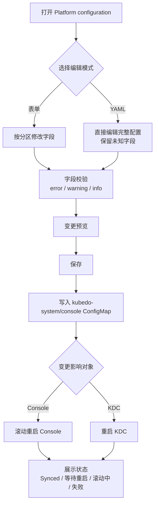
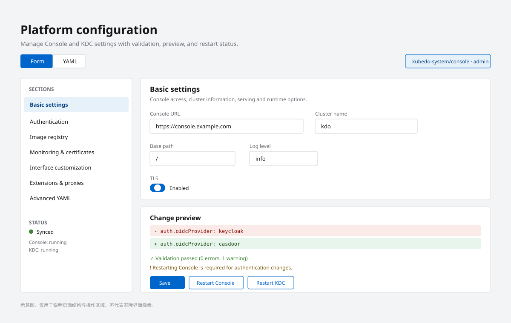

1. TOC
{:toc}

## 介绍

{: .note }
**平台配置编辑器**用于在控制台中图形化维护 Console 与 KDC 的平台配置，避免直接编辑 ConfigMap 时的格式错误与字段遗漏。

入口：**管理员界面 → Platform configuration**（`/platform-config`）。

页面同时支持两种模式：

- **表单模式**：按业务分区填写，字段带类型校验与说明；
- **YAML 模式**：直接编辑完整配置，保留未知字段，适合高级场景。

两种模式可以随时切换；切换时会提示尚未保存的修改。

{: .important }
使用该页面需要 `kubedo-system/console` ConfigMap 的 **update** 权限。没有权限时页面只读，并显示权限提示。

## 配置生效流程

只有保存成功后配置才会写入；Console 与 KDC 可以分别重启，互不影响。

## 配置分区

*图：左侧为配置分区与当前状态，右侧为表单字段、变更预览以及保存和重启操作。*

### 基本设置

| 配置项 | 说明 |
|--------|------|
| Console 访问地址 | Console 对外访问 URL，需与 Ingress/域名一致 |
| 集群信息 | 集群名称、主集群地址、默认域名等 |
| Serving | 监听地址、TLS、基础路径等 |
| 高级运行参数 | 运行模式、日志级别等 |

### 身份认证

| 配置项 | 说明 |
|--------|------|
| 登录方式 | OIDC、OpenShift OAuth 或禁用（仅开发） |
| OIDC 配置 | Issuer、Client ID/Secret、额外 Scope、CA 等 |
| KDC 用户组同步 | 是否将用户组同步到 KDC |

修改认证配置前请确认 OIDC Provider 与 Kubernetes API Server 的参数一致，否则可能导致无法登录。

### 镜像仓库

| 配置项 | 说明 |
|--------|------|
| Harbor 地址 | 内置或外部 Harbor 的访问地址 |
| Harbor 凭据 | 管理员密码等；也可从 Secret 自动读取 |
| KDC 旧镜像清理 | 旧的镜像清理策略参数 |

### 监控与证书

| 配置项 | 说明 |
|--------|------|
| 监控链接 | Prometheus/Thanos、Grafana、AlertManager 的公网地址 |
| 主集群默认地址 | 成员集群回连主集群使用的地址 |
| 证书指标 | 证书到期指标的采集配置 |

### 界面定制

| 配置项 | 说明 |
|--------|------|
| 品牌与产品名 | 控制台名称、Logo、关于信息 |
| 文档链接 | 帮助菜单中的文档地址 |
| QuickStart | 首页快速入门内容 |
| 项目访问角色 | 新建项目时默认分配的角色 |

### 扩展与代理

| 配置项 | 说明 |
|--------|------|
| 动态插件 | 插件启用列表与代理配置 |
| i18n | 默认语言与可用语言 |
| CSP | 内容安全策略模式 |
| 遥测 | 使用数据上报开关 |
| Helm | Helm Chart 仓库与代理 |
| Statuspage | 状态页地址 |

### 高级 YAML

以 YAML 形式展示 Console 与 KDC 的完整配置。

- **保留未知字段**：页面不认识的字段不会被丢弃；
- **丢弃 YAML 修改**：放弃当前 YAML 编辑内容，恢复到最近一次保存的配置；
- 保存前会执行格式与语义校验。

## 变更预览与校验

保存前点击 **Preview** 可以查看变更摘要：

- 仅展示发生变化的字段；
- 区分新增、修改、删除；
- 敏感字段（密码、Token）不会回显明文。

校验结果分为三级：

| 级别 | 含义 |
|------|------|
| Error | 阻止保存，必须修正 |
| Warning | 可能影响运行，但允许保存 |
| Info | 提示性信息 |

常见 Error 包括：URL 格式错误、必填项为空、端口非法、OIDC 参数不完整、依赖字段冲突。

## 保存与重启

Console 与 KDC 的配置相互独立：

- **Console 配置**保存后，Console Pod 会滚动重启；
- **KDC 配置**保存后，需要重启 KDC 控制器/服务才能生效。

保存后页面显示同步状态：

| 状态 | 含义 |
|------|------|
| Synced | 配置已同步，无需重启 |
| 等待重启 | 配置已写入，等待重启生效 |
| 滚动中 | Pod 正在滚动更新 |
| 失败 | 同步或重启失败，需要查看日志 |
| 未知 | 暂时无法获取状态 |

{: .warning }
保存平台配置可能触发 Console 重启，当前页面会短暂不可用。建议在维护窗口内操作，并避免同时修改 Console 与 KDC 的关键参数。

## 配置加载优先级

平台配置的加载顺序为（后者覆盖前者）：

1. YAML 配置文件；
2. 环境变量（`BRIDGE_` 前缀）；
3. 命令行参数。

通过页面保存的配置写入 ConfigMap，由 Console 挂载后生效。直接修改 ConfigMap 或 Deployment 参数可能造成页面显示与实际运行配置不一致，建议统一通过本页面维护。

## 常见问题

### 保存后配置未生效

确认 Console/KDC 是否完成重启，并检查页面上的同步状态是否为 **Synced**。KDC 配置需要单独重启 KDC 才会生效。

### 页面提示无权限

需要 `kubedo-system/console` ConfigMap 的 update 权限。请联系集群管理员在 [权限管理](/docs/rbac/) 中授权。

### YAML 中的字段在表单里看不到

页面只对已知字段提供表单；未知字段会保留在 YAML 中。若字段属于新版本能力，请升级 Console 或使用 YAML 模式维护。

### 修改认证配置后无法登录

检查 OIDC Issuer、Client ID/Secret、回调地址是否与 Keycloak 配置一致；必要时通过集群命令行回滚 ConfigMap。

## 相关链接

- [KDO Web 控制台配置](/docs/install/config/console/)
- [用户管理](/docs/admin/user-management/)
- [权限管理](/docs/rbac/)
