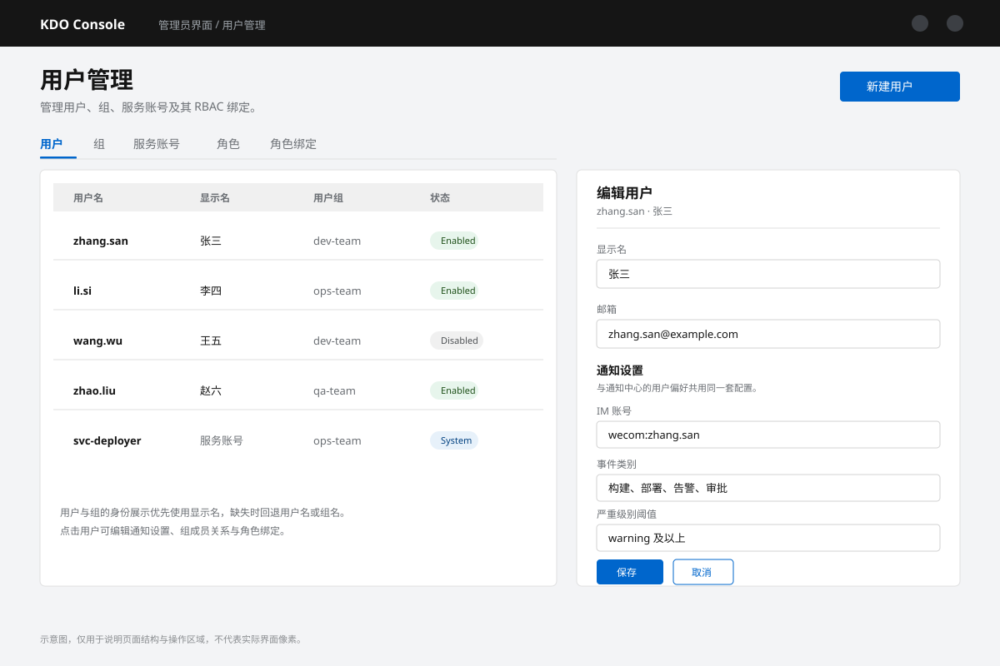
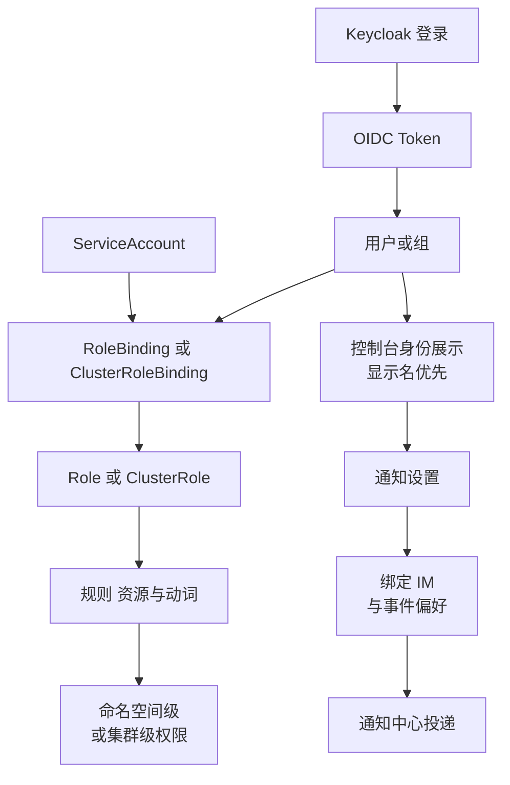

{: .note }
在Kubernetes集群中，访问控制是保障集群安全的重要组成部分。其中，权限管理是访问控制的核心。
Kubernetes 的权限管理是通过其内置的 Role-Based Access Control (RBAC) 系统来实现的。
RBAC 提供了细粒度的访问控制能力，允许你定义谁可以对集群中的资源做什么操作。

*图：用户列表与编辑用户面板中的通知设置。*

## 管理员用户管理菜单
1. [用户(User)](/docs/rbac/#用户管理)
2. [组(Group)](/docs/rbac/#组管理)
3. [服务账号(ServiceAccount)](/docs/rbac/#服务账号)
4. [角色(Role)](/docs/rbac/#role和clusterrole管理)
5. [角色绑定(RoleBinding)](/docs/rbac/#rolebinding和clusterrolebinding管理)

## 用户身份展示

控制台统一了用户与组的身份标识：

- 用户/组优先显示**显示名**，没有显示名时回退到用户名/组名；
- 成员列表、项目访问、审计信息、通知接收人等位置使用同一套身份信息，避免同一用户显示不一致；
- 编辑用户弹窗可以查看和修改用户的通知设置、组成员关系等。

## 通知设置入口

用户可以通过以下入口配置个人通知偏好：

- 右上角**用户菜单 → Notification settings**；
- **用户管理 → 编辑用户**弹窗中的通知设置；
- 项目详情页的通知标签（查看项目级规则）。

可配置绑定 IM 账号、接收的事件类别与类型、渠道类型、严重级别阈值、静默时段与汇总方式。详见 [通知中心](/docs/admin/notifications/)。

## 登录提供商

除 Keycloak 外，控制台还支持 **Casdoor** OIDC 登录。Casdoor 的用户名推导已泛化，兼容其 `preferred_username`、`name`、`email` 等声明；登录后不会再短暂显示 `anonymous` 用户。

## Keycloak 用户管理
KDO 使用 Keycloak 作为身份认证中心，统一管理用户、用户组与会话。详见 [Keycloak 用户管理](/docs/admin/user-management/keycloak/)。

## 用户权限关系

Keycloak 负责认证并签发 OIDC Token，Kubernetes 依据 Token 中的用户与组执行 RBAC 鉴权；通知设置属于用户偏好，不参与权限判定。
