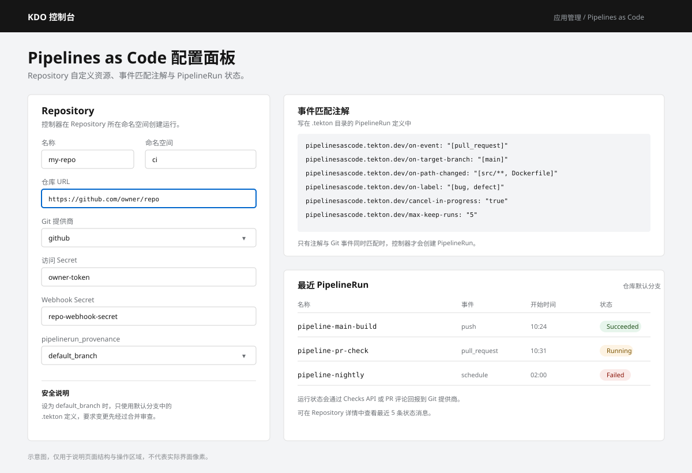
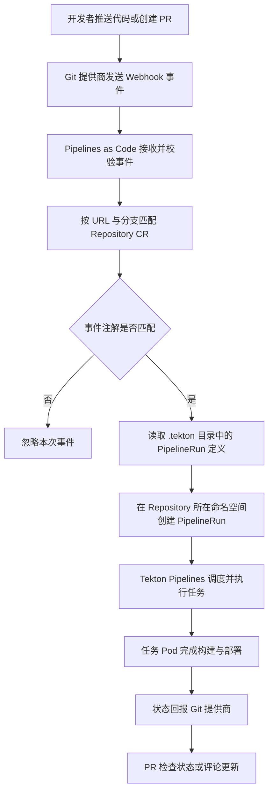

## 介绍

Pipelines as Code 是 Tekton Pipelines 的一个子系统，允许集群管理员和具有相应权限的用户将流水线模板定义为源代码 Git 仓库的一部分。当配置的 Git 仓库发生源代码推送（push）或拉取请求（pull request / merge request）时，Pipelines as Code 会自动运行流水线并将执行状态报告回 Git 提供商平台。



*图：Repository 自定义资源、事件匹配注解与最近 PipelineRun 状态的关系。*

## 主要特性

Pipelines as Code 支持以下功能：

- **拉取请求状态与控制**：在托管 Git 仓库的平台上直接显示流水线运行状态。
- **GitHub Checks API**：使用 GitHub Checks API 设置 PipelineRun 状态，包括重新检查（rechecks）功能。
- **事件驱动**：支持 GitHub pull request 和 commit 事件触发。
- **评论操作**：支持通过 PR/MR 评论中的命令操作流水线，例如 `/retest`。
- **事件过滤**：支持 Git 事件过滤，可为不同事件定义不同的流水线。
- **自动任务解析**：自动解析 Tekton Pipelines 中的任务，支持本地任务、Tekton Hub 和远程 URL。
- **GitHub Blob/Objects API**：通过 GitHub Blob 和 Objects API 检索配置。
- **访问控制**：支持基于 GitHub 组织的 ACL（访问控制列表），或使用 Prow 风格的 `OWNERS` 文件进行权限控制。
- **CLI 工具**：`tkn pac` CLI 插件，用于管理引导和 Pipelines as Code 仓库。
- **多提供商支持**：支持 GitHub App、GitHub Webhook、GitLab、Bitbucket Data Center 和 Bitbucket Cloud。
- **自动 Secret 创建**：对私有仓库自动创建认证 Secret。
- **远程任务和流水线**：支持从远程 URL 引用任务和流水线定义。
- **动态变量**：运行时替换仓库 URL、分支名、提交 SHA 等动态变量。
- **CEL 表达式**：支持 Common Expression Language（CEL）进行高级事件匹配与过滤。
- **并发控制**：支持设置并发限制和自动取消进行中的流水线。
- **自定义参数扩展**：支持在 Repository CR 中定义自定义参数并注入 PipelineRun。
- **Git 标签触发**：支持基于 Git 标签触发 PipelineRun。
- **传入 Webhook**：支持通过传入 Webhook URL 和共享密钥触发流水线。

## 核心概念与工作流程

Pipelines as Code 的完整工作流程如下：

```
开发者推送代码/创建 PR
       ↓
Git 提供商触发 Webhook
       ↓
Pipelines as Code webhook 端点接收事件
       ↓
匹配 Repository CR（通过 URL、分支等规则）
       ↓
控制器在 Repository CR 所在命名空间创建 PipelineRun CR
       ↓
Tekton Pipelines 执行流水线
       ↓
状态报告回 Git 提供商（Checks Tab / PR 评论）
```

用流程图表示同一过程：



**详细步骤说明**：

1. **配置集成**：集群管理员首先将 Pipelines as Code 与 Git 仓库提供商（如 GitHub、GitLab）集成，配置 Webhook 或 GitHub App。

2. **创建 Repository CR**：在应用所在命名空间中创建 `Repository` 自定义资源（CR），其中包含：
   - 要监听的 Git 仓库 URL
   - Git 提供商的认证信息（Secret 引用）
   - Webhook Secret 引用
   - 分支映射和目标命名空间

3. **定义流水线模板**：在被监听 Git 仓库的根目录下创建 `.tekton` 目录，将 PipelineRun 定义以 `.yaml` 或 `.yml` 文件形式存放在此目录中。

4. **添加事件匹配注解**：在 PipelineRun 定义中添加注解，指定触发该流水线的 Git 事件类型和目标分支。

5. **触发执行**：当匹配的事件发生时，Pipelines as Code 控制器根据定义创建 `PipelineRun` CR，Tekton Pipelines 开始执行流水线。

6. **状态报告**：流水线执行完成后，状态通过 Checks API（GitHub App）或 PR 评论（Webhook）报告回 Git 提供商。

### 重要安全说明

默认情况下，为 pull request 或 push 事件创建 `PipelineRun` CR 时，Pipelines as Code 使用**事件源分支**（source branch）的 `.tekton` 目录中的定义。这意味着如果 PR 修改了 `.tekton` 目录，Pipelines as Code 将使用修改后的版本。

如果希望提高安全性，可以在 `Repository` CR 中设置：

```yaml
spec:
  settings:
    pipelinerun_provenance: "default_branch"
```

启用此设置后，Pipelines as Code 始终使用 Git 仓库提供商上配置的默认分支（如 `main`、`master` 或 `trunk`）中的 `.tekton` 定义。这确保了流水线定义在被合并到默认分支之前不会被执行，从而要求所有变更都经过合并审查。

## 分册

- [安装与配置](/docs/dev/applications/pipelines-as-code/install/)
- [Git 仓库托管服务集成](/docs/dev/applications/pipelines-as-code/git-integration/)
- [Repository 与 PipelineRun](/docs/dev/applications/pipelines-as-code/repository-and-pipelinerun/)
- [运行管理与命令参考](/docs/dev/applications/pipelines-as-code/manage-and-reference/)
