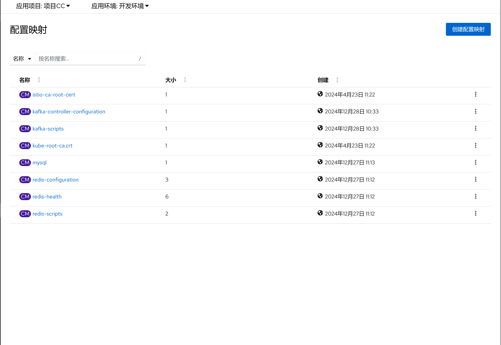
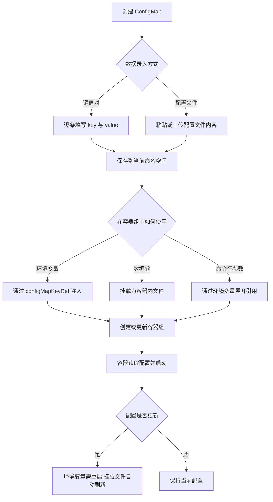
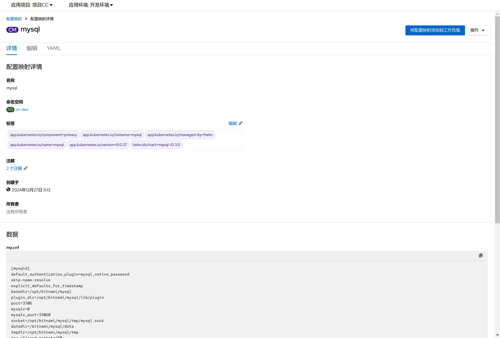
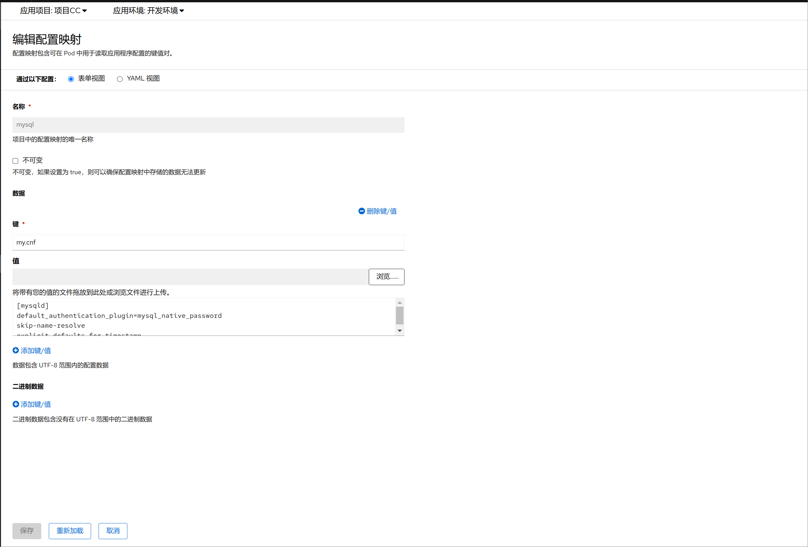
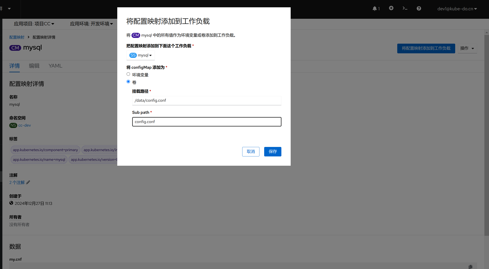

1. TOC
{:toc}

## 介绍

{: .note }
`配置映射(ConfigMap)` 是一种API对象，用于以键值对的形式存储非敏感数据。它可以在容器组中作为环境变量、命令行参数或存储卷内的配置文件使用，从而便于应用程序的配置管理。
`配置映射(ConfigMap)`能够将环境配置信息与容器镜像分离，从而简化应用配置的修改和管理。通过这种方式，不仅可以灵活调整配置参数，还能够在不影响容器镜像的情况下快速响应变化的需求。

{: .warning }
`配置映射(ConfigMap)` 并不提供保密或者加密功能。如果你想存储的数据是机密的，请使用[保密字典(Secret)](/docs/dev/configurations/secrets/)， 或者使用其他第三方工具来保证你的数据的私密性，而不是用`配置映射(ConfigMap)`。

## 使用流程

## 查看配置映射

## 编辑配置映射

{: .note }
`配置映射(ConfigMap)`采用键值对的形式存储数据，提供了灵活的管理方式，您既可以通过直观的图形界面进行编辑，也可以利用YAML文件的形式来进行配置。

## 使用配置映射

{: .note }
`配置映射(ConfigMap)`可以作为数据卷挂载。`配置映射(ConfigMap)`也可被系统的其他组件使用， 而不一定直接暴露给容器组。
例如，`配置映射(ConfigMap)`可以保存系统中其他组件要使用的配置数据。`配置映射(ConfigMap)`最常见的用法是为同一命名空间里某容器组中运行的容器执行配置。 你也可以单独使用`配置映射(ConfigMap)`。

