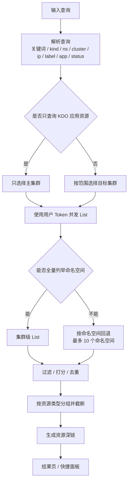
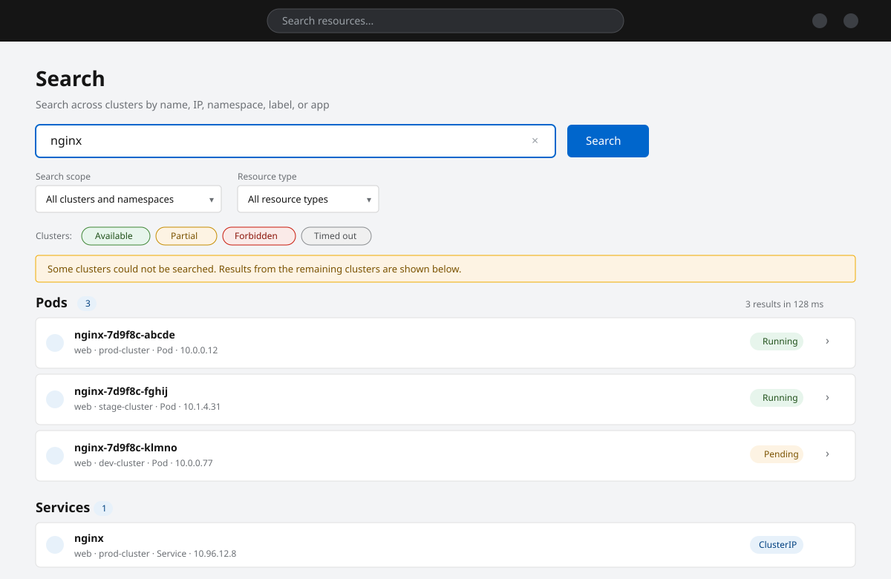

1. TOC
{:toc}

## 介绍

{: .note }
**全局资源搜索**可以在多个集群、多个命名空间中快速定位资源，支持按**名称、IP 地址/CIDR、命名空间、标签、应用、状态**检索，并对模糊匹配结果按相关度排序。

与传统列表页的过滤不同，全局搜索面向「我只记得一部分信息」的场景，例如：

- 只记得容器组名称的一部分，或它的 Pod IP；
- 想找出某个标签（`app=nginx`）在所有环境中的资源；
- 想按应用或状态筛选某个命名空间下的工作负载；
- 需要在多个集群之间确认某个资源部署在哪里。

搜索完全遵循 [Kubernetes RBAC 权限模型](/docs/rbac)：只会返回当前用户有权读取的资源。

## 工作流程



整个过程中不会使用 ServiceAccount 提权：每个集群的请求都携带当前用户 Token，因此看到的资源与直接访问该集群一致。

## 入口

| 入口 | 说明 |
|------|------|
| 顶栏搜索框 | 控制台右上角工具栏的搜索框，点击后打开快捷搜索面板 |
| `Ctrl + K` / `Cmd + K` | 在任意页面打开快捷搜索面板（输入框内不触发） |
| `/kdo-search` | 完整搜索结果页，可通过快捷面板的 **View all results** 进入 |

快捷面板最多展示少量高相关结果，按 `↑` / `↓` 选择、`Enter` 打开、`Esc` 关闭；点击 **View all results** 会带着当前查询跳转到结果页。

## 使用方式

在搜索框中输入关键词即可。多个关键词之间是 **AND** 关系，例如：

```text
nginx web
```

表示名称或标签中同时包含 `nginx` 与 `web`。如果关键词包含空格，可使用英文引号：

```text
"my app"
```

### 搜索语法

| 语法 | 示例 | 说明 |
|------|------|------|
| 自由关键词 | `nginx` | 匹配资源名称、显示名、命名空间、标签值等 |
| `kind:` / `kinds:` | `kind:Pod`、`kinds:Pod,Service` | 限定资源类型，多个类型用逗号分隔 |
| `ns:` / `namespace:` | `ns:dev`、`namespace:prod` | 限定命名空间；仅支持一个命名空间 |
| `cluster:` | `cluster:member-1` | 限定集群 |
| `ip:` | `ip:10.0.0.1`、`ip:10.0.0.0/24` | 按 IP 或 CIDR 匹配 |
| `label:` | `label:app`、`label:app=nginx` | 按标签键或键值匹配 |
| `app:` | `app:shop` | 按 KDO 应用名匹配 |
| `status:` | `status:Running` | 按状态匹配 |
| `-` 前缀 | `-status:Terminating`、`-dev` | 排除匹配项 |
| 裸 IP | `10.0.0.1` | 自动识别为 IP 或 CIDR 过滤 |

{: .note }
- 目前只支持**一个** IP/CIDR 过滤条件，输入多个会返回提示。
- `ns:`、`cluster:`、`ip:`、`label:`、`app:`、`status:` 暂不支持负向写法（`-ns:` 等）。
- 查询长度上限为 256 个字符。

### 支持的资源类型

默认搜索以下资源：

| 分类 | 资源 |
|------|------|
| 工作负载 | Pod、Deployment、StatefulSet、DaemonSet |
| 网络 | Service、Ingress |
| 集群 | Node、Namespace |
| KDO 应用 | AppProject、AppEnv、Repository |

在标准 Kubernetes/OpenShift 集群上，如果未安装 KDO CRD，AppProject、AppEnv、Repository 会自动隐藏或返回空结果，不影响核心资源搜索。

## 结果页

结果页 `/kdo-search` 提供更完整的筛选与结果展示。

### 搜索范围

| 范围 | 说明 |
|------|------|
| 所有集群和命名空间 | 在所有有权限的集群、所有命名空间中搜索（默认） |
| 当前集群，所有命名空间 | 只在当前集群内搜索 |
| 当前集群和命名空间 | 只在当前集群、当前命名空间中搜索 |

如果当前没有选中的命名空间，范围会自动降级为「当前集群，所有命名空间」。

### 资源类型

可通过 **Resource type** 下拉限定单一资源类型；标准 Kubernetes 环境下不会显示 KDO 专属类型。

### 结果展示

- 结果按资源类型分组，组标题右侧显示该类型的命中总数。
- 每条结果显示资源名、命名空间、集群、类型、状态与 IP（如有）。
- 名称命中部分会高亮显示。
- 点击结果直接跳转到对应资源详情页；Pod 还提供日志与终端入口。



*图：结果页由搜索输入、范围与类型筛选、集群状态、提示信息以及按资源类型分组的结果列表组成。*

### 集群状态

结果页顶部会列出参与搜索的集群及其状态：

| 状态 | 含义 |
|------|------|
| Available | 该集群搜索正常完成 |
| Partial | 部分资源类型查询失败或超时 |
| Forbidden | 当前用户没有该集群的访问权限 |
| Unauthorized | 身份认证失败 |
| Timed out | 查询超时 |
| Unavailable | 集群不可达或返回异常 |

当部分集群失败、结果被截断，或部分集群只能按当前命名空间搜索时，页面会显示相应提示，但不会影响其他集群的结果展示。

## 最近搜索

搜索框会记录最近 5 条搜索，保存在浏览器本地（`localStorage`），不会上传到服务端。可在快捷面板中快速重复之前的查询。

## 标准 Kubernetes 支持

全局搜索不依赖 KDO 专属 CRD：

- 搜索后端在缺少 `Cluster` CRD 时会回退为本地集群配置，控制台仍可正常启动；
- 对 AppProject、AppEnv、Repository 等可选 CRD 的 404 会自动跳过，不会把集群标记为搜索失败；
- 权限仍按用户 Token 执行，不会使用 ServiceAccount 提权。

## 与其他搜索入口的区别

Console 中还有两个按当前集群工作的资源搜索入口，三者用途不同：

| 入口 | 范围 | 适用场景 |
|------|------|----------|
| 顶栏搜索框、`Ctrl/Cmd+K` 或 `/kdo-search` | 所有有权限的集群和命名空间 | 按名称、IP、命名空间、标签、应用或状态跨集群查找 |
| 管理员视角左侧导航 **Search**（`/search`） | 当前集群 | OpenShift 传统资源搜索，按资源类型浏览当前集群对象 |
| 开发者视角左侧导航 **Search**（`/search-page`） | 当前集群 | 开发者视角的旧版资源搜索页 |

全局搜索不会替换传统搜索页。需要按资源类型浏览当前集群对象、或使用传统搜索页的筛选能力时，仍可从左侧导航进入。

## 已知限制

- 单次搜索有超时预算，超大集群可能返回部分结果并标记为 `Partial`；
- 命名空间权限受限时，会回退为逐个命名空间查询，最多覆盖前 10 个命名空间；
- 全命名空间列举只读取命名空间列表的第一页（最多 500 个）；
- 状态文本沿用 Kubernetes 原始状态值（如 `Running`、`Ready 2/3`）。

## 相关链接

- [资源搜索（开发者主页）](/docs/dev/home/)
- [权限管理](/docs/rbac/)
- [集群管理](/docs/admin/management/clusters/)
