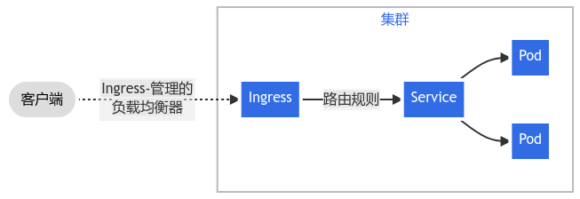
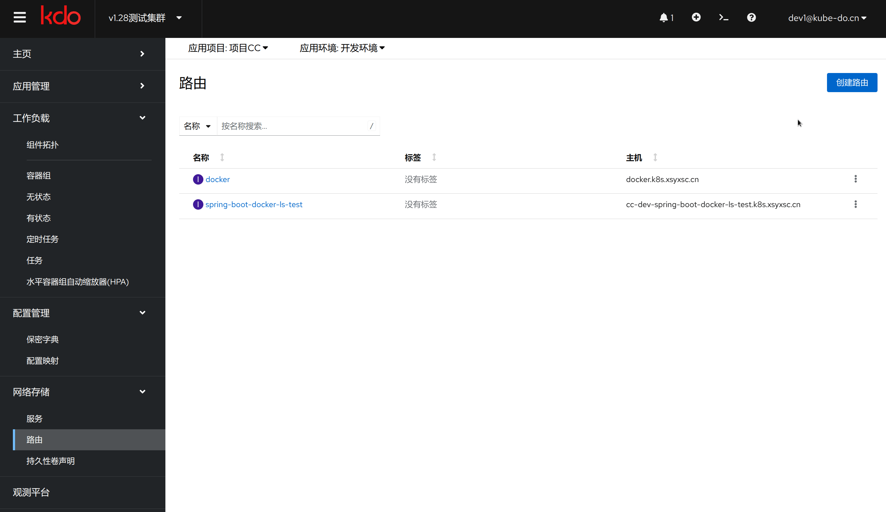
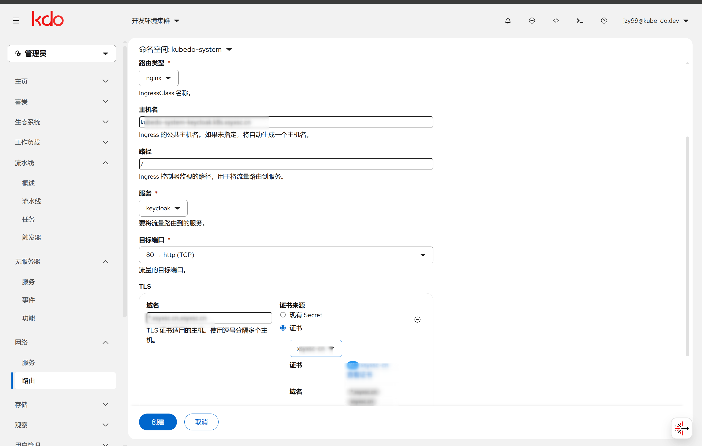
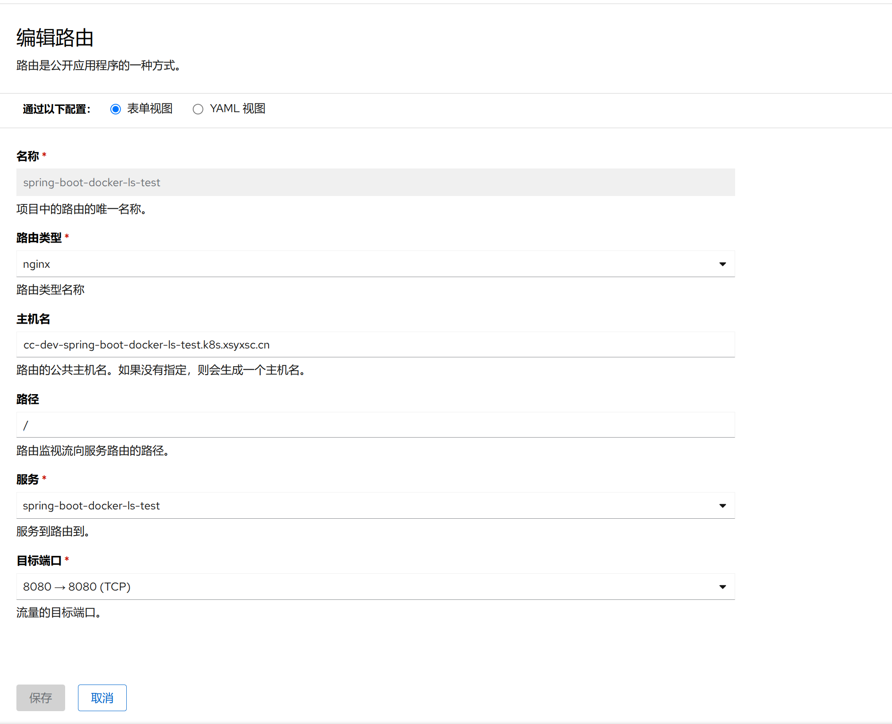

1. TOC
{:toc}

## 介绍

{: .note }
路由(Ingress)概念允许你通过 Kubernetes API 定义的规则将流量映射到不同后端。路由使用一种能感知协议配置的机制来解析 URI、主机名称、路径等 Web 概念， 让你的 HTTP（或 HTTPS）网络服务可被访问。
[更多资料](https://kubernetes.io/zh-cn/docs/concepts/services-networking/ingress/)

## 新增路由

{: .note }
新增/路由编辑有表单视图和YAML视图，默认一些简单路由可以使用表单视图，如果要一些高级能力，需要使用YAML编辑。
在添加路由，只需要选择对应的服务和端口，其他的选项都可以自动生成，需要自定义，可以手动修改。

### 常用字段 

| 菜单   | 说明                                                           |
|:-----|:-------------------------------------------------------------|
| 名称   | 这个资源对象的名字                                                    |
| 路由类型 | 路由类型(IngressClass) 资源用于定义和区分不同类型的路由控制器，现在默认使用的是nginx-ingress |
| 主机名  | 应用的域名，要确保已经配置hosts文件或者设置了DNS，把域名指向了路由控制器的IP                  |
| 路径   | 应用的根路径，一般为`/`                                                |
| 服务   | 要对外暴露的服务名                                                    |
| 目标端口 | 服务的监听端口                                                      |

## 使用证书(KdcCertificate)自动生成 TLS

{: .note }
在表单视图的 **TLS 证书** 区块，证书来源可选 **已存在的 Secret** 或 **证书(KdcCertificate)**。选择证书后，系统会自动填充主机名，并在提交时生成（或复用）目标 TLS Secret，无需手工维护证书。

选择证书后：

- **自动填充主机名**：使用证书域名（优先 `status.domains`，回退 `spec.domains`）填充该 TLS 条目的主机名；若主机名未被证书覆盖会给出告警（**不阻断**提交）。
- **显示证书信息**：域名、到期时间（含过期/临期标识）、来源 Secret、适用集群，并可**查看证书内容**。
- **目标 Secret 命名规则**：
  - 同名 Secret 已由**同一证书**托管（注解 `kube-do.cn/certificate` 相同）→ 直接复用，不重写；
  - 否则使用证书名（`spec.secretName`，未设置时为证书名）；
  - 若该名字被无关 Secret 占用 → 使用 `<路由名>-<证书名>`（再冲突时追加 8 位哈希）。
- **提交顺序**：先创建/复用目标 TLS Secret，再创建/更新 Ingress；目标 Secret 创建失败会终止提交。
- **多集群**：来源 Secret 固定从**主集群（管理集群）**读取，目标 Secret 写入**当前集群**。若从主集群读取来源 Secret 失败（如无权限），则不在本地创建，交由 KDC 控制器按周期下发，并给出提示。
- **YAML 视图**不会自动生成 Secret，仅保存 YAML 中填写的内容。

证书的管理与分发规则见[证书管理(KdcCertificate)](/docs/admin/management/kdccertificates/)。

## 编辑路由

{: .note }
在图形化界面中，用户只能进行一些基础的配置。若需使用更多高级特性，则需要手动编辑路由的YAML配置文件，主要是通过修改路由资源的注解来实现。
这种方式允许用户根据具体需求定制路由规则，解锁更复杂的配置选项和功能，如细粒度的流量管理、定制化的负载均衡策略以及更高级的安全设置等。
请参考[路由高级特性](https://www.w3ccoo.com/nginx/nginx_ingress_annotations.html)。

