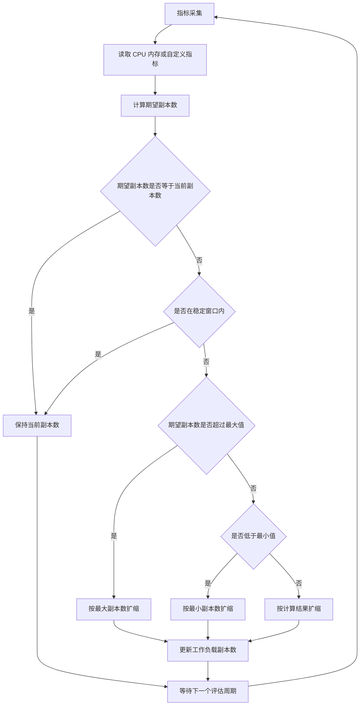
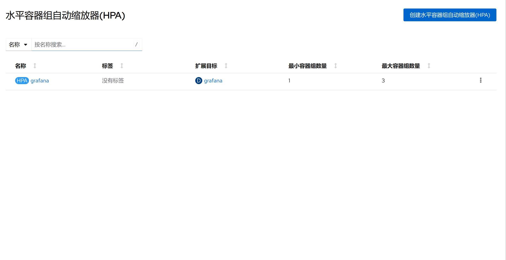

1. TOC
{:toc}

## 介绍

{: .note }
在 Kubernetes 中，`HorizontalPodAutoscaler` 自动更新工作负载资源 （例如 `Deployment` 或者 `StatefulSet`）， 目的是自动扩缩工作负载以满足需求。

1. 水平扩缩意味着对增加的负载的响应是部署更多的 Pod。 这与垂直(`Vertical`)扩缩不同，对于 `Kubernetes`， 垂直扩缩意味着将更多资源（例如：内存或 CPU）分配给已经为工作负载运行的 Pod。
2. 如果负载减少，并且 `Pod` 的数量高于配置的最小值， `HorizontalPodAutoscaler` 会指示工作负载资源（`Deployment`、`StatefulSet` 或其他类似资源）缩减。
3. 水平 `Pod` 自动扩缩不适用于无法扩缩的对象（例如：`DaemonSet`。）
4. `HorizontalPodAutoscaler` 被实现为 `Kubernetes` API 资源和控制器。 资源决定了控制器的行为。 
   在 `Kubernetes` 控制平面内运行的水平 Pod 自动扩缩控制器会定期调整其目标（例如：`Deployment`）的所需规模，以匹配观察到的指标， 例如，平均 CPU 利用率、平均内存利用率或你指定的任何其他自定义指标。

## 扩缩容流程

## [HPA更多信息](/docs/workload-actions/hpa)