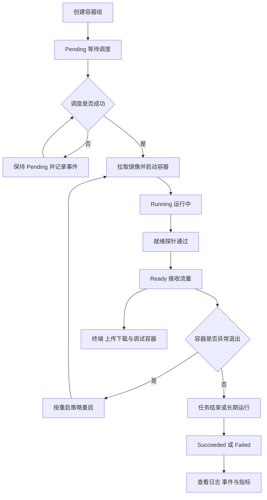
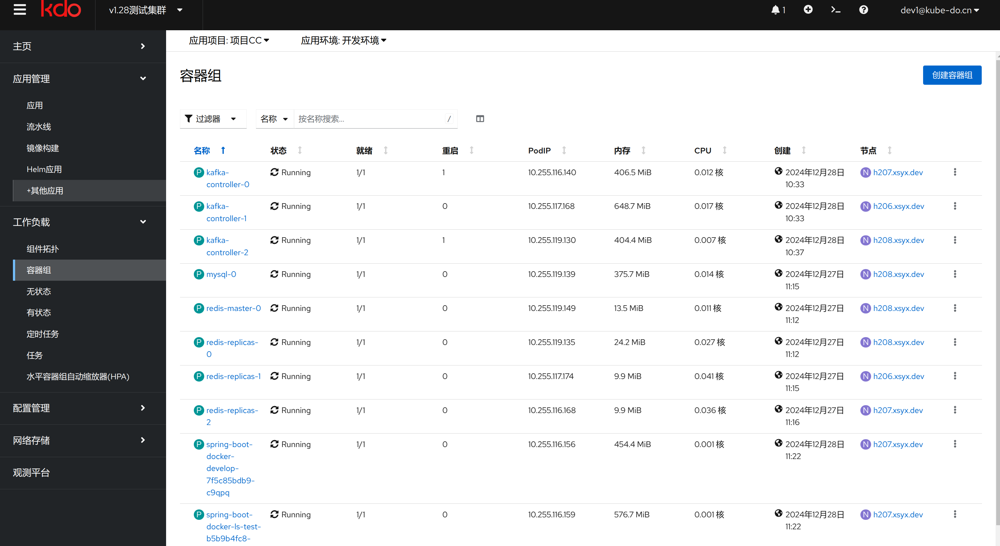
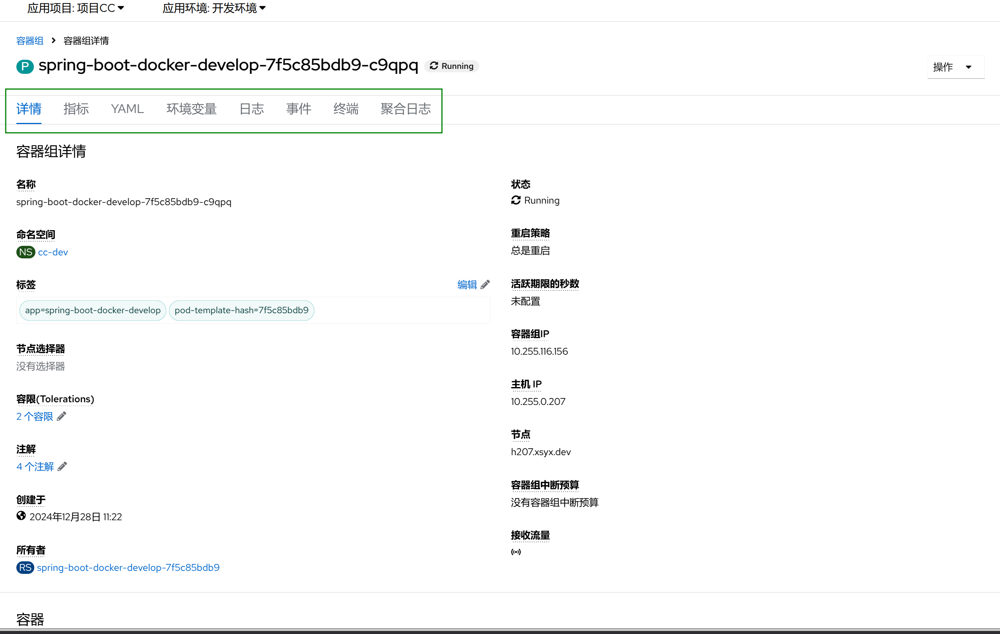
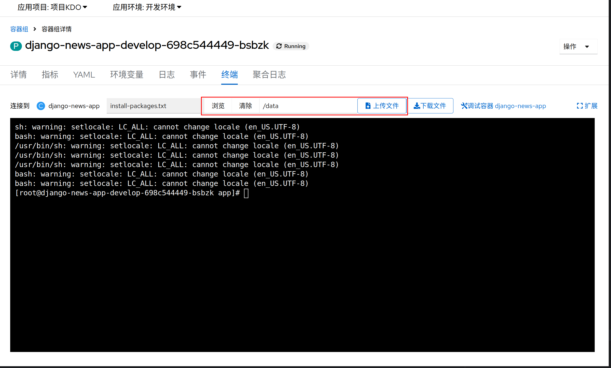
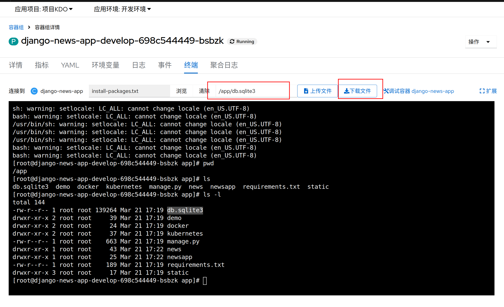
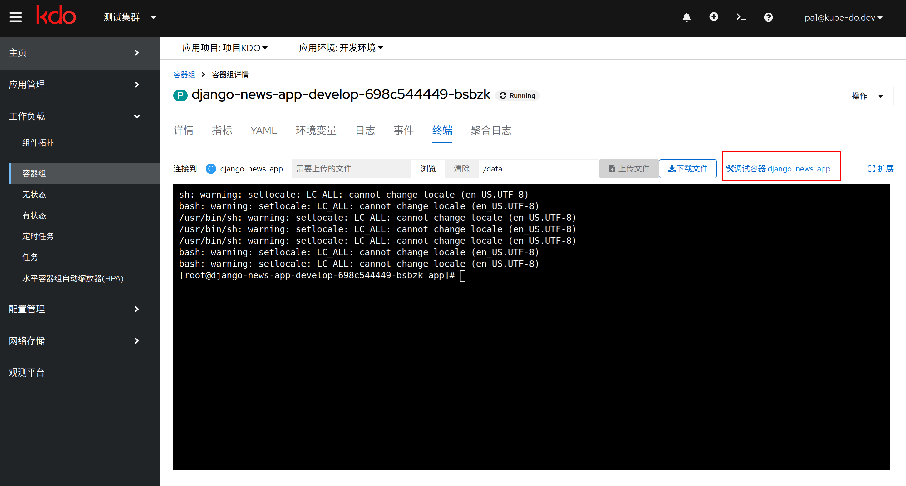
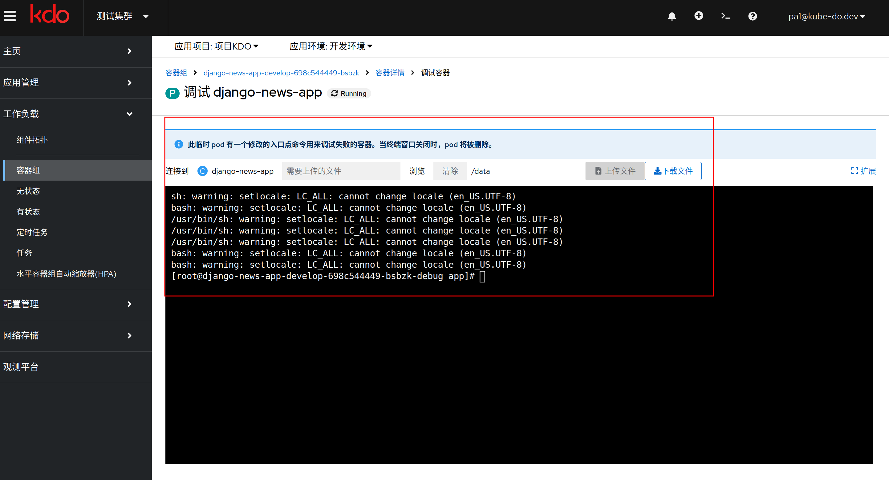

1. TOC
{:toc}

## 介绍

{: .note }
容器组（Pod）是 Kubernetes 中最小的可部署计算单元，用于运行和管理容器化应用。一个Pod可以包含一个或多个紧密相关的容器，这些容器共享存储资源、网络命名空间以及运行规约。
容器组（Pod）是一组（一个或多个）容器；这些容器共享存储、网络以及运行规约。
Pod 中的内容总是并置（colocated）的并且一同调度，在共享的上下文中运行。 Pod 所建模的是特定于应用的 “逻辑主机”，其中包含一个或多个应用容器， 这些容器相对紧密地耦合在一起。
在非云环境中，在相同的物理机或虚拟机上运行的应用类似于在同一逻辑主机上运行的云应用。
[更多信息](https://kubernetes.io/zh-cn/docs/concepts/workloads/pods/)

## 生命周期

## 容器组主页

{: .note }
点击`工作负载 -> 容器组`访问容器组菜单，可以访问当前环境的容器组，看到以下菜单。

| 菜单    | 说明                                                                                                             |
|:------|:---------------------------------------------------------------------------------------------------------------|
| 名称    | 容器组的名字                                                                                                         |
| 状态    | 容器组的状态，容器组有很多状态，Running表示正在运行。 [更多信息](https://kubernetes.io/zh-cn/docs/concepts/workloads/pods/pod-lifecycle/) |
| 就绪    | 容器组是否就绪，就绪后就能进行访问了                                                                                             |
| 重启    | 容器组重启的次数，容器组发生异常就会重启，可以通过日志或者事件查看原因。                                                                           |
| PodIP | 容器组的IP地址                                                                                                       |
| 内存    | 容器组的当前内存使用量                                                                                                    |
| CPU   | 容器组的当前CPU使用量                                                                                                   |
| 创建    | 容器组的创建时间                                                                                                       |
| 节点    | 容器组所在的节点                                                                                                       |

## 容器组内容

{: .note }
点击容器组，可以打开容器组的页面，会看到以下菜单：

| 菜单   | 说明                                                                          |
|:-----|:----------------------------------------------------------------------------|
| 详情   | 容器组的详细信息                                                                    |
| 指标   | 容器组的监控指标，包括CPU, 内存，网络，磁盘                                                    |
| YAML | 容器组资源对象的YAML                                                                |
| 环境变量 | 容器组的环境变量，继承它的拥有者（Owner），一般为[无状态应用](/docs/dev/workloads/deployments/)或[有状态应用](/docs/dev/workloads/statefulsets/) |
| 日志   | 容器组打印到标准输出的日志内容                                                             |
| 事件   | [事件详情](/docs/observability/events)                                          |
| 终端   | 容器组的访问终端，并且支持上传和下载文件                                                        |
| 聚合日志 | 存储在日志平台的日志，可以访问更久时间的日志.[日志详情](/docs/observability/logging#容器组页面访问)          |

## 容器组操作

### 上传文件
kdo平台支持容器组的文件上传，上传文件时，选择文件后，点击`上传文件`按钮。

### 下载文件
下载文件时，输入对应的文件路径(完整路径)后，点击`下载文件`按钮，如果文件比较大，时间较长，请耐心等待。

### 调试容器组

调试容器组时，选择要调试的容器，点击`调试容器`按钮，会弹出一个临时的容器组，用来调试容器组，默认会运行命令`/bin/sh`。

此临时 容器组 有一个修改的入口点命令用来调试失败的容器。当终端窗口关闭时，容器组 将被删除。

