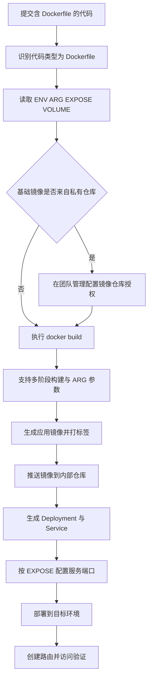

## 概述

代码主目录下有 `Dockerfile` 文件，KDO 会识别代码语言类型为 **Dockerfile** 。

### 编译原理

识别为 Dockerfile 类型的源码将使用类似于 `docker build -t xxx .` 的命令进行镜像构建，构建过程支持 docker multi-stage(多阶段构建)和 ARG 参数指定。

### Dockerfile 规范

**Dockerfile** 是由一系列命令和参数构成的脚本，这些命令应用于基础镜像并最终创建一个新的镜像。

KDO 在源码检测阶段会读取 [Dockerfile](https://docs.docker.com/engine/reference/builder/) 定义的如下参数：

| 参数类型   | 名称    | 说明              |
|--------|-------|-----------------|
| ENV    | 环境变量  | 识别为服务可设置的环境变量配置 |
| ARG    | 构建参数  | 识别为构建可设置的参数配置   |
| EXPOSE | 暴露端口  | 识别为服务的端口配置      |
| VOLUME | 持久化存储 | 识别为服务的共享持久化存储配置 |

### 私有仓库

如果 `Dockerfile` 中使用私有镜像，在`团队管理 -> 镜像仓库授权信息`，填写私有镜像仓库的域名、用户名和密码，保存后再次构建，即可构建成功。

## 构建与部署流程

## 部署示例

1. 基于源码创建组件，填写以下信息：

|        | 内容                                               |
|--------|--------------------------------------------------|
| 组件名称   | 自定义                                              |
| 组件英文名称 | 自定义                                              |
| 仓库地址   | `https://gitee.com/rainbond/dockerfile-demo.git` |
| 代码版本   | master                                           |

2. 识别为 Dockerfile 项目，点击构建启动。