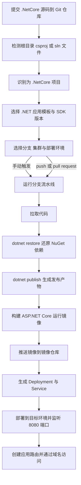
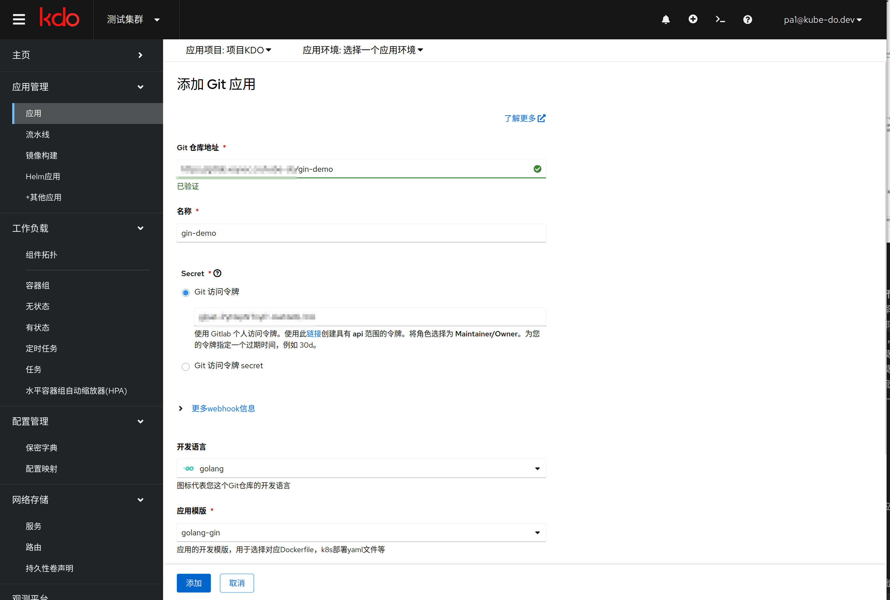
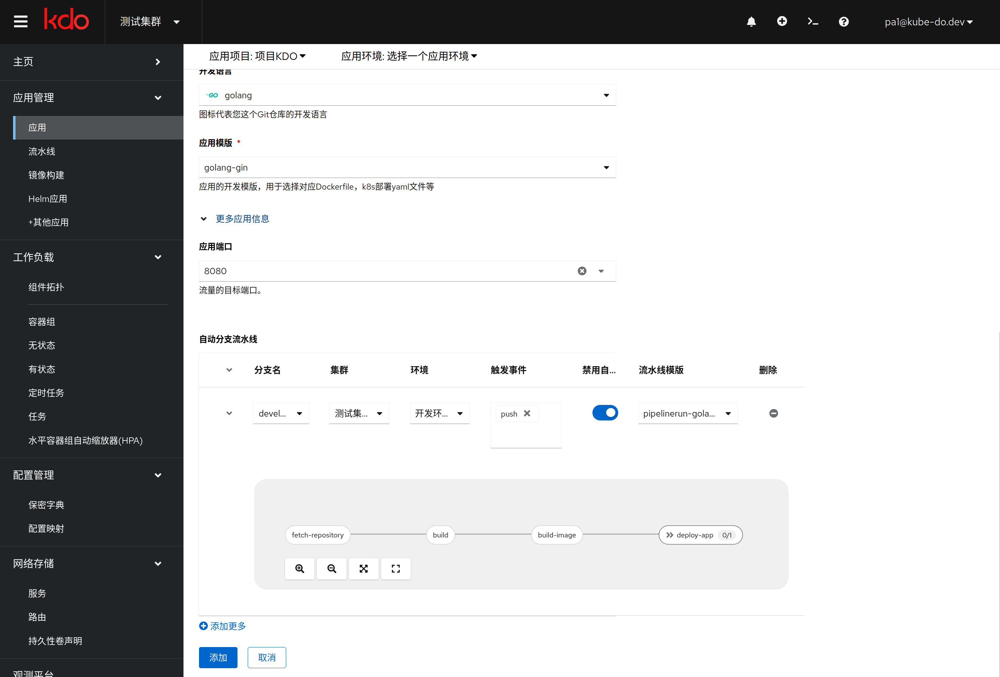
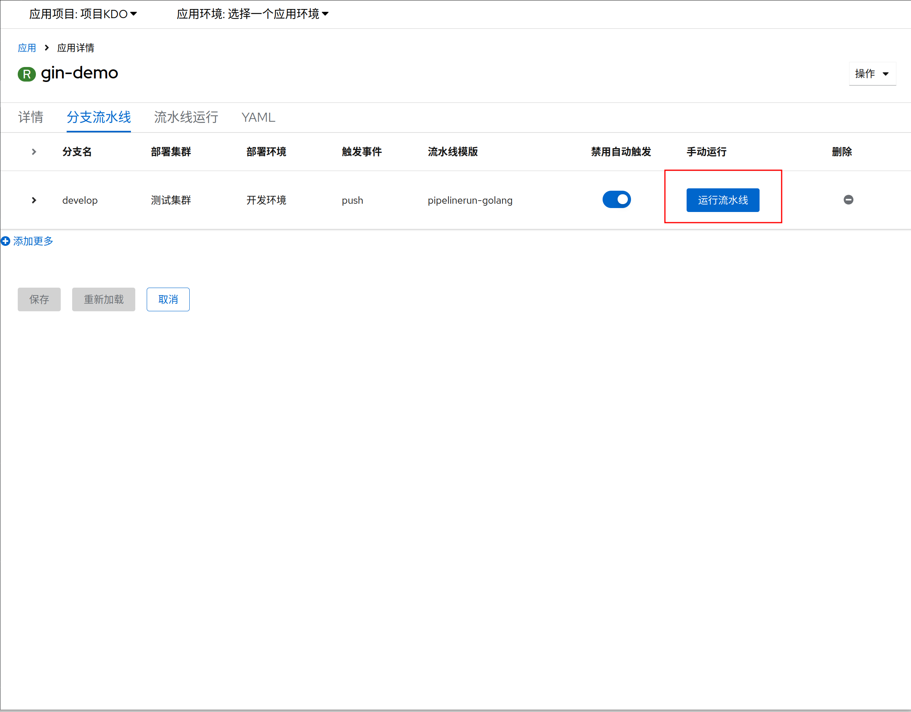
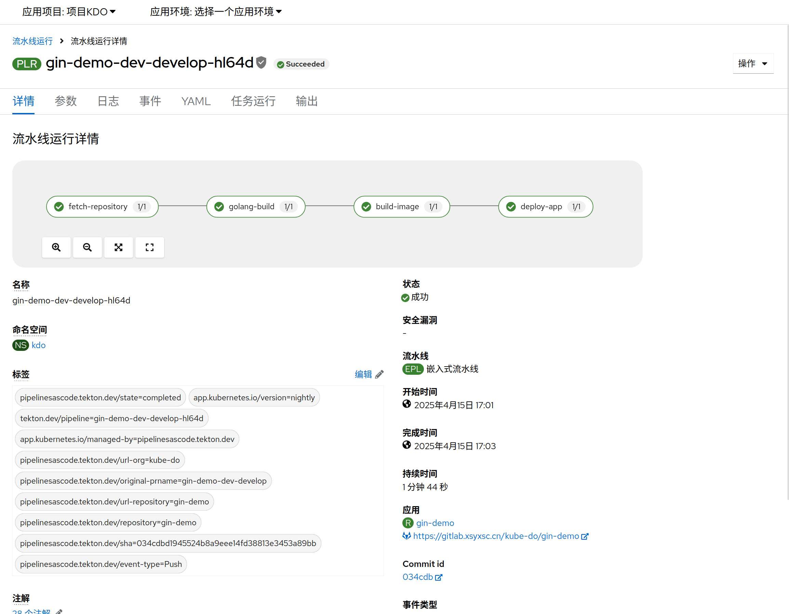
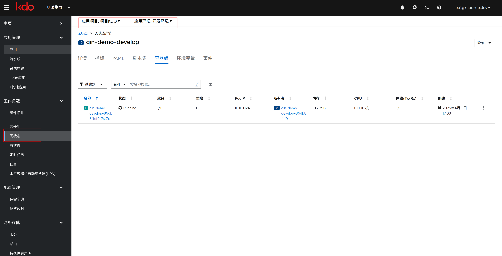
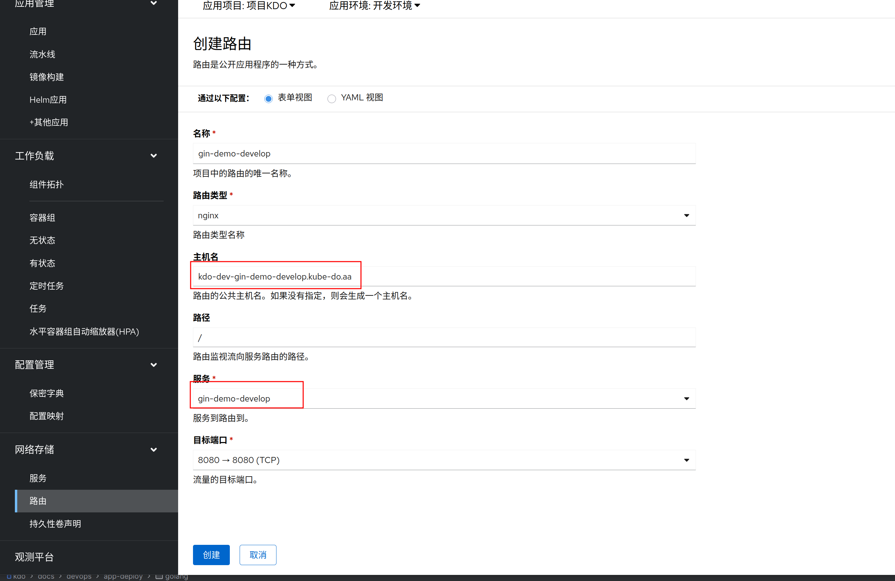

1. TOC
{:toc}

## 概述

KDO 支持通过源码构建 `.NET` / `.NET Core` 项目。当源代码根目录存在 `*.csproj` 文件（或解决方案 `*.sln` 文件）时，KDO 会将代码识别为 `.NetCore` 项目。

平台使用 .NET SDK 完成依赖还原与发布，并将发布产物打包为 ASP.NET Core 运行镜像，默认监听 `8080` 端口。

## 构建与部署流程

## 创建应用

### 应用基本信息

1. 输入源码根目录，平台默认会根据源码根目录是否存在 `*.csproj` 或 `*.sln` 文件自动识别为 `.NetCore` 项目。
2. 在`Git访问令牌`输入 Git 仓库的令牌，如果没有现存的令牌，通过访问`链接`到对应的仓库，创建一个新的令牌。
3. 开发语言会自动识别为 `.NetCore`。
4. 在`应用模板`中选择对应的 `.NET` 应用模板，并选择匹配项目的 .NET SDK 版本。

### 应用扩展信息

1. 应用端口默认为 `8080`，如有需要可以修改为其他端口。
2. 在自动分支流水线中，选择对应的分支进行流水线构建，例如 `develop` 分支流水线，并选择`部署集群`和`部署环境`。
   流水线触发默认为手动触发，也可以根据触发事件自动触发，`触发事件`默认为 `push`，也可以选择 `pull request` 等。
   最后选择对应的流水线模板，点击`下箭头`按钮可展开模板，查看模板的组件组成。
3. 可以选择多个分支进行管理，`分支`和`部署环境`是多对多关系：一个分支可以部署到多个环境，一个环境也可以部署多个分支。
4. 选择完成后，点击**添加**，应用创建完成。

## 管理应用

应用创建完成后，就可以对应用进行管理了。[更多信息](/docs/dev/applications/repository#应用管理)

### 定制流水线

1. `.NetCore` 应用的流水线一般包含五个[任务](/docs/dev/applications/pipelines#task)：`拉取代码`、`dotnet还原`、`dotnet发布`、`构建镜像`、`部署镜像`。
2. 流水线可以根据需要进行定制。
3. 如需使用私有 NuGet 源，可在流水线编辑中配置 NuGet 源地址与凭据。
4. .NET SDK 版本需与应用模板和项目目标框架保持一致，避免 `restore` 或 `publish` 失败。

### 手动运行流水线

进入`分支流水线`页面，选择一个分支，点击**运行流水线**，即可进行应用构建和部署。

### 查看流水线运行信息

1. 进入`流水线运行`页面，选择对应的流水线运行，即可查看流水线运行信息。[更多信息](/docs/dev/applications/pipelines)
2. KDO 平台会在项目内创建一个[持久存储卷 PVC](/docs/storage#存储概念)，用于缓存项目依赖（包括 NuGet 包）。因此首次构建时间较长，后续构建会明显加快。

### 查看应用运行信息

进入`工作负载`菜单，选择`无状态`，再选择对应的`应用名称`，即可查看应用运行信息。[更多信息](/docs/dev/workloads/deployments)

### 创建应用路由

如应用属于 `web` 类型应用，可以创建对应的路由，通过路由访问应用。[更多信息](/docs/dev/network-storage/ingresses#新增路由)

### 访问应用

路由创建完成后，即可通过域名访问应用（需要确认已配置域名解析或设置 `hosts` 文件）。
