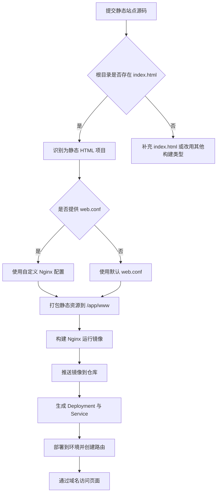

## 概述

平台默认会根据源码根目录是否有`index.html`文件来识别为静态语言项目.

如需自定义请在源码根目录定义 `web.conf` 配置文件，默认配置文件如下:

```conf
server {
  listen       80;
  location / {
      root   /app/www;
      index  index.html index.htm;
  }
}
```

## 构建与部署流程



## 部署示例

进入到团队下，新建应用选择**基于源码示例**进行构建，选中 `2048 Demo` 并默认全部下一步即可。
