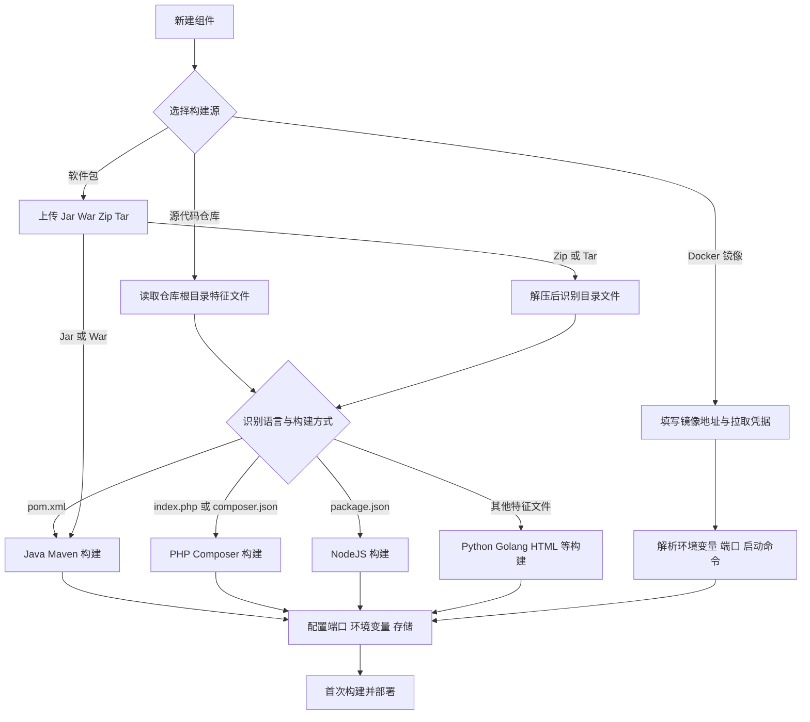

本篇文档介绍在 KDO 中创建组件的基础流程。

## 创建方式决策

KDO 会根据构建源的类型选择不同的识别与构建路径：源码和软件包走语言识别，Docker 镜像走镜像元数据解析。

## 从源码开始创建组件

KDO 会根据源代码根目录下的文件来判断源码的语言类型，目前支持的源码类型有 Java、Python、PHP、NodeJS、.Net、Golang、Html 等。
1. 例如源代码目录下有 `pom.xml` 文件，KDO 将会识别为 Java 语言类型的源码。KDO 会根据源码类型自动识别构建方式，比如 Java 语言类型的源码会自动识别为 Maven 构建方式。
2. 例如源代码目录下有 `requirements.txt` 文件，KDO 将会识别为 Python 语言类型的源码。KDO 会根据源码类型自动识别构建方式，比如 Python 语言类型的源码会自动识别为 Pip 构建方式。

### 从软件包创建组件

KDO 支持从软件包创建组件，用户可以通过上传软件包的方式创建组件，KDO 会根据软件包的类型自动识别构建方式。支持上传 Jar、War、Zip、Tar 等软件包。

1. 例如 Jar、War 软件包会自动识别为 Java 构建方式。
2. 例如 Zip、Tar 软件包在解压后会自动识别目录中的文件，根据文件类型自动识别构建方式。

## 从 Docker 镜像创建

KDO 支持从 Docker 镜像创建组件，与源码创建流程一样，不同的是提供的构建源信息和类型不同。

1. KDO 支持解析镜像层中的元数据，获取镜像的元数据信息，比如镜像的环境变量、端口、启动命令等。
2. KDO 支持通过 `docker run` 命令创建组件，用户可以通过 `docker run` 命令提供更多参数，比如 `-e` 设置环境变量、`-p` 设置端口映射、`-v` 设置数据卷等，这些参数都会被 KDO 解析并应用到组件中。