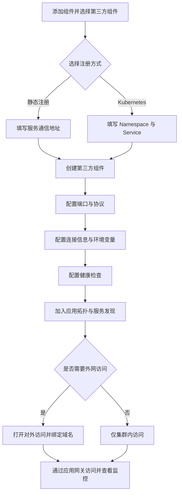

## 概述

运行于 KDO 集群之外，运行生命周期不受 KDO 管理，且在网络上能够与 KDO 集群通信的服务称为第三方服务。例如单独运行的 Oracle 服务，或运行于 Windows 服务器的.net 服务等。

KDO 支持第三方服务管理的初衷是为了解决企业在使用 KDO 落地过程中遇到的两类主要问题：迁移过程中的集群内外服务共存和未迁移服务与 KDO 上服务的统一管理与通信。

1. 循序渐进的迁移策略：在服务迁移到 KDO 平台时，常常需要与未迁移的遗留服务通信和统一管理。KDO 以应用和服务为核心，提供服务注册和发现机制，但过去的版本中无法很好地支持未迁移的外部服务。为了实现逐步迁移的策略，KDO 致力于通过环境变量和统一管理功能来简化配置管理和服务通信，使得新旧服务可以共存并高效协作。

2. 共享外网端口与域名：KDO 的应用网关提供了强大的外网服务能力，但过去未迁移的服务无法直接使用这些功能，用户不得不在网关前额外添加一层 nginx，增加了配置复杂性。通过支持第三方服务管理，KDO 旨在让遗留服务也可以共享其网关的外网功能，减少配置复杂性，并享受域名访问监控等开箱即用的能力。

## 第三方服务接入流程

第三方服务不经过镜像构建，注册后直接以地址或 Kubernetes Service 的形式加入应用的服务发现与网关体系。

## 创建第三方服务

### 静态注册

在 **应用视图 -> 添加组件 -> 第三方组件** 中，选择服务注册方式为静态注册，
1. 填写服务的通信地址如 `192.168.1.1:8080` 
2. 创建组件

进入组件详情页，配置端口、连接信息、健康检查属性等。

### Kubernetes

在 **应用视图 -> 添加组件 -> 第三方组件** 中，选择服务注册方式为 `Kubernetes`，
1. 填写 `Namespace` ，默认为当前团队所在 `Namespace`
2. 填写 `Service` ，`Service` 应属于上边填写的 `Namespace`
3. 创建组件

进入组件详情页，配置端口、连接信息、健康检查属性等。

## 示例

使用第三方服务代理 KDO 控制台，通过域名访问 KDO 控制台。

在 **应用视图 -> 添加组件 -> 第三方组件** 中，选择服务注册方式为静态注册，
1. 填写服务的通信地址如 `192.168.1.1:7070` 
2. 创建组件

进入组件详情页，配置端口协议为 `HTTP`，端口号为 `7070`，打开对外访问，即可通过域名访问 KDO 控制台。