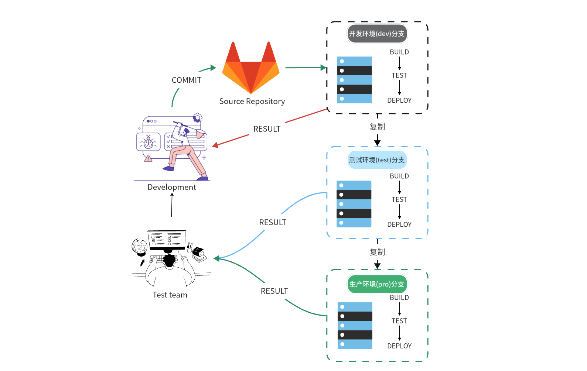

## kdo 源码持续交付流程图

如下图所示，要实现持续交付，通常需要以下流程。

1. 用户提交代码到源码仓库，此时在开发环境中构建和进行自动化测试流程，测试完成后，如果不通过则反馈到开发人员进行调整，从而保证代码质量。

2. 当开发人员功能基本开发完成后，此时代码需要从 dev 分支合并到 testing 分支，并部署测试环境用于测试人员进行测试。这样开发者还可以基于 dev 分支继续开发，而测试人员则进行完整功能测试。如果功能测试失败，则继续反馈给开发人员。

3. 当某个版本测试通过以后，我们就可以认为已经有了高质量可交付的版本。接下来需要人工审核，将代码从 testing 分支合并到 master 分支，用于生产环境的部署上线。




## 操作步骤

### 准备工作

1. 拥有一套 kdo 集群，参考[快速安装](/docs/install)，多个团队/项目(用于模拟开发环境、测试环境、生产环境)。

2. 项目源代码拥有三个分支，dev、test、master。

3. [创建项目](/docs/devops/project-manage/project#创建项目)时，选择`开发环境`、`测试环境`、`生产环境`三个环境。

4. [创建应用](/docs/dev/applications/repository#创建应用)时，在`自动分支流水线`选项中把源代码分支和环境环境进行对应。

### 开发环境

1. 在你的 Git 仓库配置完成该步骤后，可以通过提交代码触发开发环境的自动构建以及自动化测试，再根据构建结果完成代码调整。

### 部署测试环境

在开发人员功能基本开发完成，完成自测以后，此时需要将代码交付给测试人员部署测试环境，并进行完整的功能测试。

1. 将代码从 dev 分支合并到 test 分支。

2. 测试人员在测试环境验证完成后，将问题反馈到开发人员，开发人员完成修复和代码合并后，测试人员只需在测试环境的`应用页面->列表`，选择全部组件进行批量构建即可快速更新测试环境。

### 交付生产环境

1. 在测试完全通过以后，需要将代码从 test 分支合并到 master 分支。此时，由具有上线权限的用户完成审核，并合并代码。

2. 代码合并到 master 分支后，通过手动或自动运行流水线，实现应用的发布

3. 如果生产出现问题。仍然需要开发者在 dev 分支上完成自测，测试团队在 test 分支上测试通过，最后由具有生产环境上线的用户来完成代码合并和上线。

## 构建写回与自动部署

kdo 的发布分成两条链路：**构建**负责产出镜像并把版本写回代码仓库，**部署**由平台在构建成功后自动创建。应用仓库里不再需要维护部署流水线文件。

### 工作流程

1. 构建流水线执行 `gitops-writeback` 任务，把新镜像版本写入 `kubernetes/deploy-<环境>-<分支>.yaml`，并以 `[kubedo-writeback]` 开头的提交信息推送回仓库；
2. 构建成功后，平台读取写回结果（`changed=true` 且拿到提交 sha），自动创建部署流水线；
3. 部署流水线按**写回提交**拉取仓库、校验清单，然后执行 `kubectl apply` 完成发布。

部署由平台在集群内直接创建，**不依赖 Git 服务器的 webhook**。源代码仓库访问不到平台的情况下，构建完成后依然可以自动部署。

| 项目 | 说明 |
|---|---|
| 部署流水线定义 | 集群内 `kubedo` 命名空间的 ConfigMap `pipelinerun-gitops-deploy`，不在应用仓库中 |
| 触发条件 | 构建成功，且 `gitops-writeback` 任务 `changed=true` |
| 运行名称 | `<应用>-<环境>-<分支>-deploy-<写回提交前 8 位>` |
| 部署版本 | 写回提交中的清单，与构建产物严格对应 |
| 幂等性 | 同一提交重复触发不会重复创建运行 |
| 历史保留 | 每个分支保留最近 3 次部署运行 |

### 手动部署与回滚

需要重新发布（例如集群被手工改动、或想回到某个历史版本）时，可以从控制台的`发布历史`中选择目标版本，平台会自动提交清单变更并触发部署。

也可以通过接口手动触发当前分支的部署：

```bash
curl -X POST "http://pipelines-as-code-controller.pipelines-as-code.svc:8080/manual?cluster=<集群>&namespace=<项目>&repository=<应用>&branch=<分支>&appEnv=<环境>&deploy=yes" \
  -H "X-Webhook-Secret: ${WEBHOOK_SECRET}"
```

`deploy=yes` 只创建部署运行、不触发构建；如需部署指定提交，可追加 `revision=<提交 sha>`。

### 注意事项

- 清单中的镜像必须带版本 tag，否则部署会被拒绝并提示先运行构建；
- 部署只应用清单，不会修改镜像 tag，镜像版本由构建写回决定；
- 构建成功但没有产生部署时，按`问题排查`中的“构建成功但没有创建部署运行”逐项检查。

