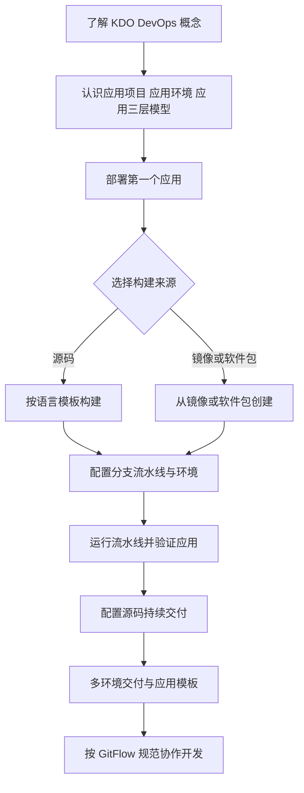

KDO DevOps 把应用项目、应用环境与应用组织在一起，围绕源码构建、镜像构建和持续交付提供开箱即用的能力。建议按下面的路径从概念走到多环境交付。

## 能力地图与学习路径

- 概念与模型：[KDO DevOps介绍](/docs/devops/introduce/)
- 创建组件：[部署应用](/docs/devops/app-deploy/)
- 流水线与交付：[持续交付](/docs/devops/continuous/)
- 项目与环境管理：[项目管理](/docs/devops/project-manage/)
- 分支协作规范：[GitFlow](/docs/devops/gitflow/)

