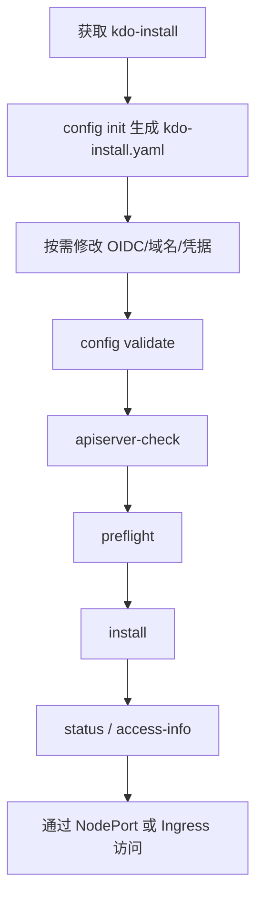

1. TOC
{:toc}


## 安装方式

KDO 平台使用 Go 安装器 `kdo-install`，不再使用旧的 bash 安装脚本。安装器负责：

- 安装 NFS、Keycloak、Harbor、Ingress-Nginx、cert-manager、MinIO 等基础组件
- 部署 KDC、Console、Pipelines as Code、Tekton、Prometheus、Logging 等 KDO 组件
- 生成动态密码并写入 `kubedo-system/kdo-credentials`
- 生成 `/root/kdo-access-info.txt`
- 检查 kube-apiserver 的 OIDC 参数
- 可选创建 NodePort 之外的 Ingress 访问入口

安装必须在**控制面节点以 root 用户**执行，因为需要写 `/etc/exports`、`/data/nfs`、`/root` 以及操作主机 NFS。

## 工作流程



## 获取 kdo-install

从发布页下载对应架构的二进制，或从源码构建：

```shell
git clone https://gitee.com/kube-do/kdo.git
cd kdo
make build
```

构建产物为 `installer/bin/kdo-install`。将二进制复制到控制面节点，例如：

```shell
install -m 0755 installer/bin/kdo-install /usr/local/bin/kdo-install
```

## 生成配置文件

```shell
kdo-install config init -output kdo-install.yaml \
  -node-ip 10.22.1.20 -domain kube-do.dev
```

生成的 `kdo-install.yaml` 包含集群、OIDC、Ingress、访问地址和凭据配置，并带有字段说明。

常用配置项：

```yaml
spec:
  cluster:
    nodeIP: "10.22.1.20"
    domain: "kube-do.dev"

  oidc:
    # 必须与 kube-apiserver 的 --oidc-issuer-url 一致
    issuerURL: "https://10.22.1.20:30443/realms/kdo"
    clientID: "kdo"

  access:
    # 留空时按 nodeIP/domain 自动推导
    consoleURL: "http://10.22.1.20:30080"
    keycloakURL: "https://10.22.1.20:30443"

  ingress:
    # 额外创建 Ingress；NodePort 仍是默认访问方式
    enabled: true
    className: "nginx"

  credentials:
    # 密码/secret 留空时自动生成，并保存到该 Secret
    secretName: "kdo-credentials"
    bootstrap:
      keycloakAdminUser: "admin"
      keycloakAdminPassword: ""
      harborAdminPassword: ""
      grafanaAdminPassword: ""
      minioRootPassword: ""
      demoUserPassword: ""
      oidcClientSecret: ""

  install:
    timeout: 900s
```

配置优先级为：默认值 < 配置文件 < 环境变量 < 命令行参数。

## 安装前检查

```shell
kdo-install config validate -config kdo-install.yaml
kdo-install apiserver-check -config kdo-install.yaml
kdo-install preflight -config kdo-install.yaml
```

`apiserver-check` 会逐节点检查：

- `--oidc-issuer-url`
- `--oidc-client-id`
- `--oidc-username-claim=preferred_username`
- `--oidc-username-prefix=-`
- `--oidc-groups-claim=groups`
- `--oidc-groups-prefix=kdo:`

它只检查参数，不检查 issuer 是否可以连接，因此 Keycloak 尚未部署时也可以执行。`--oidc-ca-file` 是可选参数。

## 运行安装

```shell
kdo-install install -config kdo-install.yaml
```

确认信息后输入 `y`，或使用 `-yes` 跳过确认：

```shell
kdo-install install -config kdo-install.yaml -yes
```

镜像拉取较慢时可调大超时：

```shell
kdo-install install -config kdo-install.yaml -yes -timeout 30m
```

也可以只执行部分步骤，便于排障：

```shell
kdo-install install -config kdo-install.yaml -only keycloak -yes
```

## 安装验证

```shell
kdo-install status -config kdo-install.yaml
kdo-install access-info -config kdo-install.yaml
```

查看访问信息：

```shell
cat /root/kdo-access-info.txt
```

文件中包含 NodePort 地址、Ingress 地址、管理员账号、动态密码和演示用户密码。

也可以直接检查 Pod：

```shell
kubectl get pod -n kubedo-system
kubectl get pod -A | grep -E 'kdc|console|keycloak|harbor'
```

Console 默认地址为 `http://${NODE_IP}:30080`，使用 Keycloak 管理员账号登录。

## Ingress 访问

默认同时创建以下 Ingress：

| 组件 | 默认域名 |
| --- | --- |
| Console | `console.<domain>` |
| Keycloak | `keycloak.<domain>` |
| Harbor | `harbor.<domain>` |
| Grafana | `grafana.<domain>` |
| Pipelines as Code | `pac.<domain>` |
| MinIO | `minio.<domain>` |

使用前需要配置 DNS，或在客户端 hosts 文件中添加解析：

```text
10.22.1.20 console.kube-do.dev keycloak.kube-do.dev harbor.kube-do.dev grafana.kube-do.dev pac.kube-do.dev minio.kube-do.dev
```

TLS 证书默认由集群 CA 签发，浏览器需要信任该 CA。Ingress 创建失败不会阻断安装，NodePort 仍然可用；可稍后重试：

```shell
kdo-install ingress apply -config kdo-install.yaml
kdo-install ingress status -config kdo-install.yaml
```

## 升级与卸载

```shell
# 查看升级计划
kdo-install upgrade -config kdo-install.yaml --plan

# 执行升级（只升级 KDO 组件，第三方组件版本冻结）
kdo-install upgrade -config kdo-install.yaml --apply -yes

# 卸载（默认删除数据，需要确认）
kdo-install cleanup -config kdo-install.yaml --confirm-data-loss -yes

# 保留数据卸载
kdo-install cleanup -config kdo-install.yaml --keep-data -yes
```

## 常见问题

**Keycloak 初始化较慢**

Keycloak 首次启动需要创建 realm、client 和用户，镜像拉取也可能较慢。安装器默认等待 900 秒，并会持续重试。可继续调大：

```shell
kdo-install install -config kdo-install.yaml -yes -timeout 30m
```

**NodePort 可以访问，Ingress 域名打不开**

先确认 DNS 或 hosts 是否指向控制面节点/VIP，再检查 Ingress Controller 和 Ingress 状态：

```shell
kubectl get ingress -A
kubectl get pod -n ingress-nginx
```
