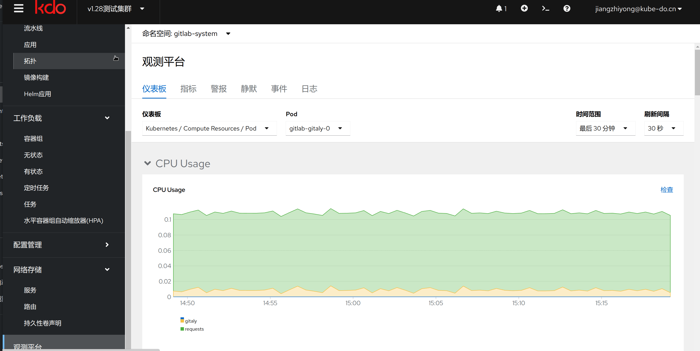
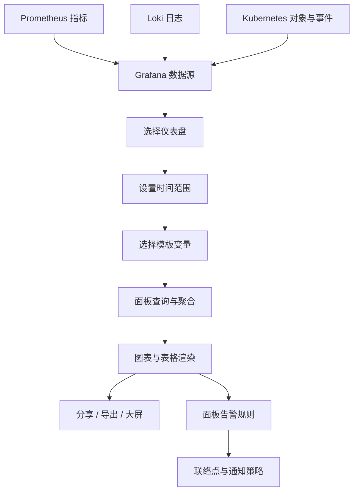

1. TOC
{:toc}

## 介绍
{: .note }
本页介绍 KDO 监控中 Grafana 仪表盘的浏览、筛选、查看、分享与权限。集群资源总览、健康巡检和指标口径请参阅 [指标](/docs/observability/metrics/)；告警规则、联络点和通知策略请参阅 [监控](/docs/observability/monitoring/)。

*图：KDO 监控仪表盘入口与典型面板布局。*

## 入口与界面

1. 在左侧导航选择 **观测平台 → 监控 → 仪表盘**。
2. 也可以直接访问 Grafana，地址通常为 `http://grafana.<平台域名>`，以实际部署为准。
3. 管理员账号默认为 `admin`，初始密码请参考部署配置或联系平台管理员，首次登录后请立即修改；普通用户通过 OAuth 登录，默认拥有 Viewer 权限。

| 区域 | 内容 |
| --- | --- |
| 左侧导航 | Dashboards、Browse、Alerting、Explore、数据源等 |
| 顶部工具栏 | 仪表盘选择、时间范围、刷新间隔、模板变量、分享 |
| 面板区 | 图表、表格、状态卡片、图例与阈值 |
| 面板菜单 | View、Edit、Inspect、Data、Query、JSON、Share |

## 仪表盘数据流

仪表盘只负责查询与呈现，不产生指标。Prometheus、Loki 和 Kubernetes 作为数据源，面板按时间范围与变量过滤后渲染；面板上配置的告警规则会进入 Grafana 告警流程。

## 浏览与选择仪表盘

1. 打开 **Dashboards → Browse**，可以按名称搜索，或按标签、文件夹筛选。
2. 仪表盘通常按主题放在不同文件夹中，例如集群与节点、应用与工作负载、网络、日志等。
3. 点击仪表盘名称进入；点击星标可以加入收藏，常用仪表盘会出现在最近访问列表中。
4. 仪表盘中的变量和当前时间范围会保留在 URL 中，复制链接即可复现同一视图。

## 调整时间范围与刷新

1. 右上角时间选择器支持相对时间（如最近 15 分钟、1 小时、24 小时）和绝对时间范围。
2. 刷新间隔可选关闭、5 秒、10 秒、30 秒、1 分钟等；排查实时问题时再开启较高频率，避免频繁查询。
3. 相对时间会随页面刷新滚动，绝对时间固定不变，适合复盘和截图。
4. 时间范围会影响所有面板的查询结果，也会影响面板告警的预览结果。

## 使用模板变量过滤

仪表盘顶部通常会提供 `cluster`、`namespace`、`pod`、`node` 等变量：

- 选择 **All** 查看全部范围，或选择单个集群、命名空间、Pod、节点。
- 支持多选的变量可以同时选择多个值。
- 变量之间可能存在联动，例如切换集群后，命名空间选项会随之更新。
- 变量值会写入 URL，便于在团队内分享同一筛选条件。

## 查看面板

1. 将鼠标悬停在图表上可以查看具体时间点的数值；点击图例中的 series 可以高亮或隐藏该序列。
2. 打开面板右上角菜单：
   - **View**：全屏查看该面板；
   - **Edit**：查看或修改查询与可视化配置（需要编辑权限）；
   - **Inspect → Data**：查看原始查询结果；
   - **Inspect → Query**：查看实际执行的查询语句；
   - **Inspect → JSON**：查看面板定义。
3. 表格面板支持按列排序；状态卡片和阈值颜色用于快速判断异常。
4. 面板标题旁的说明图标通常会给出指标含义、单位或统计口径。

## 分享与导出

- **Share → Link**：复制带时间范围和变量值的链接。
- **Share → Snapshot**：生成只读快照，适合发给没有集群权限的同事。
- **Share → Embed**：获取可嵌入其他页面的链接。
- **Export CSV**：导出表格面板数据；**Export JSON**：导出仪表盘定义，便于备份或导入其他环境。
- 应用大屏和系统大屏的入口见 [指标](/docs/observability/metrics/) 页面。

## 面板告警

1. 在面板菜单中选择 **More → Alert rule**，可以基于该面板的查询创建告警规则。
2. 告警规则需要配置评估间隔、触发条件、持续时间以及联络点。
3. 告警规则、联络点、通知策略和告警历史的完整说明见 [监控](/docs/observability/monitoring/)。
4. 只有具备编辑权限的用户才能创建或修改告警规则。

## 权限说明

- 通过 OAuth 登录的普通用户默认是 **Viewer**，可以查看仪表盘，不能保存修改。
- 管理员可以在 Grafana 中为用户或团队授予 Viewer、Editor、Admin 权限，也可以按文件夹设置权限。
- 看不到某个仪表盘时，先确认所属文件夹的权限，而不是仪表盘本身被删除。
- 生产环境建议限制 Editor 权限，避免误改共享仪表盘和告警规则。

## 常见问题

### 面板显示 No data

1. 检查时间范围是否覆盖了数据产生的时间。
2. 检查模板变量是否选择了不存在的集群、命名空间或 Pod。
3. 检查数据源是否正常，以及对应组件是否在采集数据。

### 仪表盘打开很慢

缩小时间范围、减少同时展示的 series，或降低自动刷新频率。查询范围过大时，Grafana 和 Prometheus 的响应都会变慢。

### 看不到某个仪表盘

通常是文件夹权限不足。联系管理员确认账号或团队是否拥有该文件夹的查看权限。

### 修改后刷新又恢复

Viewer 权限不能保存修改；即使是 Editor，也需要点击保存并确认覆盖，未保存的修改会在刷新后丢失。

### 告警没有发送

确认告警规则已启用、评估结果确实触发、通知策略匹配到了正确的联络点，并检查联络点的测试结果。

## 相关文档

- [指标](/docs/observability/metrics/)
- [监控与告警](/docs/observability/monitoring/)
- [日志](/docs/observability/logging/)
- [事件中心](/docs/observability/events/)
