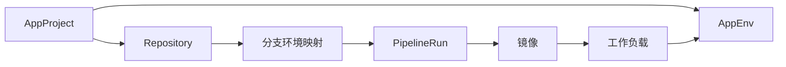

# 创建 Git 应用

Git 应用是 KDO 最常用的应用类型：平台读取 Git 仓库，生成 `devfile.yaml`、`Dockerfile`、Kubernetes 清单和 `.tekton` 流水线，并在代码推送后自动构建、写回镜像并部署。

## 适用场景 {#scenario}

- 代码已经在 GitHub、GitLab、Gitee、Gitea 或阿里云 Codeup 中。
- 希望通过 `git push` 自动触发构建和部署。
- 需要多分支、多环境的发布流程。
- 希望平台托管构建流水线，而不是自己维护 Jenkinsfile 或 Tekton YAML。

## 前置条件 {#prerequisites}

| 条件 | 要求 |
|---|---|
| 项目 | 已存在 AppProject，且当前用户有创建应用的权限 |
| 环境 | 项目下至少有一个 AppEnv，例如 `dev` |
| Git | 仓库可访问，Token 具备读取代码和写入 Webhook 的权限 |
| 镜像仓库 | 项目已绑定 Harbor 项目或等价镜像仓库 |
| 构建资源 | 集群有可用的 Tekton Pipeline 和足够的 CPU/内存 |

## 对象关系 {#object-model}



一个 Repository 可以对应多个分支，每个分支映射到一个环境。构建成功后，`gitops-writeback` 把镜像写回部署清单；清单发生变化时，平台自动创建部署 PipelineRun。

## 创建应用 {#create-app}

1. 进入 **开发者界面 → 应用管理 → Git 应用**。
2. 点击 **创建应用**。
3. 填写基本信息：

   | 字段 | 示例 | 说明 |
   |---|---|---|
   | 名称 | `my-first-app` | 小写字母、数字和短横线 |
   | 仓库 URL | `https://github.com/example/my-first-app.git` | 支持 HTTPS 和 SSH |
   | 分支 | `main` | 可添加多个分支 |
   | 凭证 | Git Token | 只读代码 + Webhook 权限 |
   | 端口 | `80` | 应用实际监听端口 |

4. 选择开发语言、版本和模板。平台会根据模板生成 `devfile.yaml` 和 `Dockerfile` 初稿。
5. 配置分支与环境映射。例如 `main → dev`、`release/* → prod`。
6. 确认 Webhook 和流水线来源。平台会向仓库写入 `.tekton/` 定义。
7. 点击 **创建**。


:::note
创建应用会修改仓库内容，包括 `devfile.yaml`、`Dockerfile`、Kubernetes 清单和 `.tekton` 目录。建议先在测试仓库验证，再接入生产仓库。
:::

## 触发第一次构建 {#trigger-build}

推送代码，或在应用详情页点击 **手动运行**：

```bash
git commit --allow-empty -m "Trigger KDO build"
git push
```

构建 PipelineRun 会依次执行：拉取代码、构建镜像、推送 Harbor、执行 `gitops-writeback`。构建成功后，平台根据清单变化决定是否创建部署 PipelineRun。

## 验证 {#verify}

1. 打开 **应用详情 → 流水线运行**，确认构建状态为 `Succeeded`。
2. 查看构建日志，确认镜像已推送到 Harbor。
3. 打开 **项目 → 环境 → 工作负载**，确认 Deployment 已就绪。
4. 访问应用地址，确认页面内容符合预期。

## 常见问题 {#troubleshooting}

### 创建应用时提示仓库不可访问 {#repo-unreachable}

- 确认仓库 URL 是否包含 `.git` 后缀。
- 确认 Token 是否有 `repo` 读取权限。
- 如果使用自签名 Git 服务，确认平台信任其证书。

### 构建成功但没有自动部署 {#no-auto-deploy}

这是正常行为：只有 `gitops-writeback` 输出 `changed=true` 时才会创建部署运行。如果镜像和清单都没有变化，平台不会重复部署。可以修改一个注解或副本数，再推送一次验证。

### Webhook 没有触发 {#webhook-missing}

- 在 Git 仓库设置中确认 Webhook 指向 PAC 地址。
- 检查 PAC Pod 日志和 Ingress 是否可达。
- 如果 Git 服务位于内网，确认 PAC 能访问该服务。

## 下一步 {#next}

- 了解 Deployment 的发布与回滚：[无状态应用](/docs/developer/workloads/deployments/)
- 配置构建后的监控：[监控与告警](/docs/observability/monitoring/)
- 回到完整链路：[快速开始](/docs/quick-start/)
