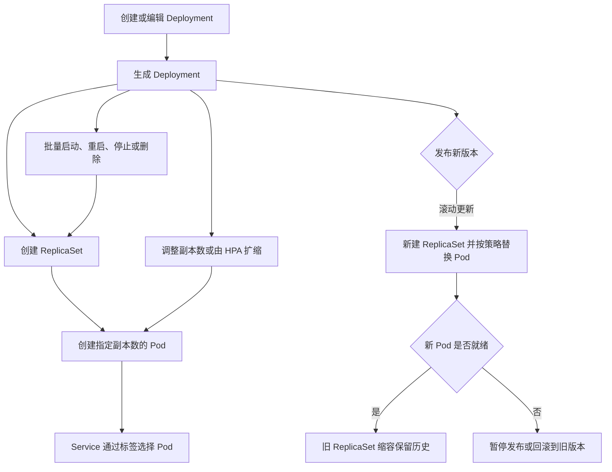

# 无状态应用（Deployment）

无状态应用（Deployment）用于管理一组可互换的 Pod。它适合 Web 服务、API、微服务等不需要在本地保存持久状态的负载。

## 概念 {#concept}

Deployment 不直接管理 Pod，而是通过 ReplicaSet 管理 Pod 版本：

- **Deployment** 描述期望状态：镜像、副本数、更新策略、健康检查。
- **ReplicaSet** 保证指定数量的 Pod 副本存在。
- **Pod** 是实际运行容器的单元。
- **Service** 通过标签选择器把流量转发到 Pod。

当镜像或 Pod 模板变化时，Deployment 会创建新的 ReplicaSet，并按更新策略逐步替换旧 Pod。

## 对象关系 {#object-model}

## 发布与回滚 {#rollout}

KDO 默认使用滚动更新。一次发布的过程如下：

1. 新 ReplicaSet 创建，副本数从 0 开始增加。
2. 新 Pod 通过就绪探针后，旧 ReplicaSet 逐步缩容。
3. 如果新 Pod 一直不就绪，发布会停在中间状态。
4. 你可以暂停发布、调整健康检查，或回滚到上一个 ReplicaSet。

:::note
回滚恢复的是 Pod 模板和镜像，不会自动回滚数据库结构或外部配置。涉及数据变更时，需要单独制定回滚方案。
:::

## 常用操作 {#operations}

| 操作 | 入口 | 说明 |
|---|---|---|
| 调整副本数 | 工作负载 → 操作 → 设置副本数 | 手动扩缩容；HPA 开启时可能被覆盖 |
| 配置 HPA | 工作负载 → 操作 → HPA | 按 CPU、内存或自定义指标扩缩 |
| 配置 PDB | 工作负载 → 操作 → PDB | 限制自愿中断时的可用副本数 |
| 设置健康检查 | 工作负载 → 操作 → 健康检查 | 就绪、存活、启动探针 |
| 编辑资源限制 | 工作负载 → 操作 → 资源限制 | requests/limits，影响调度和稳定性 |
| 添加存储 | 工作负载 → 操作 → 添加存储 | 挂载 PVC 或临时卷 |
| 编辑更新策略 | 工作负载 → 操作 → 更新策略 | 滚动更新参数、最大不可用/最大超额 |
| 查看 YAML | 工作负载 → YAML | 高级用户直接编辑资源对象 |

这些操作的详细说明见[工作负载操作](/docs/developer/workload-operations/)。

## 列表与批量操作 {#batch-operations}

在无状态应用列表上可以批量启动、重启、停止和删除：

| 按钮 | 行为 |
|---|---|
| 启动 | 恢复到停止前的副本数；新应用默认启动两个副本 |
| 重启 | 按更新策略滚动重启 Pod |
| 停止 | 记录当前副本数，然后把副本数缩到 0 |
| 删除 | 删除 Deployment，需要输入 `confirmed` 确认 |

## 限制与注意事项 {#limits}

- Deployment 不适合需要稳定网络标识或持久本地存储的服务，后者应使用 StatefulSet。
- 修改 Service 的标签选择器会导致流量切换，发布前先在测试环境验证。
- 资源限制过低会导致 Pod OOMKilled 或调度失败；过高会浪费集群资源。
- 健康检查配置错误会让 Pod 一直不就绪，滚动更新无法完成。
- 删除 Deployment 会级联删除其 ReplicaSet 和 Pod，但不会删除 PVC。

## 下一步 {#next}

- 查看所有工作负载类型：[工作负载](/docs/developer/workloads/)
- 配置扩缩容和健康检查：[工作负载操作](/docs/developer/workload-operations/)
- 观察发布后的运行状态：[监控与告警](/docs/observability/monitoring/)
