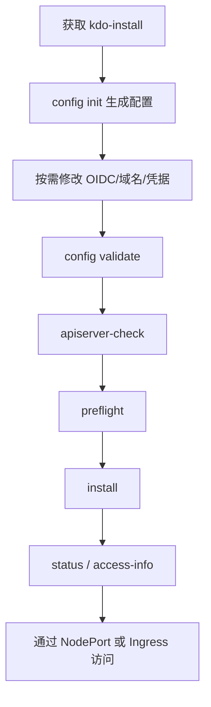

# 安装 KDO 平台

KDO 使用 Go 安装器 `kdo-install` 完成平台安装。安装器负责基础组件、KDO 组件、OIDC 检查、动态凭据生成和访问入口配置。

## 适用场景 {#scenario}

- 已有一台或多台 Linux 控制面节点，并已安装 Kubernetes v1.28+。
- 需要通过 NodePort 或 Ingress 访问 KDO 控制台。
- 需要由安装器统一安装 Keycloak、Harbor、Tekton、Prometheus 等组件。

如果你还没有 Kubernetes 集群，先阅读[安装 Kubernetes](/docs/install/kubernetes/)。如果你要对接已有 OIDC 平台，先阅读[安装 Keycloak](/docs/install/keycloak/) 或确认现有 issuer 参数。

## 前置条件 {#prerequisites}

| 条件 | 要求 |
|---|---|
| 执行位置 | Kubernetes 控制面节点 |
| 执行用户 | `root` |
| Kubernetes | v1.28 及以上 |
| 磁盘 | 预留至少 100 GB 给镜像、NFS 和日志 |
| 网络 | 节点可拉取镜像；客户端可访问 NodePort 或 Ingress |
| OIDC | kube-apiserver 已配置 issuer、client、username/groups claim |

:::warning
安装器需要写 `/etc/exports`、`/data/nfs`、`/root`，并操作主机 NFS。不要在不符合条件的节点上执行，也不要在生产集群直接跳过 `preflight`。
:::

## 安装流程 {#install-flow}



## 获取安装器 {#download}

从发布页下载对应架构的二进制：

```bash
wget https://gitee.com/kube-do/docs/releases/download/latest/kdo-install
chmod +x kdo-install
./kdo-install version
```

## 生成配置文件 {#config-init}

```bash
./kdo-install config init -output kdo-install.yaml \
  -node-ip 10.22.1.20 -domain kube-do.dev
```

生成的 `kdo-install.yaml` 包含集群、OIDC、Ingress、访问地址和凭据配置，并带有字段说明。常用配置项：

```yaml
spec:
  cluster:
    nodeIP: "10.22.1.20"
    domain: "kube-do.dev"

  oidc:
    # 必须与 kube-apiserver 的 --oidc-issuer-url 一致
    issuerURL: "https://10.22.1.20:30443/realms/kdo"
    clientID: "kdo"

  access:
    # 留空时按 nodeIP/domain 自动推导
    consoleURL: "http://10.22.1.20:30080"
    keycloakURL: "https://10.22.1.20:30443"

  ingress:
    # 额外创建 Ingress；NodePort 仍是默认访问方式
    enabled: true
    className: "nginx"

  credentials:
    # 密码/secret 留空时自动生成，并保存到该 Secret
    secretName: "kdo-credentials"

  install:
    timeout: 900s
```

配置优先级为：默认值 < 配置文件 < 环境变量 < 命令行参数。凭据留空时由安装器生成，并写入 `kubedo-system/kdo-credentials`。

## 安装前检查 {#preflight}

```bash
./kdo-install config validate -config kdo-install.yaml
./kdo-install apiserver-check -config kdo-install.yaml
./kdo-install preflight -config kdo-install.yaml
```

`apiserver-check` 会逐节点检查以下参数：

- `--oidc-issuer-url`
- `--oidc-client-id`
- `--oidc-username-claim=preferred_username`
- `--oidc-username-prefix=-`
- `--oidc-groups-claim=groups`
- `--oidc-groups-prefix=kdo:`

它只检查参数，不检查 issuer 是否可以连接，因此 Keycloak 尚未部署时也可以执行。`--oidc-ca-file` 是可选参数。

## 执行安装 {#install}

```bash
./kdo-install install -config kdo-install.yaml
```

确认信息后输入 `y`。在自动化环境中可以跳过确认：

```bash
./kdo-install install -config kdo-install.yaml -yes
```

镜像拉取较慢时调大超时：

```bash
./kdo-install install -config kdo-install.yaml -yes -timeout 30m
```

排障时可以只执行部分步骤：

```bash
./kdo-install install -config kdo-install.yaml -only keycloak -yes
```

## 验证安装 {#verify}

```bash
./kdo-install status -config kdo-install.yaml
./kdo-install access-info -config kdo-install.yaml
cat /root/kdo-access-info.txt
```

`kdo-access-info.txt` 包含 NodePort 地址、Ingress 地址、管理员账号、动态密码和演示用户密码。

也可以直接检查 Pod：

```bash
kubectl get pod -n kubedo-system
kubectl get pod -A | grep -E 'kdc|console|keycloak|harbor'
```


Console 默认地址为 `http://<NODE_IP>:30080`，使用 Keycloak 管理员账号登录。

## Ingress 访问 {#ingress}

默认同时创建以下 Ingress：

| 组件 | 默认域名 |
|---|---|
| Console | `console.<domain>` |
| Keycloak | `keycloak.<domain>` |
| Harbor | `harbor.<domain>` |
| Grafana | `grafana.<domain>` |
| Pipelines as Code | `pac.<domain>` |
| MinIO | `minio.<domain>` |

使用前需要配置 DNS，或在客户端 hosts 文件中添加解析：

```text
10.22.1.20 console.kube-do.dev keycloak.kube-do.dev harbor.kube-do.dev grafana.kube-do.dev pac.kube-do.dev minio.kube-do.dev
```

TLS 证书默认由集群 CA 签发，浏览器需要信任该 CA。Ingress 创建失败不会阻断安装，NodePort 仍然可用；可稍后重试：

```bash
./kdo-install ingress apply -config kdo-install.yaml
./kdo-install ingress status -config kdo-install.yaml
```

## 升级与卸载 {#upgrade-uninstall}

```bash
# 查看升级计划
./kdo-install upgrade -config kdo-install.yaml --plan

# 执行升级（只升级 KDO 组件，第三方组件版本冻结）
./kdo-install upgrade -config kdo-install.yaml --apply -yes

# 卸载（默认删除数据，需要确认）
./kdo-install cleanup -config kdo-install.yaml --confirm-data-loss -yes

# 保留数据卸载
./kdo-install cleanup -config kdo-install.yaml --keep-data -yes
```

## 常见问题 {#troubleshooting}

### Keycloak 初始化较慢 {#keycloak-slow}

Keycloak 首次启动需要创建 realm、client 和用户，镜像拉取也可能较慢。安装器默认等待 900 秒，并会持续重试。可以继续调大：

```bash
./kdo-install install -config kdo-install.yaml -yes -timeout 30m
```

### NodePort 可以访问，Ingress 域名打不开 {#ingress-not-working}

先确认 DNS 或 hosts 是否指向控制面节点/VIP，再检查 Ingress Controller 和 Ingress 状态：

```bash
kubectl get ingress -A
kubectl get pod -n ingress-nginx
```

### 安装卡在镜像拉取 {#image-pull}

检查节点是否能访问镜像仓库，以及是否配置了私有仓库凭据。离线环境请准备镜像包，或改用离线安装流程。
