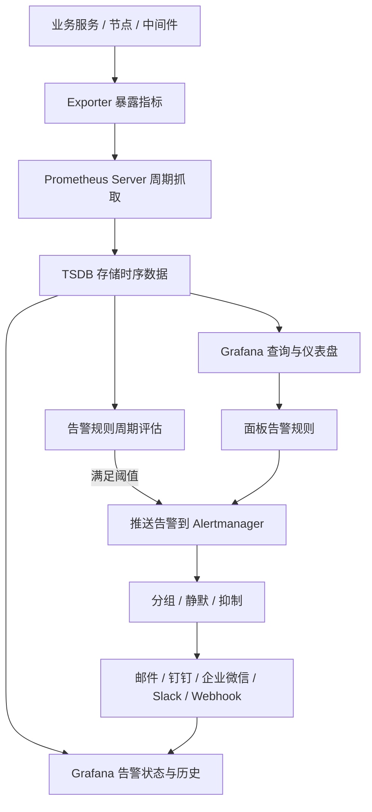

# 监控与告警

KDO 的可观测性中心把指标、日志、事件和告警集中到一个入口。监控域负责指标采集、可视化、告警规则评估和通知发送。

## 能力范围 {#scope}

| 能力 | 说明 |
|---|---|
| 指标采集 | Prometheus 周期抓取节点、工作负载、中间件和自定义指标 |
| 可视化 | Grafana 仪表盘、监控大屏、项目级视图 |
| 告警规则 | Prometheus 规则和 Grafana 面板告警 |
| 告警收敛 | Alertmanager 分组、静默、抑制 |
| 通知渠道 | 邮件、钉钉、企业微信、Slack、Webhook |
| 日志告警 | 对接 Loki，按日志查询结果触发告警 |

监控域不负责日志检索和事件详情，这两部分分别在日志和事件页面维护。

## 架构 {#architecture}



指标链路和告警链路共用 Prometheus：规则在 Prometheus 侧评估后交给 Alertmanager 收敛；Grafana 面板告警由 Grafana 直接评估。两条链路最终都汇入通知渠道和告警历史。

<video controls muted loop playsinline poster="/img/docs/observability/monitoring/prometheus-architecture.png">
  <source src="/img/docs/observability/monitoring/prometheus-architecture.mp4" type="video/mp4" />
  你的浏览器不支持 video 标签，请查看下方文字说明。
</video>

如果视频无法播放，可以按下面的文字理解链路：Exporter 暴露指标 → Prometheus 抓取并存储 → 规则评估 → Alertmanager 收敛 → 通知渠道。Grafana 只负责查询、展示和面板告警。

## 登录 Grafana {#grafana}

Grafana 默认地址为：

```text
http://grafana.<DEFAULT_DOMAIN>
```

例如 `http://grafana.kube-do.dev`。管理员账号默认为 `admin`，初始密码请参考部署配置或联系平台管理员；首次登录后立即修改密码。

普通用户通过 OAuth 登录，与 KDO 控制台使用同一身份源。默认 OAuth 用户是 `Viewer` 权限，管理员可以按需提升。


## 配置告警规则 {#configure-alert}

一条告警规则由查询、表达式、触发条件、评估周期和通知配置组成：

1. 选择数据源，例如 Prometheus 或 Loki。
2. 添加查询和表达式，预览结果。
3. 设置触发条件、持续时间和评估间隔。
4. 配置无数据、执行错误时的处理方式。
5. 添加摘要、描述和标签，便于路由和静默。
6. 选择通知策略或 contact point。
7. 保存并手动触发一次，验证通知是否送达。

:::tip
先用一个低风险测试规则验证通知链路，再配置生产告警。否则容易出现“规则已触发但没人收到”的假安全感。
:::

## 通知与收敛 {#notification}

Grafana 支持邮件、企业微信、钉钉、Webhook、PagerDuty 等通知方式。配置时注意：

- **Contact point** 决定消息发到哪里。
- **Notification policy** 决定哪些告警走哪个 contact point。
- **Mute timing** 用于维护窗口，避免计划内变更触发噪声。
- **Silence** 用于临时压制已知告警，需设置过期时间。
- **Inhibition** 用于高优先级告警抑制低优先级告警，避免重复通知。

## 验证 {#verify}

1. 在 Grafana 中打开 **Alerting → Alert rules**，确认规则状态为正常。
2. 手动触发测试规则，确认 contact point 收到消息。
3. 查看 **Alerting → Alert history**，确认告警从触发到恢复的完整记录。
4. 在 KDO 控制台确认通知中心收到对应事件。

## 限制与注意事项 {#limits}

- Prometheus 只保存有限保留期的时序数据，长期趋势需要远端存储。
- 告警规则过多会增加 Prometheus 评估压力，建议按团队和业务域拆分。
- 通知渠道的限流和重试策略由外部系统决定，关键告警应有第二通道。
- 静默和抑制规则需要定期清理，否则会掩盖真实故障。
- 监控数据本身也可能暴露敏感信息，仪表盘分享前需脱敏。

## 下一步 {#next}

- 查看可观测性整体入口：[可观测性](/docs/observability/)
- 配置日志检索与日志告警：日志页面（即将迁移）
- 配置事件与通知：事件、通知中心（即将迁移）
