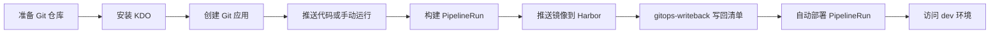

# 快速开始：部署第一个应用

本教程带你完成一条完整链路：**安装 KDO → 准备 Git 仓库 → 创建应用 → 触发构建 → 访问应用**。如果集群和网络已经就绪，大约 30 分钟可以完成。

## 目标 {#goal}

完成后，你会得到一个运行在 `dev` 环境的 Nginx 应用，并能在 KDO 控制台看到它的构建记录、部署状态和访问地址。

## 前置条件 {#prerequisites}

| 条件 | 要求 |
|---|---|
| Kubernetes | v1.28 及以上，节点状态为 `Ready` |
| 操作系统 | RHEL 9 / AlmaLinux 9 / Rocky 9 / Ubuntu 22.04+ |
| 权限 | 能通过 SSH 登录控制面节点，并以 `root` 执行安装器 |
| Git | 一个可访问的 GitHub、GitLab、Gitee、Gitea 或 Codeup 仓库 |
| 网络 | 节点能拉取镜像；客户端能访问控制台 NodePort 或 Ingress |

:::note
如果还没有 Kubernetes 集群，先阅读[安装 Kubernetes](/docs/install/kubernetes/)，再回到本教程。
:::

## 步骤 1：准备 Git 仓库 {#prepare-repo}

创建一个最小仓库，包含 `Dockerfile` 和静态页面：

```bash
mkdir my-first-app && cd my-first-app
cat > Dockerfile <<'EOF'
FROM nginx:alpine
COPY index.html /usr/share/nginx/html
EOF
cat > index.html <<'EOF'
<!doctype html>
<html lang="zh-CN">
  <head><meta charset="utf-8"><title>Hello KDO</title></head>
  <body><h1>Hello KDO</h1></body>
</html>
EOF
git init
git add .
git commit -m "Initial commit"
git remote add origin <your-git-repo-url>
git push -u origin main
```

把 `<your-git-repo-url>` 替换成你的仓库地址。后续创建应用时需要仓库 URL 和一个有读取权限的 Token。

## 步骤 2：安装 KDO {#install-kdo}

在控制面节点以 `root` 执行：

```bash
wget https://gitee.com/kube-do/docs/releases/download/latest/kdo-install
chmod +x kdo-install

./kdo-install config init -output kdo-install.yaml \
  -node-ip <NODE_IP> -domain <DOMAIN>

./kdo-install config validate -config kdo-install.yaml
./kdo-install apiserver-check -config kdo-install.yaml
./kdo-install preflight -config kdo-install.yaml
./kdo-install install -config kdo-install.yaml -yes
```

安装完成后查看访问信息：

```bash
cat /root/kdo-access-info.txt
```

完整的参数说明、Ingress 配置和升级方式见[安装 KDO 平台](/docs/install/kdo/)。

## 步骤 3：创建 Git 应用 {#create-app}

1. 打开控制台，使用管理员账号登录。
2. 进入 **开发者界面 → 应用管理 → Git 应用**。
3. 点击 **创建应用**，填写：
   - **名称**：`my-first-app`
   - **仓库 URL**：步骤 1 的仓库地址
   - **分支**：`main`
   - **凭证**：Git Token 或 SSH Key
   - **端口**：`80`
4. 选择开发语言和模板，确认分支与环境映射。
5. 点击 **创建**。

平台会向仓库写入 `devfile.yaml`、`Dockerfile`、Kubernetes 清单和 `.tekton` 流水线定义，并挂载 Webhook。

:::tip
如果你不想等待 Webhook，可以在应用详情页点击 **手动运行**，效果与推送一次代码相同。
:::

## 步骤 4：触发构建 {#trigger-build}

向仓库推送一个空提交：

```bash
git commit --allow-empty -m "Trigger KDO build"
git push
```

在控制台进入 **应用详情 → 流水线运行**，你会看到一条构建 PipelineRun。构建成功后，`gitops-writeback` 会把新镜像写回部署清单；清单发生变化时，平台自动创建部署 PipelineRun。

## 步骤 5：验证部署 {#verify}

1. 进入 **开发者界面 → 项目 → 默认项目 → dev**。
2. 找到 `my-first-app`，确认状态为 **运行中**。
3. 打开访问地址，页面应显示 `Hello KDO`。

如果使用 NodePort，地址通常类似：

```text
http://<NODE_IP>:30080
```

## 工作流程图 {#flow}



## 下一步 {#next}

| 我想…… | 去哪里 |
|---|---|
| 了解应用对象和仓库配置 | [创建 Git 应用](/docs/developer/applications/git/) |
| 理解 Deployment 的发布与回滚 | [无状态应用](/docs/developer/workloads/deployments/) |
| 配置监控和告警 | [监控与告警](/docs/observability/monitoring/) |
| 管理用户、权限和项目 | [管理指南](/docs/admin/) |

## 常见问题 {#troubleshooting}

### 控制台无法访问 {#console-unreachable}

- 检查 Pod：`kubectl get pod -n kubedo-system`
- 检查 Service：`kubectl get svc -n kubedo-system`
- 检查防火墙是否放行 NodePort 端口
- 如果使用 Ingress，确认 DNS 或 `/etc/hosts` 已指向入口地址

### 构建失败 {#build-failed}

优先查看 PipelineRun 日志，常见原因是 Git Token 无权限、Dockerfile 路径错误、Harbor 凭据缺失或资源配额不足。

### 应用没有自动部署 {#no-auto-deploy}

确认构建成功且 `gitops-writeback` 输出 `changed=true`。如果清单没有变化，平台不会重复创建部署运行，这是预期行为。
