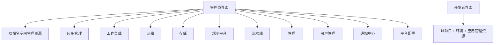

## 介绍

:::note

管理员界面主要面向管理员和资深Kubernetes用户使用，需要对Kubernetes有一定的运维知识。
明显的区别，管理员是通过命名空间（Namespace）的方式管理资源，而开发者是通过项目+环境+应用的模型来管理资源。

:::

<video class="doc-video" controls muted loop autoplay playsinline preload="metadata" poster="/media/docs/admin/imgs/admin-start-poster.webp" aria-label="管理员界面"><source src="/media/docs/admin/imgs/admin-start.mp4" type="video/mp4" /></video>

## 导航结构

管理员与开发者面对同一套集群资源，但入口与资源组织方式不同：管理员直接操作命名空间级对象，开发者围绕项目、环境和应用展开。

## 快速入口

| 入口 | 说明 |
|---|---|
| [管理员概览](/docs/admin/overview/) | 管理对象、常用任务与权限模型 |
| [集群与节点](/docs/admin/clusters/) | 纳管集群、查看节点状态与容量 |
| [命名空间与配额](/docs/admin/namespaces/) | Namespace、ResourceQuota、LimitRange、AppProject |
| [用户与权限](/docs/admin/access-control/) | 用户、用户组、角色与 RBAC |
| [存储](/docs/admin/storage/) | StorageClass、PV/PVC、快照与扩容 |
| [可观测性](/docs/observability/) | 集群监控、日志、告警与事件 |
| [平台配置](/docs/admin/platform-config/) | Console 配置、认证、镜像仓库与代理 |
