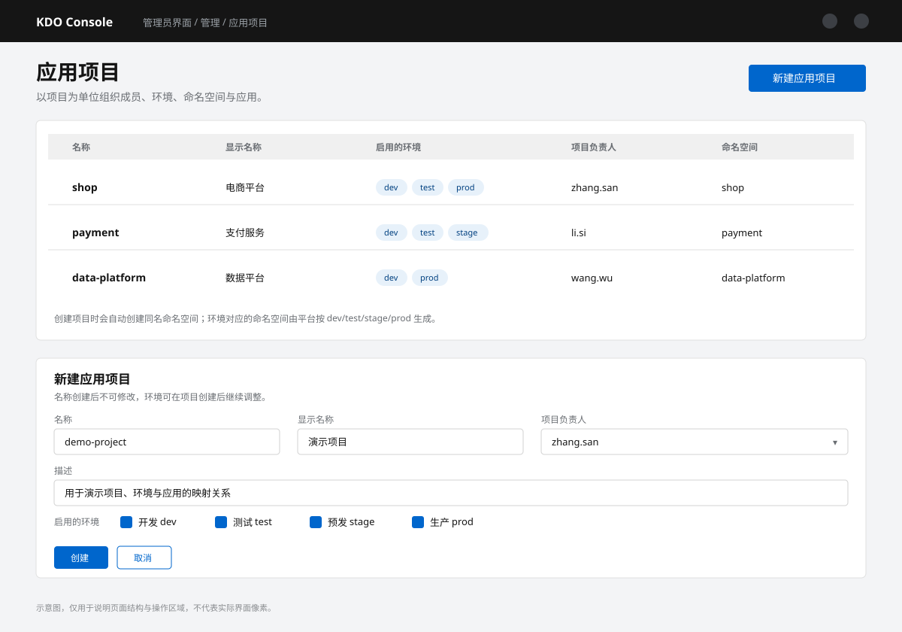
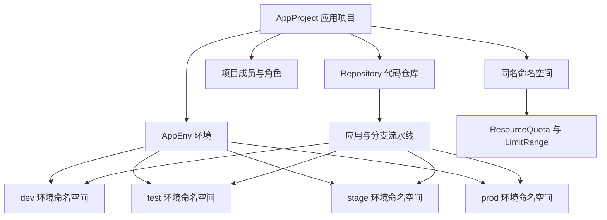

入口：[访问应用项目详情](/docs/developer/projects/#项目管理)。

**AppProject** 是 KDO 的项目模型：创建项目时会生成同名命名空间，并按启用的环境创建对应的环境命名空间。项目成员、角色与资源配额都围绕这些命名空间生效。



*图：应用项目列表与新建应用项目表单。*

## 组件关系



项目的管理员可管理成员与环境，普通成员只能操作被授权的环境；每个环境命名空间独立承载应用、构建与工作负载。

## 创建应用项目

1. 进入管理员界面的 **应用项目** 页面。
2. 填写项目名称。名称会作为命名空间前缀，创建后不建议修改。
3. 选择需要启用的环境。常用环境为 `dev`、`test`、`stage`、`prod`。
4. 按需设置项目成员和环境权限。
5. 提交后确认同名命名空间和环境命名空间已创建。

创建完成后，在开发者界面进入该项目，即可创建 Git 应用、运行流水线并查看环境工作负载。

## 成员与权限

| 角色 | 典型权限 |
|---|---|
| 项目管理员 | 管理项目成员、环境和项目级配置 |
| 开发人员 | 在授权环境中创建应用、运行流水线和查看日志 |
| 测试人员 | 查看测试环境资源、日志和事件 |
| 运维人员 | 管理生产环境工作负载、发布和回滚 |

项目成员只有在被授权的环境命名空间中才能操作资源。需要跨项目访问时，应通过管理员界面配置 RBAC，而不是把用户加入所有项目。

## 环境命名空间

应用项目的环境命名空间通常遵循：

```text
{project}-{env}
```

例如项目 `payment` 启用 `dev` 和 `prod` 后，会使用：

```text
payment-dev
payment-prod
```

ResourceQuota、LimitRange 和网络策略应按环境分别配置。生产环境通常需要更严格的配额、更高的副本数和独立的通知渠道。

## 常见问题

### 项目创建后没有环境命名空间

确认创建项目时已勾选对应环境，并检查 AppProject 与 AppEnv 资源是否处于正常状态。环境命名空间由控制面创建，创建失败时优先查看 AppProject 事件。

### 成员看不到项目

确认用户已加入项目成员，并且角色允许访问目标环境。只加入项目但未授予环境权限时，成员无法看到环境下的工作负载。

### 可以重命名项目吗

不建议。项目名称与命名空间、Repository、流水线和工作负载绑定，重命名会影响已有资源和外部链接。需要调整名称时应新建项目并迁移应用。

### 删除项目会删除什么

删除应用项目通常会清理项目下的环境命名空间及其工作负载。执行前应确认没有需要保留的镜像、PVC、备份或外部数据。

## 相关文档

- [项目管理](/docs/developer/projects/)
- [命名空间](/docs/admin/namespaces/)
- [资源配额](/docs/admin/namespaces/resource-quotas/)
- [限制范围](/docs/admin/namespaces/limit-ranges/)
- [RBAC 权限管理](/docs/admin/access-control/rbac/)
