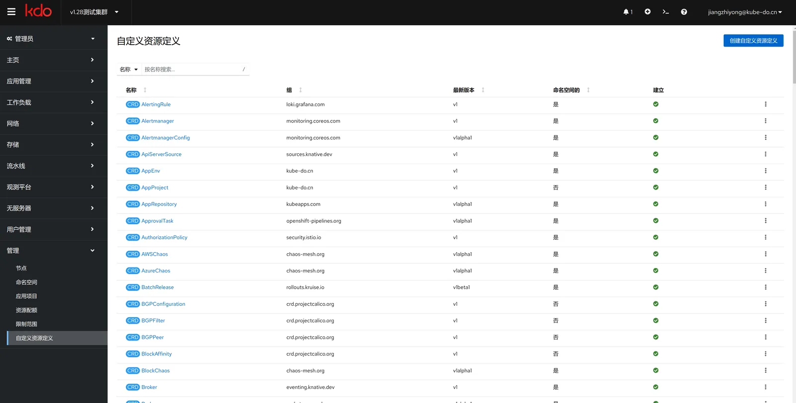
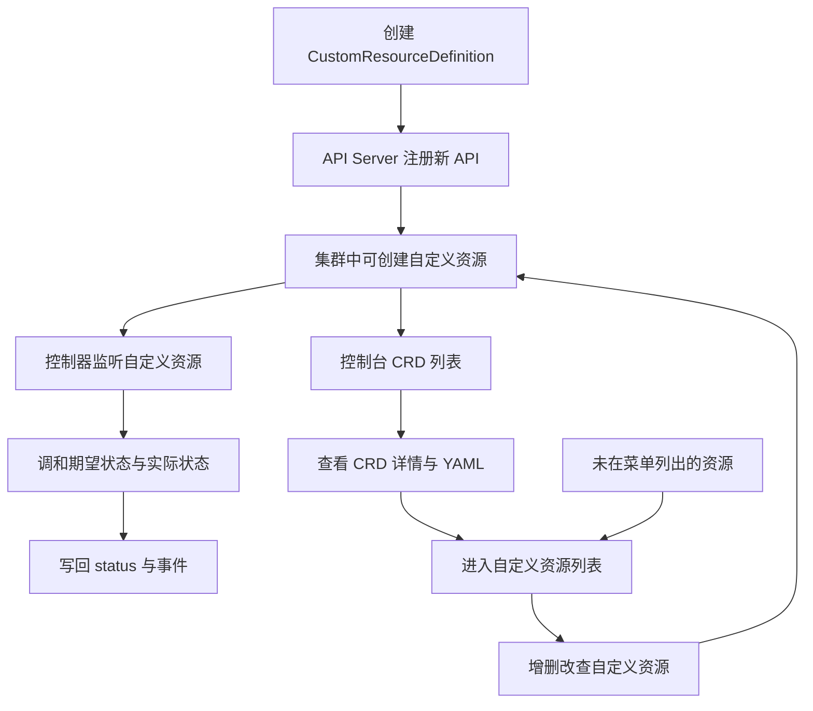
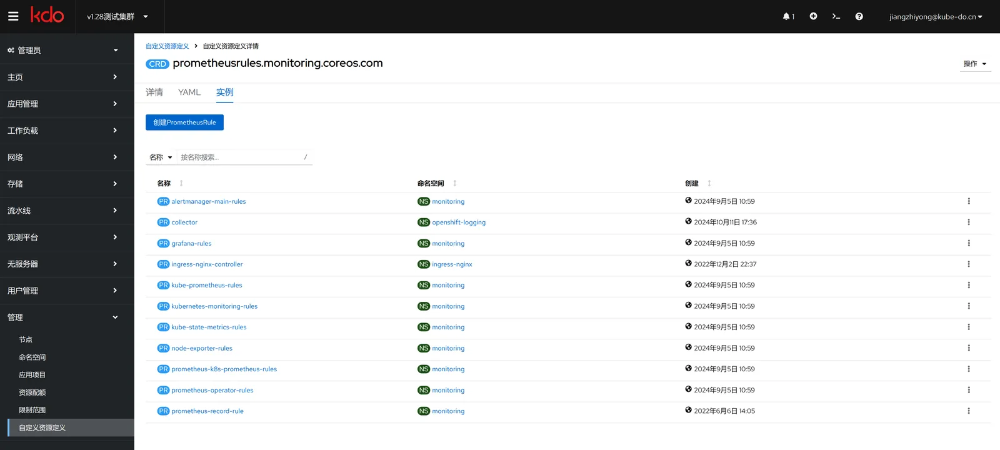

## 介绍

:::note

[Custom Resource Definitions (CRDs)](https://kubernetes.io/zh-cn/docs/concepts/extend-kubernetes/api-extension/custom-resources/) 是 Kubernetes 中用于扩展 API 的一种机制，允许用户定义自己的资源类型。
CRD 是一种 API 对象，它代表了一类自定义资源。 当你创建一个 CRD 时，Kubernetes API 服务器会自动为你提供存储和访问该类型的自定义资源的能力。
这使得开发者可以在不修改 Kubernetes 核心代码的情况下，轻松地为集群引入新的功能或抽象层。 KDO平台的很多组件都是通过CRD来实现的。

:::

## CRD 与自定义资源的关系

CRD 定义的是资源类型，真正承载配置的是该类型下的自定义资源实例；删除 CRD 会同时移除集群中所有同类型的自定义资源。

## 操作 CRD

:::note

由于诸多资源并未在KDO平台的菜单中列出，例如用于监控的`PrometheusRule`。
针对这种情况，我们可以通过访问`CRD（Custom Resource Definitions）`来实现对这些资源的增删改等管理操作。
这样，即使某些资源不在默认菜单内，我们也能够灵活地对其进行操作和管理。

:::

## 查看 CRD

在管理员界面的 CRD 列表中可以查看：

| 字段 | 说明 |
|---|---|
| 名称 | CRD 的复数资源名，例如 `prometheusrules.monitoring.coreos.com` |
| Group | API 组 |
| Kind | 资源类型 |
| Scope | `Namespaced` 或 `Cluster` |
| Versions | 已提供服务的 API 版本 |
| 自定义资源 | 该类型下已创建的实例数量 |

进入详情页后，可以查看 YAML、版本、转换策略和该 CRD 下的自定义资源。

## 管理自定义资源

对于未出现在默认菜单中的资源，可以通过 CRD 进入对应的自定义资源列表，执行查看、创建、编辑和删除。

创建自定义资源前应确认：

1. 使用的 `apiVersion` 和 `kind` 与 CRD 定义一致。
2. 资源作用域是命名空间级还是集群级。
3. 必填字段和校验规则满足 CRD schema。
4. 控制器已正常运行，能够处理新创建的实例。

## 删除 CRD 的风险

删除 CRD 会同时删除集群中所有同类型的自定义资源。该操作通常不可逆，执行前必须：

- 导出所有自定义资源 YAML。
- 确认没有控制器或应用依赖该 CRD。
- 确认关联的 PVC、Secret 和外部资源不需要保留。
- 在非生产环境先验证恢复流程。

## 常见问题

### CRD 存在但创建资源失败

检查 CRD 的 `spec.versions` 是否包含提交的 `apiVersion`，以及 schema 是否拒绝必填字段。错误通常出现在 `kubectl apply` 的返回信息或资源事件中。

### 自定义资源一直不 Ready

CRD 只负责注册 API，不负责调和资源。自定义资源是否正常取决于对应 Operator 或控制器，请检查控制器 Pod、日志和事件。

### 删除 CRD 后菜单仍有入口

菜单或缓存可能尚未刷新。确认 CRD 已删除后刷新页面；如果入口仍存在，检查是否有其他同组资源或前端缓存。

## 相关文档

- [命名空间与配额](/docs/admin/namespaces/)
- [已安装的 Operators](/docs/admin/operators/installed/)
- [Operator 管理](/docs/admin/operators/)
- [事件](/docs/observability/events/)
