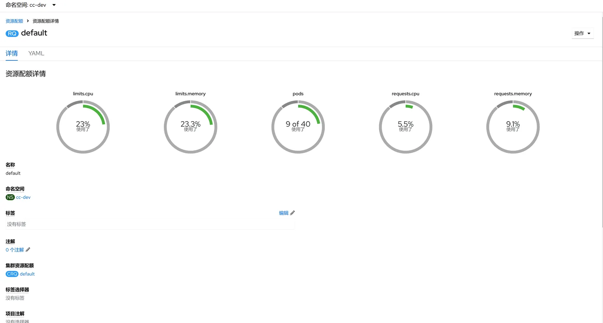
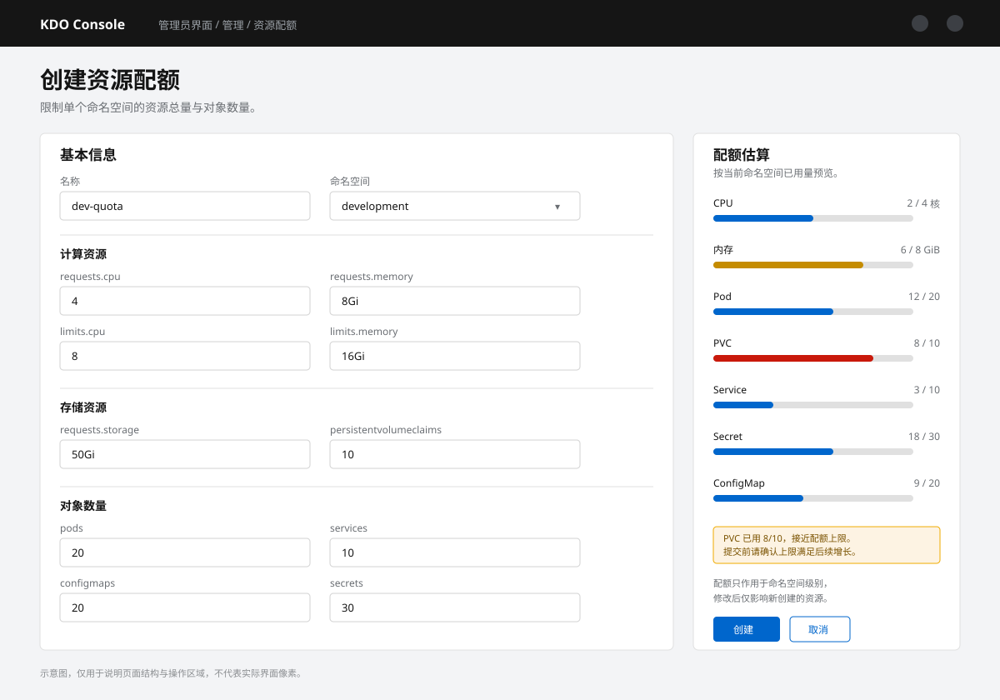
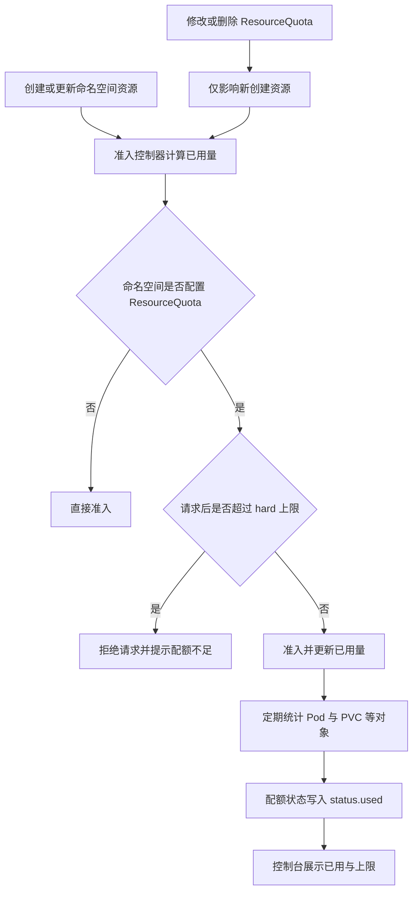

## 介绍

:::note

资源配额(`ResourceQuota`) 是 `Kubernetes` 中用于限制命名空间内资源总量的一种策略对象。
它允许集群管理员对每个命名空间设置资源使用上限，从而控制该命名空间内的资源消耗，确保整个集群的资源不会被单个命名空间耗尽。
这有助于在多租户环境中实现资源的公平分配和隔离。
[更多信息, 请参考官方文档。](https://kubernetes.io/zh-cn/docs/concepts/policy/resource-quotas/)

:::





*图：创建资源配额表单与配额估算区域。*

## 主要功能

1. **硬性配额(Hard limits):** `ResourceQuota` 可以为各种计算资源（如 CPU、内存）、存储资源（如持久卷声明 PVC），以及对象数量（如 `Pod`、`Service`、`ConfigMap` 等）设定硬性的使用上限。一旦达到这些上限，任何进一步的资源请求都会被拒绝。
2. **作用于命名空间级别:** 每个 `ResourceQuota` 对象只影响它所属的命名空间。这意味着你可以为不同的团队或项目创建独立的命名空间，并为每个命名空间单独配置配额，以满足各自的资源需求。
3. **支持多种资源类型:** 除了常见地计算和存储资源外，`ResourceQuota` 还可以限制其他类型的 Kubernetes 对象数量，例如 `Secrets`、`Services`、`Deployment` 等等。这对于防止意外创建过多的对象，保持集群整洁有序非常重要。
4. **与[限制范围(LimitRange)](/docs/admin/namespaces/limit-ranges/) 协同工作:** 虽然`限制范围(LimitRange)`主要用于设置单个容器或 Pod 的资源使用限制，但 `ResourceQuota` 则是针对整个命名空间的总量限制。两者可以一起使用来提供更精细的资源管理。

## 配额准入流程



配额是准入阶段的硬性检查，不会驱逐已经运行且超出新配额的资源；调整配额后应同步检查现有工作负载。

##  注意事项
1. `ResourceQuota` 只能应用于[命名空间](/docs/admin/namespaces/)级别的资源，因此需要为每个目标命名空间单独配置。
2. 如果你在命名空间中同时使用了 `LimitRange` 和 `ResourceQuota`，请确保它们之间的配置是一致且兼容的，以避免冲突。
3. 当你删除 `ResourceQuota` 或修改其配置时，现有资源不受影响；只有新创建的资源会受到新的配额规则约束。
4. 配置合理的 `ResourceQuota` 需要考虑命名空间的实际需求和集群的整体资源情况，以平衡资源利用率和服务质量。

## 创建资源配额

### 通过控制台

1. 进入 **管理 → 命名空间**，选择目标命名空间。
2. 打开 **资源配额** 页签，点击 **创建资源配额**。
3. 按需填写 CPU、内存、存储和对象数量上限。
4. 保存后返回命名空间详情，确认已用资源和上限正确。

### 通过 YAML

```yaml
apiVersion: v1
kind: ResourceQuota
metadata:
  name: demo-dev-quota
  namespace: demo-dev
spec:
  hard:
    requests.cpu: "4"
    requests.memory: 8Gi
    limits.cpu: "8"
    limits.memory: 16Gi
    requests.storage: 50Gi
    pods: "20"
    services: "10"
    configmaps: "20"
    secrets: "20"
```

## 支持的配额项

| 类型 | 常用配额项 | 说明 |
|------|------------|------|
| 计算资源 | `requests.cpu`、`requests.memory`、`limits.cpu`、`limits.memory` | 限制所有容器请求和限制的总和 |
| 存储资源 | `requests.storage`、`persistentvolumeclaims` | 限制 PVC 总容量和数量 |
| 对象数量 | `pods`、`services`、`configmaps`、`secrets`、`deployments` | 限制命名空间内对象数量 |
| 扩展资源 | `requests.nvidia.com/gpu` 等 | 限制 GPU 等扩展资源 |

不同 Kubernetes 版本支持的对象类型可能不同，可通过 `kubectl explain resourcequota` 查看当前集群的字段说明。

## 查看与验证

```bash
kubectl get resourcequota -n demo-dev
kubectl describe resourcequota demo-dev-quota -n demo-dev
```

`describe` 输出中的 `Used` 和 `Hard` 分别表示当前已用量和上限。控制台的资源配额页也会展示同样的数据。

## 常见问题

### Q: 创建 Pod 时提示 `exceeded quota` 怎么办？

先查看配额已用量：

```bash
kubectl describe resourcequota demo-dev-quota -n demo-dev
```

确认是新 Pod 的 requests/limits 超过剩余额度，还是命名空间对象数量达到上限。必要时调整配额或清理不再使用的资源。

### Q: 修改配额后，已有工作负载会被驱逐吗？

不会。配额只在准入阶段检查新创建或更新的资源，不会驱逐已经运行且超出新配额的 Pod。

### Q: 为什么配额显示已用，但看不到对应 Pod？

配额统计的是命名空间内的对象总量，可能包含已完成、失败但尚未清理的 Pod，或其他控制器创建的资源。可结合 `kubectl get pods -n <namespace>` 检查。

### Q: 删除 ResourceQuota 后资源会恢复吗？

已有资源保持不变，但新建资源不再受该配额限制。删除前应确认命名空间仍需要资源保护。

## 最佳实践

- 为每个项目环境单独设置配额，避免不同环境互相争抢资源。
- 同时配置 `LimitRange`，为未显式设置 requests/limits 的容器提供默认值。
- 集群总容量预留至少 20% 缓冲，避免配额总和接近物理容量。
- 对对象数量设置上限，防止意外创建大量 ConfigMap、Secret 或 Service。
- 定期检查 `Used/Hard`，根据实际使用率调整，而不是一次性设置过大配额。

## 相关文档

- [限制范围（LimitRange）](/docs/admin/namespaces/limit-ranges/)
- [命名空间](/docs/admin/namespaces/)
- [应用项目](/docs/admin/namespaces/appprojects/)
- [Kubernetes ResourceQuota 官方文档](https://kubernetes.io/zh-cn/docs/concepts/policy/resource-quotas/)
