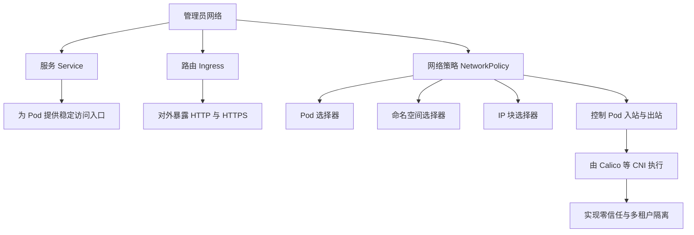

## 和开发者界面的区别

管理员的网络界面主要增加了网络策略页面。

## 管理员网络菜单
1. [服务](/docs/developer/network-storage/service/)
2. [路由](/docs/developer/network-storage/ingress/)
3. [网络策略](/docs/admin/networking/network-policies/)

## 功能地图



服务与路由负责流量的接入和转发，网络策略负责决定哪些流量可以到达 Pod；两者配合构成完整的网络访问模型。

## 常用任务

### 创建网络策略

进入 **网络 → 网络策略**，选择目标命名空间，配置：

- Pod 选择器：策略作用于哪些 Pod。
- 入站规则：允许哪些来源访问目标端口。
- 出站规则：允许目标 Pod 访问哪些外部地址。
- 策略类型：`Ingress`、`Egress` 或两者。

没有匹配任何策略的 Pod 默认允许全部流量；一旦有策略选中该 Pod，未明确允许的流量会被拒绝。

### 验证策略是否生效

```bash
kubectl get networkpolicy -n <namespace>
kubectl describe networkpolicy <name> -n <namespace>
kubectl get pods -n <namespace> --show-labels
```

从一个 Pod 测试到另一个 Pod 或 Service 的连通性，确认策略选择器和端口与实际负载一致。

### 排查 DNS 与出站流量

启用出站隔离后，必须显式允许 DNS：

```yaml
egress:
  - to:
      - namespaceSelector: {}
    ports:
      - protocol: UDP
        port: 53
      - protocol: TCP
        port: 53
```

否则 Pod 可能能解析已有连接，但新的 DNS 查询会超时。

## 排查思路

| 现象 | 优先检查 |
|---|---|
| 策略创建后完全没效果 | CNI 是否支持 NetworkPolicy，策略是否选中目标 Pod |
| 服务访问偶发超时 | DNS、出站规则、端口协议是否正确 |
| 只允许部分 Pod 访问 | 检查 Pod 标签与 namespaceSelector |
| 生产环境误拦截 | 先观察策略命中，再逐步收紧规则 |
| 跨命名空间访问失败 | 同时检查来源和目标命名空间的策略 |

## 最佳实践

- 先使用默认允许，确认业务流量后再逐步收紧。
- 为每个环境单独维护策略，不要直接复制生产策略到开发环境。
- 使用稳定的标签选择 Pod，避免依赖自动生成的名称。
- 明确允许 DNS、监控、日志和镜像仓库等基础出站流量。
- 变更前在测试环境验证，并保留回滚用的 YAML。

## 相关文档

- [网络策略](/docs/admin/networking/network-policies/)
- [服务](/docs/developer/network-storage/service/)
- [路由](/docs/developer/network-storage/ingress/)
- [命名空间](/docs/admin/namespaces/)
- [事件](/docs/observability/events/)
