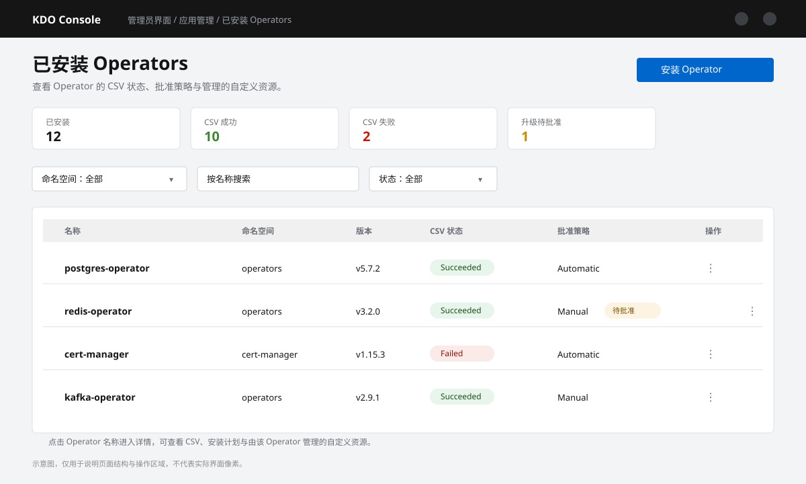
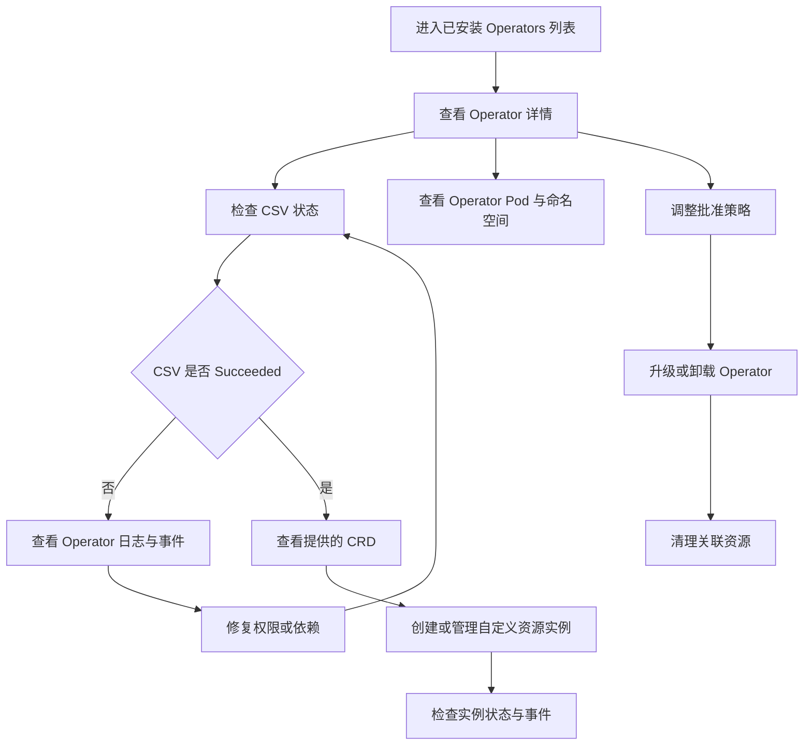

## 介绍

:::note

本页展示集群中已安装的 Operator，可查看 CSV 状态、批准策略以及由该 Operator 管理的自定义资源。

:::

*图：已安装 Operators 列表与 CSV 状态。*

## Operator 生命周期

CSV 状态为 `Succeeded` 只表示 Operator 自身部署成功；自定义资源是否正常，还需要结合实例的 `status` 与事件判断。

## 查看 Operator 状态

已安装 Operators 列表通常包含：

| 字段 | 说明 |
|---|---|
| 名称 | Operator 或 CSV 名称 |
| 命名空间 | Operator 安装所在的命名空间 |
| 版本 | 当前安装版本 |
| CSV 状态 | `Succeeded`、`Installing`、`Failed`、`Pending` |
| 批准策略 | `Automatic` 或 `Manual` |
| 提供的 API | 该 Operator 管理的 CRD |

进入详情页后，重点检查 Operator Pod、CSV 条件、事件和 Operator 日志。CSV 失败时，日志通常比列表状态更有诊断价值。

## 管理批准策略

- **Automatic**：Operator 有新版本时自动批准升级。
- **Manual**：新版本需要管理员手动批准。

生产环境通常使用 `Manual`，以便在升级前检查变更说明和兼容性。审批前应确认：

1. 新版本与当前 Kubernetes、KDO 版本兼容。
2. 受管自定义资源的 API 版本没有移除。
3. 已有备份和回滚方案。

## 管理自定义资源

Operator 安装成功后，会注册一个或多个 CRD。可在 Operator 详情页进入对应自定义资源列表，执行查看、创建、编辑和删除操作。

删除自定义资源前，应确认它没有被其他应用引用。删除 Operator 本身不一定会自动清理已创建的自定义资源和 PVC，卸载时需要单独检查。

## 卸载注意事项

卸载 Operator 前建议：

1. 停止依赖该 Operator 的流水线和应用。
2. 导出关键自定义资源 YAML。
3. 确认关联 PVC、Secret 和外部资源是否需要保留。
4. 先删除自定义资源，再卸载 Operator 和 CSV。
5. 检查 CRD 是否仍被其他组件使用。

## 常见问题

### CSV 一直是 Installing

检查 Operator Pod 是否正常运行、镜像是否能拉取、ServiceAccount 权限是否足够。查看 CSV 的 `status.conditions` 和 Operator 日志。

### 升级后自定义资源异常

确认新版本是否移除或重命名了 CRD 字段。必要时回滚 Operator 版本，并从备份恢复自定义资源。

### 卸载后 CRD 还在

卸载 Operator 通常不会自动删除 CRD，这是为了避免误删数据。确认不再使用后，再由管理员手动删除 CRD。

## 相关文档

- [Operator 管理](/docs/admin/operators/)
- [OperatorHub](/docs/admin/operators/operator-hub/)
- [自定义资源定义](/docs/admin/namespaces/crd/)
- [事件](/docs/observability/events/)
