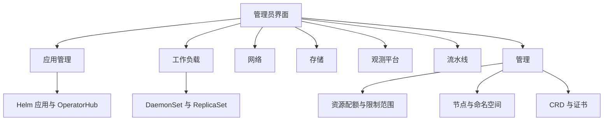

## 介绍

**管理员界面**提供了集群级别的管理能力，包括应用管理、资源管控、网络配置、存储管理、观测平台等核心功能。不同于开发者界面专注于应用开发，管理员界面面向集群运维，提供更底层的资源控制和策略配置能力。

### 主要功能模块

| 模块 | 描述 | 入口位置 |
|------|------|----------|
| **应用管理** | Helm 应用部署、Operator 生命周期管理 | 左侧菜单第2项 |
| **工作负载** | 管理 DaemonSet、ReplicaSet、Pod Disruption Budget | 左侧菜单第3项 |
| **网络** | 网络策略、服务、路由配置 | 左侧菜单第4项 |
| **存储** | 持久卷、存储类、卷快照管理 | 左侧菜单第5项 |
| **观测平台** | 集群监控、日志、告警 | 左侧菜单第6项 |
| **流水线** | CI/CD 流水线配置 | 左侧菜单第8项 |
| **管理** | 资源配额、节点、命名空间、CRD | 左侧菜单第9项 |

## 功能地图



各模块共享当前选择的集群与命名空间；切换集群后，资源视图与权限检查会按目标集群重新执行。

---

## 快速导航

### 常用任务

- [安装 Helm 应用](/docs/developer/applications/helm/) - 通过 Helm Chart 部署应用
- [部署 Operator](/docs/admin/operators/installed/) - 安装和管理 Kubernetes Operators
- [配置网络策略](/docs/admin/networking/network-policies/) - 控制 Pod 间访问规则
- [管理存储类](/docs/admin/storage/) - 定义持久化存储类型
- [设置资源配额](/docs/admin/namespaces/resource-quotas/) - 限制命名空间资源使用
- [创建命名空间](/docs/admin/namespaces/) - 为新团队或环境隔离资源
- [配置 AppProject](/docs/admin/namespaces/appprojects/) - 管理 KDO 项目模型与成员权限

---

## 管理对象

管理员界面围绕以下集群级对象工作。大多数对象都属于某个命名空间，集群、节点与证书则是跨命名空间的管理对象。

| 对象 | 作用 | 文档 |
|---|---|---|
| **ResourceQuota** | 限制命名空间内 CPU、内存、存储和对象数量总量 | [资源配额](/docs/admin/namespaces/resource-quotas/) |
| **LimitRange** | 设置容器资源请求/限制的默认值与允许范围 | [限制范围](/docs/admin/namespaces/limit-ranges/) |
| **Node** | 查看节点状态、容量、标签、污点并执行维护 | [节点管理](/docs/admin/clusters/nodes/) |
| **Namespace** | 提供多租户逻辑隔离，是配额和权限的边界 | [命名空间](/docs/admin/namespaces/) |
| **AppProject** | KDO 项目模型，映射命名空间并约束成员角色 | [应用项目](/docs/admin/namespaces/appprojects/) |
| **CRD** | 查看和管理集群中安装的自定义资源定义 | [自定义资源](/docs/admin/namespaces/crd/) |
| **KdcCertificate** | 自动分发和替换 Ingress TLS 证书 | [证书管理](/docs/admin/maintenance/certificates/) |

### 资源配额与限制范围

ResourceQuota 管“命名空间总量”，LimitRange 管“单个容器或 Pod 的默认值与边界”。两者通常一起使用：

```yaml
apiVersion: v1
kind: ResourceQuota
metadata:
  name: dev-quota
  namespace: development
spec:
  hard:
    requests.cpu: "4"
    requests.memory: 8Gi
    limits.cpu: "8"
    limits.memory: 16Gi
    requests.storage: 50Gi
    pods: "20"
    services: "10"
```

配额变更可能触发 Pod 驱逐或拒绝新建资源，调整前应先核对命名空间当前用量。

### 节点与命名空间

- **节点**：关注 `Ready` 状态、可分配容量、标签与污点。维护前先排空节点，确认工作负载已迁移。
- **命名空间**：按环境、团队或项目划分；删除命名空间会级联清理其中的所有资源。
- **AppProject**：把项目、环境命名空间和成员角色组织在一起，是 KDO 权限模型的入口。

---

## 权限说明

管理员界面功能需要以下权限：

- `*` 集群级别资源（大部分操作）
- `namespaces` 管理命名空间
- `nodes` 查看和管理节点

如需细粒度权限控制，请参考 [RBAC 配置指南](/docs/admin/access-control/rbac/)。

---

## 最佳实践

> **⚠️ 注意**：管理员操作会影响整个集群，请谨慎执行！

### 操作前检查

- ✅ 确认操作窗口（避免业务高峰期）
- ✅ 备份关键资源（删除前导出 YAML）
- ✅ 了解影响范围（资源配额变更可能触发 Eviction）
- ✅ 测试环境验证后再应用到生产

### 资源管理建议

- 📊 为每个项目创建独立 Namespace
- 📊 设置 ResourceQuota 防止资源滥用
- 📊 使用 LimitRange 规范容器资源请求/限制
- 📊 定期检查节点资源使用率，及时扩容

---

## 常见问题

### ResourceQuota 不支持的资源类型怎么办？

ResourceQuota 支持的资源取决于 Kubernetes 版本和启用的 API 组。可以先查看当前集群支持的字段：

```bash
kubectl explain resourcequota --api-version=v1
```

如果自定义资源无法设置配额，需要先确认对应的 API 扩展和准入控制器是否已启用。

### 节点 NotReady 如何处理？

1. 检查节点网络和 kubelet 状态：`journalctl -u kubelet -f`
2. 检查容器运行时是否正常
3. 查看节点 Conditions 和事件：`kubectl describe node <node>`
4. 如果节点无法恢复，排空后从集群移除并替换

### LimitRange 修改后为什么没有生效？

LimitRange 只对新建 Pod 生效，已经运行的 Pod 不会自动调整。确认 LimitRange 与 Pod 在同一个命名空间，并检查新 Pod 的请求值是否超出允许范围。

---

## 相关链接

- [Kubernetes 官方文档](https://kubernetes.io/docs/) - 参考底层概念
- [开发者界面概览](/docs/developer/) - 了解应用开发者视角
- [系统架构说明](/docs/architecture/) - 理解 KDO 集群设计
