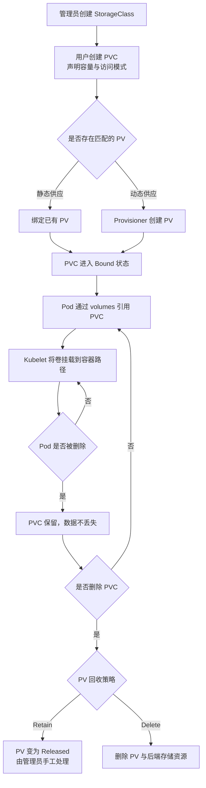

## 介绍

**存储管理**模块面向集群管理员，提供持久化存储资源的全生命周期管理，包括持久卷（PV）、存储类（StorageClass）、卷快照（VolumeSnapshot）等。管理员负责底层存储后端的配置、维护和容量规划，为开发者提供稳定高效的存储服务。

### 核心职责

- ✅ **StorageClass 管理**：定义不同性能、成本的存储类型
- ✅ **PV 供应与回收**：静态分配或动态供应，回收策略控制
- ✅ **容量监控**：跟踪存储使用率，及时扩容
- ✅ **快照与备份**：配置卷快照类，管理快照生命周期
- ✅ **存储后端集成**：对接 NFS、Ceph、云存储等 CSI 驱动

---

## 快速导航

### 常用任务

- [管理存储类](/docs/admin/storage/) - 创建、编辑 StorageClass
- [查看持久卷](/docs/admin/storage/) - 集群 PV 概览和状态
- [管理卷快照](/docs/admin/storage/) - 创建快照、恢复数据
- [PVC 扩容与容量管理](/docs/admin/storage/) - 调整存储容量与使用趋势
- [CSI 驱动与存储类](/docs/admin/storage/) - 安装、升级 CSI 插件

### 访问路径

管理员界面左侧菜单：
- **存储** → 自动跳转到 KDO 存储管理页面（复用开发者界面的部分功能，但可查看所有命名空间）

---

<a id="存储概念"></a>

## 核心概念

### 持久卷 (PV) vs 持久卷声明 (PVC)

Kubernetes 存储采用**两级模型**：

- **PV（PersistentVolume）**：集群层面的存储资源（如 NFS 目录、云硬盘）
- **PVC（PersistentVolumeClaim）**：命名空间层面对存储的**请求**

**供应模式：**

| 模式 | 流程 | 管理员职责 |
|------|------|-----------|
| **静态供应** | 管理员预先创建 PV，开发者创建 PVC 绑定 | 创建和管理 PV |
| **动态供应** | 开发者创建 PVC，自动触发 PV 创建（通过 StorageClass） | 配置和维护 StorageClass 及后端 |

**推荐：** 使用动态供应，简化开发者体验。

## 存储生命周期



静态供应需要管理员先创建 PV，动态供应则由 StorageClass 自动完成；两条路径最终都要经过 PV 与 PVC 绑定后才能被 Pod 挂载。删除 PVC 后，数据是否保留取决于 PV 的回收策略。

### 卷类型

| 类型 | 生命周期 | 典型场景 |
|---|---|---|
| `EmptyDir` | 与 Pod 相同，Pod 删除即丢失 | 临时缓存、同 Pod 内容器共享 |
| `HostPath` | 与节点绑定 | 开发调试、节点代理；生产慎用 |
| `PV/PVC` | 独立于 Pod | 数据库、业务持久化数据 |
| `ConfigMap` / `Secret` | 随对象存在 | 配置文件和敏感信息挂载 |
| 云盘（EBS/ESSD 等） | 由云厂商管理 | 生产块存储 |
| `CSI` | 由驱动管理 | 标准化接入第三方存储 |
| `Local` | 与节点绑定 | 高性能本地盘；需考虑调度和可用性 |
| `NFS` | 由 NFS 服务端管理 | KDO 默认存储，开发测试常用 |
| CephFS / RBD / iSCSI 等 | 由企业存储管理 | 企业级共享或块存储 |

### 访问模式

| 模式 | 含义 | 典型场景 |
|---|---|---|
| `ReadWriteOnce` (RWO) | 单个节点以读写方式挂载 | 大多数块存储、单副本应用 |
| `ReadOnlyMany` (ROX) | 多个节点以只读方式挂载 | 共享只读数据集、静态内容 |
| `ReadWriteMany` (RWX) | 多个节点同时读写 | NFS、CephFS、分布式文件系统 |

RWO 限制的是“挂载节点”，不是“Pod 数量”；同一节点上的多个 Pod 仍可能共享同一个 RWO 卷。需要多节点同时读写时必须使用支持 RWX 的后端。

### 回收策略

| 策略 | 删除 PVC 后的行为 | 适用场景 |
|---|---|---|
| `Retain` | PV 保留并变为 `Released`，需管理员手工清理或重新绑定 | 数据库等需要保留数据的场景 |
| `Delete` | 删除 PV 及后端存储资源 | 临时数据、可重建环境 |

动态供应的 PV 通常继承 StorageClass 的 `reclaimPolicy`，默认多为 `Delete`。对重要数据应在 StorageClass 或 PV 上显式设置为 `Retain`。

### KDO 默认存储

KDO 默认内置 NFS 存储，提供简单的网络存储方案，适合开发测试和对性能、安全要求不高的场景。生产环境建议使用企业级 CSI 存储，并根据数据重要性配置快照、备份和 `Retain` 策略。

---

## 功能概览

### 1. 存储类 (StorageClass)

StorageClass 定义了存储的"种类"和供应参数：

| 参数 | 说明 | 示例 |
|------|------|------|
| `provisioner` | 负责创建 PV 的 CSI 驱动 | `nfs-client.csi.k8s.io` |
| `parameters` | 驱动特定参数（如 NFS 服务器地址） | `server: nfs.example.com` |
| `reclaimPolicy` | PV 回收策略（Delete/Retain） | `Delete`（删除 PVC 时自动删 PV）|
| `volumeBindingMode` | 绑定时机（ Immediate / WaitForFirstConsumer） | `WaitForFirstConsumer` 延迟绑定 |
| `allowVolumeExpansion` | 是否支持扩容 | `true` |

KDO 默认提供：
- `nfs-client`：内置 NFS 存储，适用于开发/测试
- `managed-csi`：云平台托管存储（生产环境，如 AWS EBS、阿里云 ESSD）

### 2. 卷快照 (VolumeSnapshot)

快照功能允许在不中断服务的情况下备份 PVC 数据：

**资源对象：**
- `VolumeSnapshot`：快照实例（用户创建）
- `VolumeSnapshotClass`：快照类（定义后端和策略）
- `VolumeSnapshotContent`：快照的实际实现（系统创建）

**典型流程：**
1. 创建 VolumeSnapshot，指定源 PVC
2. CSI 驱动备份数据到快照存储
3. 从快照恢复：创建新 PVC，`dataSource: snapshot`

**限制：**
- 需要 CSI 驱动支持快照功能
- 快照一致性：应用静定期间创建最佳
- 快照存储成本：考虑保留策略

### 3. 卷扩容

如果 StorageClass 设置 `allowVolumeExpansion: true`，支持在线扩容：

1. 编辑 PVC，增加 `spec.resources.requests.storage`
2. Kubernetes 自动扩展底层存储
3. 在 Pod 内部执行文件系统扩容（如 `resize2fs`）

**注意：** 并非所有存储后端都支持扩容，需提前验证。

---

## 最佳实践

### 存储类设计

- 🎯 **多级存储**：提供 `fast-ssd`（高性能）、`medium-hdd`（性价比）、`slow-archive`（归档）多类
- 🎯 **环境隔离**：dev 用 NFS，prod 用云存储
- 🎯 **默认 StorageClass**：设置一个对应用户最常用的为 default，避免开发者忘记指定
- 🎯 **参数优化**：根据后端性能调整 `fsType`、`mountOptions` 等

### 容量管理

- 📊 **监控水位**：PV/PVC 使用率 >80% 时预警，>90% 时扩容
- 📊 **配额控制**：通过 ResourceQuota 限制每个命名空间的 PVC 总容量
- 📊 **增长预测**：基于历史数据预测未来 30-90 天的存储需求
- 📊 **清理策略**：定期删除不再使用的 PVC（可通过 TTL 控制器自动化）

### 数据保护

- 🔒 **快照策略**：关键数据设置定期快照（如每天），保留最近 30 天
- 🔒 **跨区域复制**：生产数据复制到异地/跨可用区
- 🔒 **加密传输**：使用 TLS 的 NFSv4.1 或 CSI 加密驱动
- 🔒 **访问控制**：通过 RBAC 限制 PVC/PV 操作权限

### 运维

- 🛠️ **CSI 驱动升级**：先在测试环境验证，分批升级生产集群
- 🛠️ **后端监控**：监控存储后端的 IOPS、吞吐量、延迟
- 🛠️ **故障演练**：定期模拟存储后端故障，验证恢复流程
- 🛠️ **文档化**：记录 StorageClass 参数含义、适用场景、联系人

---

## 常见问题

### Q: PVC 一直处于 Pending 状态？

- 没有可用 PV：动态供应器未安装或参数错误
- StorageClass 不存在：检查 `kubectl get storageclass`
- 配额不足：ResourceQuota 限制了 PVC 总量或数量
- 后端故障：NFS 服务器宕机、云存储 API 错误

查看事件：`kubectl describe pvc <name> -n <namespace>`

### Q: PV 和 PVC 绑定失败？

检查匹配条件：
- 存储类是否匹配
- 访问模式是否匹配（RWO、RWX、ROX）
- 大小：PV 容量 >= PVC 请求容量
- 标签选择器（如果用 `claimRef` 指定）

### Q: 如何升级 CSI 驱动？

1. 查看当前驱动版本：`kubectl get csidrivers`
2. 下载新版本 Helm Chart 或 YAML
3. 在测试环境验证
4. 生产环境升级：`helm upgrade <release> <new-chart>`
5. 验证：`kubectl get pods -n <csi-namespace>` 是否全部 Running

### Q: 快照失败？

- CSI 驱动不支持快照
- StorageClass 的 `snapshotClassName` 未设置或错误
- PVC 已挂载到运行中的 Pod（某些驱动不支持在线快照）
- 快照存储空间不足

查看事件：`kubectl get volumesnapshot <name> -o yaml` 的 `status` 字段。

### Q: 如何回收 PV？

根据 PV 的 `reclaimPolicy`：

- `Delete`：删除 PVC 后自动删除 PV 和底层存储
- `Retain`：PVC 删除后 PV 状态变为 `Released`，需要手动清理：
  ```bash
  kubectl patch pv <pv-name> -p '{"spec":{"persistentVolumeReclaimPolicy":"Delete"}}'
  kubectl delete pv <pv-name>
  ```

建议生产环境使用 `Retain` 策略，手动确认后再删除数据。

---

## 与开发者界面的区别

开发者界面的 **网络存储 → 持久卷声明** 仅允许开发者创建和查看**自己命名空间**的 PVC。管理员可以：

- 查看**所有命名空间**的 PVC 和 PV
- 创建和管理 StorageClass
- 查看和管理 VolumeSnapshot
- 配置 CSI 驱动参数
- 直接操作底层存储系统（如 NFS 服务器、云控制台）

---

## 相关链接

- [Kubernetes PV/PVC 官方文档](https://kubernetes.io/docs/concepts/storage/persistent-volumes/)
- [Kubernetes StorageClass](https://kubernetes.io/docs/concepts/storage/storage-classes/)
- [Kubernetes VolumeSnapshot](https://kubernetes.io/docs/concepts/storage/volume-snapshots/)
- [CSI 规范](https://github.com/container-storage-interface/spec)
- [开发者持久卷声明指南](/docs/developer/network-storage/pvc/)
