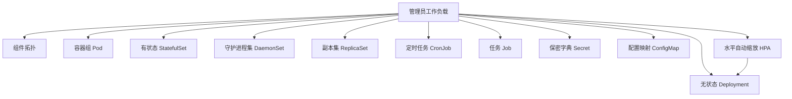

## 和开发者界面的区别

:::note

`管理员`界面的工作负载菜单，相当于是`开发者`界面的工作负载和配置管理的集合，只是增加了一部分只有管理员才有权限操作的菜单

:::

## 管理员工作负载菜单
1. [组件拓扑](/docs/developer/workloads/topology/)
2. [容器组(Pod)](/docs/developer/workloads/pods/)
3. [无状态(Deployment)](/docs/developer/workloads/deployments/)
4. [有状态(StatefulSet)](/docs/developer/workloads/statefulsets/)
5. [守护进程集(DaemonSet)](daemonsets)
6. [副本集(ReplicaSet)](replicaset)
7. [定时任务(CronJob)](/docs/developer/workloads/cronjobs/)
8. [任务(Job)](/docs/developer/workloads/jobs/)
9. [保密字典(Secret)](/docs/developer/configuration/secrets/)
10. [配置映射(ConfigMap)](/docs/developer/configuration/configmaps/)
11. [水平容器组自动缩放器(HPA)](/docs/developer/workload-operations/hpa/)

## 功能地图

管理员工作负载菜单覆盖了开发者界面的工作负载与配置管理，并补充了 DaemonSet、ReplicaSet 等底层对象的入口。
