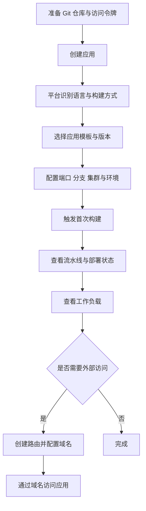
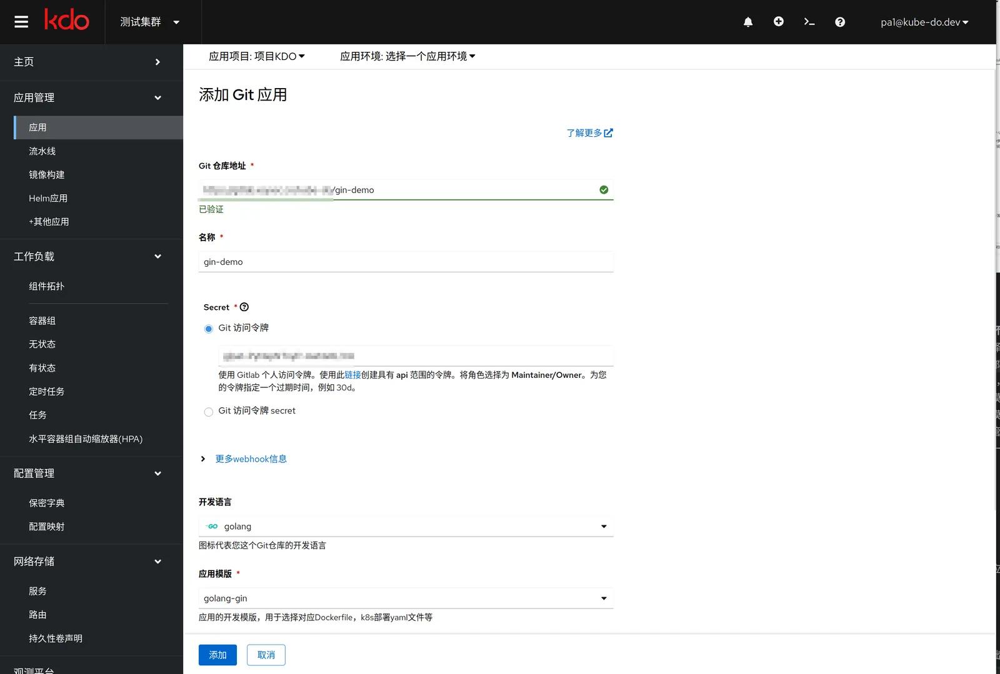
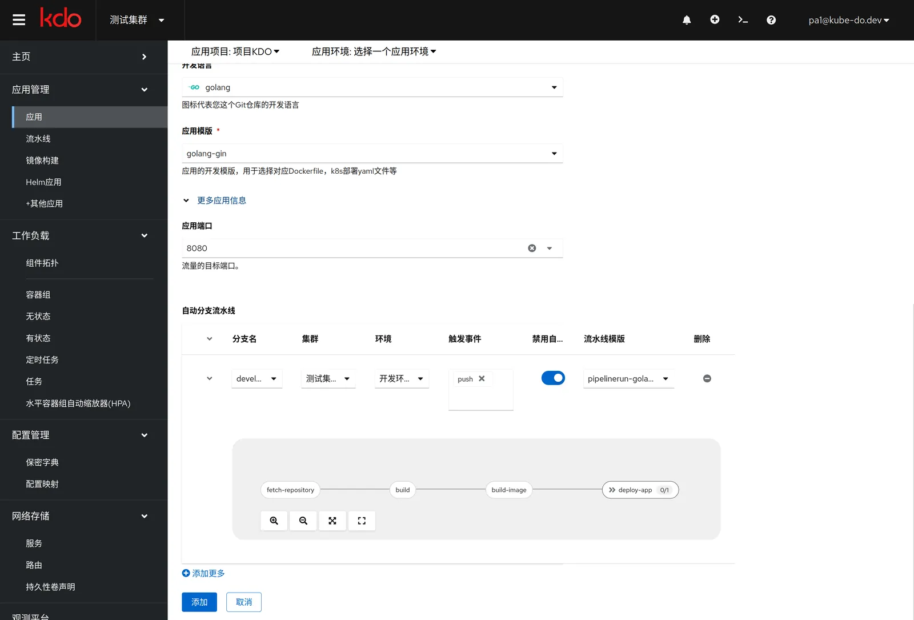
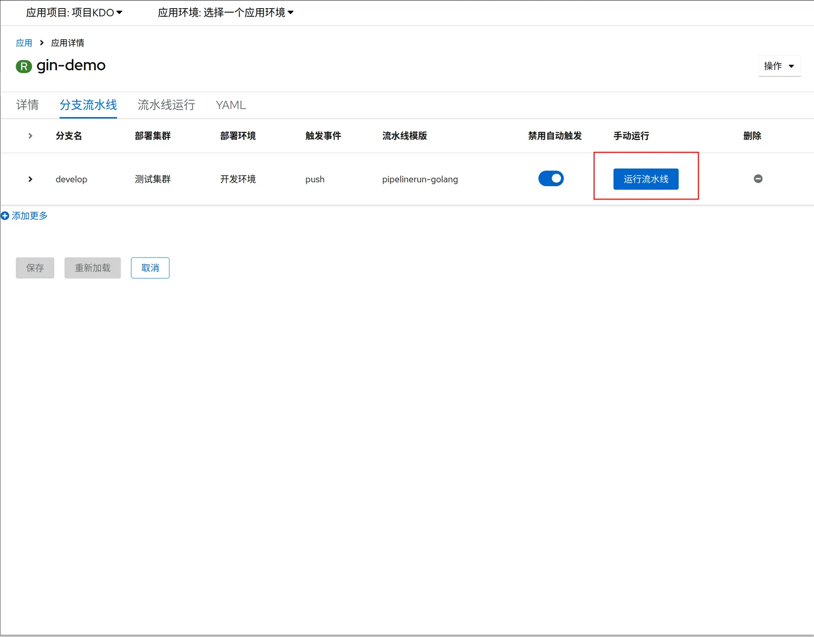
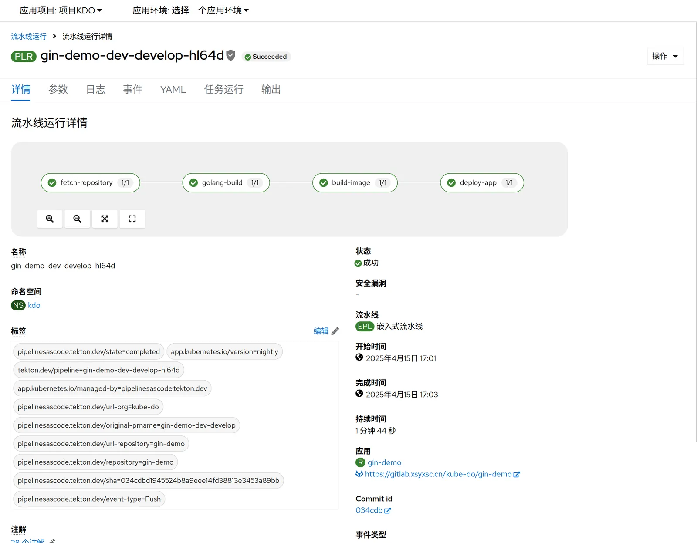
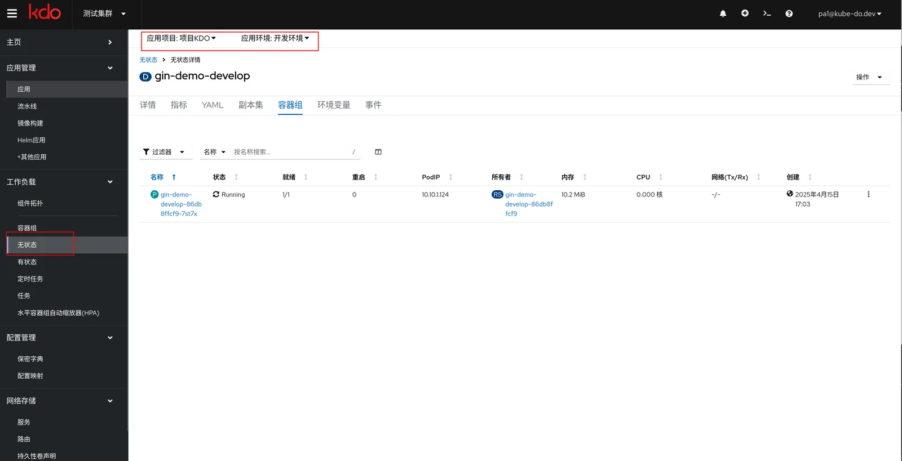
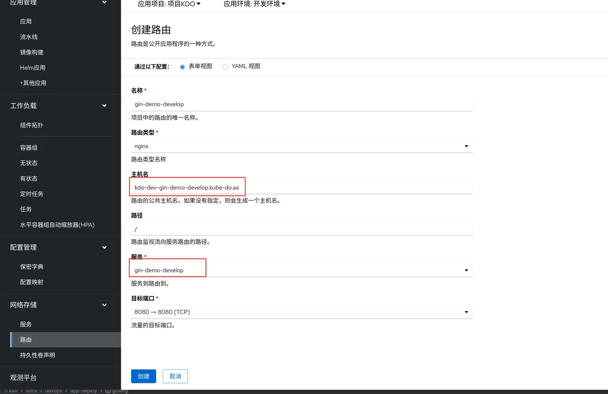
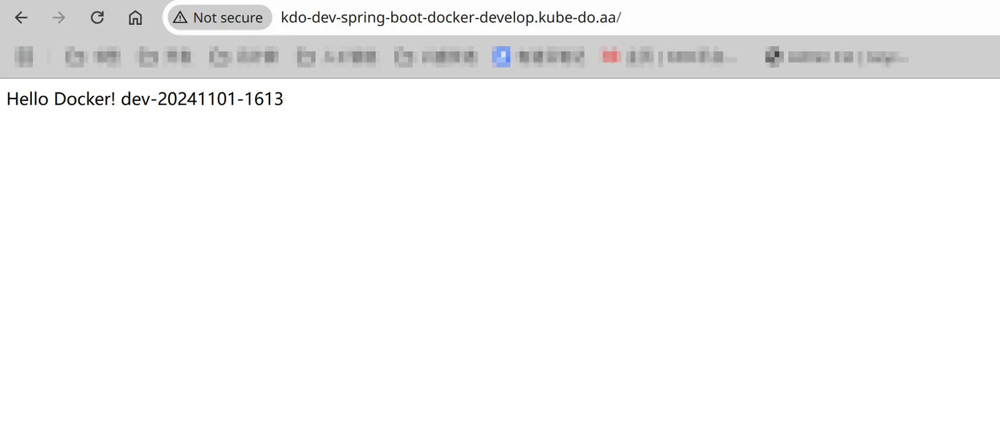

## 适用场景

本文适用于从 Git 源码创建 Java、Python、PHP、Node.js、.NET、Golang、静态 HTML 等语言应用。平台会根据仓库根目录的特征文件自动识别语言和构建方式，各语言的识别规则、版本和构建参数见对应的语言页面。

## 前置条件

- 已登录 KDO 开发者控制台，并进入目标项目和环境。
- Git 仓库可访问；私有仓库需要提前准备访问令牌。
- 目标环境已有可用的构建流水线和镜像仓库。
- 如需通过域名访问，集群已配置好 Ingress 和域名解析。

## 通用流程

## 步骤 1：准备 Git 仓库与访问令牌

1. 确认源码已推送到 Git 仓库，且仓库根目录包含语言特征文件，例如 `pom.xml`、`package.json`、`requirements.txt`、`go.mod`、`*.csproj`、`index.php`。
2. 私有仓库需要创建访问令牌。进入 **个人设置 → 访问令牌**，或直接在创建应用时点击令牌输入框旁的链接创建。
3. 将令牌保存到安全位置，创建应用时填入。

## 步骤 2：创建应用

1. 进入目标项目和环境，打开 **应用管理**，点击 **创建应用**。
2. 选择构建源为 **Git 源码**，填写仓库地址、分支和源码根目录。
3. 平台读取根目录特征文件，自动识别开发语言和构建方式。
4. 选择匹配的 **应用模板**。模板决定构建任务、运行镜像、默认端口和启动命令。
5. 填写应用名称，确认仓库凭据。

## 步骤 3：配置应用扩展信息

1. 确认应用端口。多数语言模板默认使用 `8080`；如果框架或镜像使用其他端口，按实际情况修改。
2. 选择分支流水线、部署集群和部署环境。一个分支可以部署到多个环境，一个环境也可以接收多个分支。
3. 选择触发方式：
   - **手动触发**：创建后手动运行流水线。
   - **自动触发**：按 `push` 或 `pull request` 事件触发。
4. 选择流水线模板。点击展开按钮可以查看模板包含的任务。
5. 点击 **添加** 完成创建。

## 步骤 4：触发首次构建

创建完成后，进入 **分支流水线**，选择目标分支，点击 **运行流水线**。平台会依次拉取代码、安装依赖、构建镜像、推送镜像并部署到目标环境。

首次构建通常较慢，因为需要下载依赖并初始化项目缓存。后续构建会复用项目内的持久卷缓存。

## 步骤 5：查看流水线运行信息

进入 **流水线运行**，选择对应的 PipelineRun，可以查看每个 Task 的日志、耗时和状态。失败时优先检查：

- 拉取代码是否成功，令牌是否有仓库读权限。
- 依赖下载是否超时，是否需要配置代理或私有源。
- 镜像构建和推送是否成功，镜像仓库凭据是否有效。
- 部署阶段是否有权限创建或更新工作负载。

更多流水线概念和排障方法见 [流水线](/docs/developer/delivery/pipelines/)。

## 步骤 6：查看应用运行状态

进入 **工作负载 → 无状态**，选择应用对应的 Deployment，可以查看容器组状态、事件、日志和资源使用情况。

更多说明见 [无状态应用（Deployment）](/docs/developer/workloads/deployments/)。

## 步骤 7：创建路由并访问

如果应用需要从集群外部访问：

1. 进入 **网络与存储 → 路由**，点击 **新增路由**。
2. 选择目标服务、端口和域名。
3. 保存后确认域名解析或本地 `hosts` 已指向入口地址。
4. 通过 `http://` 或 `https://` 域名访问应用。

路由配置详见 [路由（Ingress）](/docs/developer/network-storage/ingress/#新增路由)。

## 定制流水线

语言模板只提供默认构建链路。需要调整构建命令、依赖源、运行时版本或部署参数时，进入 **分支流水线 → 流水线编辑**，修改对应 Task 或参数。

常见定制项：

- 构建工具的版本，例如 JDK、Node.js、Go、Python、.NET SDK。
- 依赖源，例如 Maven、npm、PyPI、NuGet、GOPROXY。
- 构建参数和缓存目录。
- 部署清单、环境变量和资源限制。

流水线任务和自定义方法见 [流水线](/docs/developer/delivery/pipelines/)。

## 常见问题

### 平台没有识别出语言

确认仓库根目录存在对应特征文件，且源码根目录填写正确。如果项目是多模块仓库，源码根目录应指向包含构建文件的子目录。

### 应用启动后端口不通

确认应用实际监听端口与创建应用时填写的端口一致，并检查 Service 是否指向该端口。部分框架默认端口不是 `8080`，需要在模板或启动命令中调整。

### 首次构建很慢

首次构建需要下载依赖并初始化缓存。后续构建会复用项目持久卷中的缓存。如果依赖源较慢，可以在流水线中配置镜像源或代理。

### 构建成功但部署失败

检查目标环境是否存在资源配额限制、镜像拉取密钥是否配置、部署账号是否有权限更新工作负载。也可以在 PipelineRun 的部署 Task 日志中查看具体错误。

## 下一步

- [Java 项目部署](/docs/developer/applications/languages/java/)
- [Python 项目部署](/docs/developer/applications/languages/python/)
- [Node.js 项目部署](/docs/developer/applications/languages/nodejs/)
- [Golang 项目部署](/docs/developer/applications/languages/golang/)
- [.NET 项目部署](/docs/developer/applications/languages/dotnet/)
- [PHP 项目部署](/docs/developer/applications/languages/php/)
- [静态 HTML](/docs/developer/applications/languages/static-html/)
- [Dockerfile](/docs/developer/applications/languages/dockerfile/)
