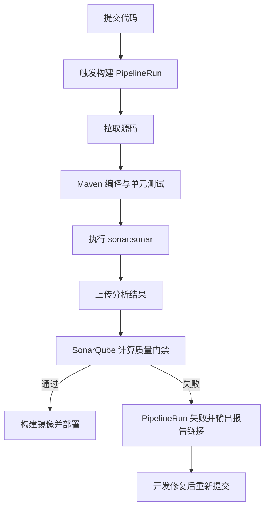

SonarQube 用于检查代码缺陷、安全漏洞、重复代码和可维护性问题。本页介绍如何把 SonarScanner 接入 KDO 的 Tekton 构建流水线，对 Maven 项目执行扫描并设置质量门禁。

## 适用场景

- 已有可访问的 SonarQube 服务。
- 应用使用 Maven 构建，代码托管在 Git 仓库。
- 希望代码提交后自动扫描，并在质量门禁失败时阻止发布。

## 前置条件

| 条件 | 说明 |
|---|---|
| KDO 集群 | 已安装 Tekton 和 Pipelines as Code |
| SonarQube | 构建 Pod 可以访问 SonarQube 地址 |
| 项目 | 已在 SonarQube 中创建 project key |
| Token | 具有扫描权限的 SonarQube Token |
| 仓库 | 包含 `pom.xml`，可以执行 Maven 构建 |

## 扫描流程



## 配置 Token

不要把 Token 写入 `pom.xml`、流水线 YAML 或 Git 仓库。推荐在构建命名空间创建 Secret：

```bash
kubectl -n <build-namespace> create secret generic sonar-token \
  --from-literal=token='<sonar-token>'
```

流水线通过 `secretKeyRef` 注入环境变量。Token 只授予扫描所需权限，不要使用管理员账号。

## 配置 Maven 扫描

在 `pom.xml` 中添加 Sonar Maven 插件：

```xml
<plugin>
  <groupId>org.sonarsource.scanner.maven</groupId>
  <artifactId>sonar-maven-plugin</artifactId>
  <version>3.11.0.3922</version>
</plugin>
```

构建命令示例：

```bash
mvn -B clean verify sonar:sonar \
  -Dsonar.host.url="${SONAR_HOST_URL}" \
  -Dsonar.token="${SONAR_TOKEN}" \
  -Dsonar.projectKey="${SONAR_PROJECT_KEY}" \
  -Dsonar.qualitygate.wait=true
```

`sonar.qualitygate.wait=true` 会让 Maven 等待质量门禁结果，门禁失败时构建失败。首次接入可以先关闭该参数，确认扫描成功后启用。

## 在流水线中增加扫描步骤

在 **分支流水线 → 流水线编辑** 中，为 Maven 构建 Task 增加一个 step，或新增一个依赖构建产物的扫描 Task。示例：

```yaml
steps:
  - name: sonar-scan
    image: maven:3.9-eclipse-temurin-17
    workingDir: /workspace/source
    env:
      - name: SONAR_HOST_URL
        value: https://sonarqube.example.com
      - name: SONAR_TOKEN
        valueFrom:
          secretKeyRef:
            name: sonar-token
            key: token
      - name: SONAR_PROJECT_KEY
        value: my-service
    script: |
      mvn -B clean verify sonar:sonar \
        -Dsonar.host.url="${SONAR_HOST_URL}" \
        -Dsonar.token="${SONAR_TOKEN}" \
        -Dsonar.projectKey="${SONAR_PROJECT_KEY}" \
        -Dsonar.qualitygate.wait=true
```

如果流水线使用图形化编辑器，选择 **添加步骤**，填写镜像、命令和环境变量，并把 Token 来源设为 Secret。

## 验证

1. 提交代码，等待 PipelineRun 完成。
2. 在 **流水线运行** 中查看 `sonar-scan` 步骤日志。
3. 日志应包含分析上传成功和 quality gate 结果。
4. 打开 SonarQube 项目页面，确认分支、版本和问题列表。
5. 故意引入一个明显问题，确认质量门禁失败时 PipelineRun 失败。

## 常见问题

### Q: 扫描报 401 Unauthorized

检查 Token 是否有效、是否属于当前 SonarQube 实例，以及 Secret 的 key 是否与 `secretKeyRef` 一致。Token 失效后需要重新生成。

### Q: 构建 Pod 无法访问 SonarQube

在构建命名空间启动临时 Pod，使用 `curl` 或 `nc` 验证 DNS、网络策略和证书。自签名证书需要把 CA 挂载到构建镜像，或使用受信任证书。

### Q: 找不到 `sonar:sonar` 插件

确认 `pom.xml` 中已添加 `sonar-maven-plugin`，或改用完整的 Maven 坐标执行。多模块项目需要在根目录执行，或分别配置模块。

### Q: 质量门禁一直失败

打开 SonarQube 报告查看具体指标。常见原因是新增代码覆盖率不足、重复率过高或存在阻断级漏洞。先修复问题，再重新运行流水线。

### Q: 扫描很慢

缩小扫描范围、启用增量分析、缓存 Maven 依赖，并避免在每次构建中下载完整插件。大型项目可以拆分为多个 SonarQube 项目。

## 安全建议

- Token 只存放在 Kubernetes Secret 中，不写入日志。
- SonarQube 使用 HTTPS，构建 Pod 校验证书。
- 扫描账号只授予项目扫描权限，不给管理权限。
- 质量门禁失败时阻止镜像推送和生产部署。

## 相关文档

- [创建 Git 应用](/docs/developer/applications/git/)
- [流水线](/docs/developer/delivery/pipelines/)
- [Pipelines as Code](/docs/developer/delivery/pac/)
- [Java 应用](/docs/developer/applications/languages/java/)
- [代码质量入口](/docs/developer/applications/quality/)
