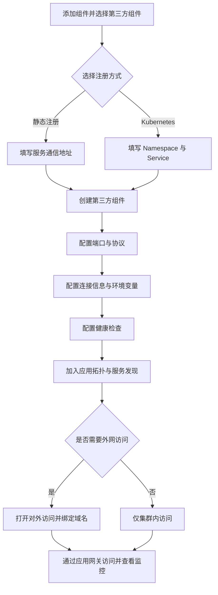

## 概述

运行于 KDO 集群之外，运行生命周期不受 KDO 管理，且在网络上能够与 KDO 集群通信的服务称为第三方服务。例如单独运行的 Oracle 服务，或运行于 Windows 服务器的.net 服务等。

KDO 支持第三方服务管理的初衷是为了解决企业在使用 KDO 落地过程中遇到的两类主要问题：迁移过程中的集群内外服务共存和未迁移服务与 KDO 上服务的统一管理与通信。

1. 循序渐进的迁移策略：在服务迁移到 KDO 平台时，常常需要与未迁移的遗留服务通信和统一管理。KDO 以应用和服务为核心，提供服务注册和发现机制，但过去的版本中无法很好地支持未迁移的外部服务。为了实现逐步迁移的策略，KDO 致力于通过环境变量和统一管理功能来简化配置管理和服务通信，使得新旧服务可以共存并高效协作。

2. 共享外网端口与域名：KDO 的应用网关提供了强大的外网服务能力，但过去未迁移的服务无法直接使用这些功能，用户不得不在网关前额外添加一层 nginx，增加了配置复杂性。通过支持第三方服务管理，KDO 旨在让遗留服务也可以共享其网关的外网功能，减少配置复杂性，并享受域名访问监控等开箱即用的能力。

## 第三方服务接入流程

第三方服务不经过镜像构建，注册后直接以地址或 Kubernetes Service 的形式加入应用的服务发现与网关体系。



## 创建第三方服务

### 静态注册

在 **应用视图 -> 添加组件 -> 第三方组件** 中，选择服务注册方式为静态注册，
1. 填写服务的通信地址如 `192.168.1.1:8080` 
2. 创建组件

进入组件详情页，配置端口、连接信息、健康检查属性等。

### Kubernetes

在 **应用视图 -> 添加组件 -> 第三方组件** 中，选择服务注册方式为 `Kubernetes`，
1. 填写 `Namespace` ，默认为当前项目所在 `Namespace`
2. 填写 `Service` ，`Service` 应属于上边填写的 `Namespace`
3. 创建组件

进入组件详情页，配置端口、连接信息、健康检查属性等。

## 示例

使用第三方服务代理 KDO 控制台，通过域名访问 KDO 控制台。

在 **应用视图 -> 添加组件 -> 第三方组件** 中，选择服务注册方式为静态注册，
1. 填写服务的通信地址如 `192.168.1.1:7070` 
2. 创建组件

进入组件详情页，配置端口协议为 `HTTP`，端口号为 `7070`，打开对外访问，即可通过域名访问 KDO 控制台。

## 注册方式对比

| 方式 | 适用场景 | 需要填写 | 特点 |
|------|----------|----------|------|
| 静态注册 | 外部 IP、域名、物理机服务 | 服务地址和端口 | 不依赖 Kubernetes Service，直接指向外部地址 |
| Kubernetes | 同一或相邻集群内的 Service | Namespace、Service、端口 | 复用 Service 发现和 Endpoints，适合集群内遗留服务 |

## 配置连接信息

创建第三方组件后，可在组件详情中配置：

- **端口与协议**：HTTP、HTTPS、TCP、gRPC 等，需与后端实际监听一致。
- **环境变量**：把服务地址、端口、用户名等注入到关联应用。
- **连接信息**：数据库连接串、访问密钥等。
- **健康检查**：HTTP 路径、TCP 端口或命令，用于判断服务是否可用。

敏感信息应通过 [保密字典（Secret）](/docs/developer/configuration/secrets/) 注入，不要直接写在环境变量明文或应用代码中。

## 验证连通性

静态注册时，可从同一命名空间的 Pod 内验证：

```bash
curl -vk https://192.168.1.10:8443/health
nc -zv 192.168.1.10 8443
```

Kubernetes 注册时，先确认 Service 和 Endpoints：

```bash
kubectl get svc,endpoints -n <namespace>
```

如果 Endpoints 为空，说明 Service 选择器没有匹配到后端 Pod。

## 常见问题

### Q: 应用无法访问第三方服务

依次检查 DNS 解析、网络策略、防火墙、服务端口和目标地址。跨集群访问时还要确认路由和出口策略。

### Q: 健康检查一直失败

确认健康检查协议、路径、端口和返回码与后端一致。HTTPS 服务使用自签证书时，需要确认平台是否校验证书。

### Q: 通过域名访问返回 502

通常是端口或协议配置错误，或第三方服务没有监听对应地址。先在同命名空间 Pod 内用 `curl` 验证，再检查网关配置。

### Q: 修改连接信息后应用没有生效

环境变量通常在 Pod 重建后生效。修改后重启关联工作负载，或使用配置挂载方式让应用重新加载。

## 安全与网络注意事项

- 尽量使用 HTTPS 或内网专线，避免明文传输凭据。
- 通过 NetworkPolicy 限制哪些命名空间可以访问第三方地址。
- 不要将数据库、管理端口直接暴露到公网。
- 第三方服务不在 KDO 生命周期内，升级和备份需由对应团队负责。
- 对外访问时只开放必要端口，并配置域名和证书。

## 相关文档

- [服务（Service）](/docs/developer/network-storage/service/)
- [路由（Ingress）](/docs/developer/network-storage/ingress/)
- [配置映射（ConfigMap）](/docs/developer/configuration/configmaps/)
- [保密字典（Secret）](/docs/developer/configuration/secrets/)
