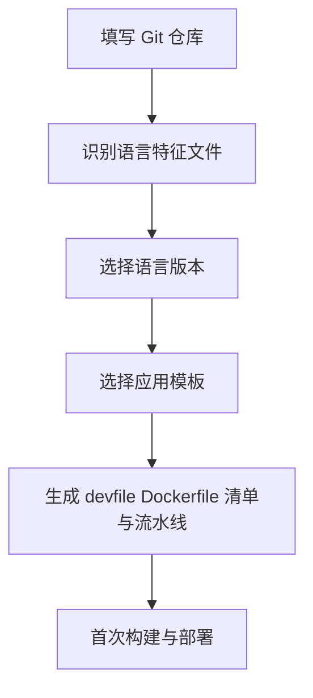

KDO 当前不再以“应用市场 + 应用模板 + 团队”作为主交付流程。应用复用主要通过**语言应用模板**、**Git 仓库模板**和 **Helm Chart** 完成。

## 三种复用方式

| 方式 | 复用内容 | 适用场景 | 入口 |
|---|---|---|---|
| 语言应用模板 | 构建任务、运行镜像、默认端口、启动命令 | 新建同语言应用 | 创建 Git 应用时选择语言、版本和模板 |
| Git 仓库模板 | 目录结构、Dockerfile、部署清单、流水线定义 | 团队统一工程规范 | 从模板仓库 fork 或复制 |
| Helm Chart | Deployment、Service、Ingress、配置和依赖 | 复杂应用、多环境部署 | 应用管理 → Helm |

## 语言应用模板

创建 Git 应用时，平台会根据仓库特征文件识别语言，并自动选择可用模板：



模板决定：

- 使用哪个构建镜像和构建命令。
- 默认应用端口和启动命令。
- 生成哪些 Kubernetes 清单。
- 默认流水线包含哪些 Task。

模板只提供默认值。需要调整依赖源、编译参数、JVM 参数或启动命令时，进入 **分支流水线 → 流水线编辑** 修改对应 Task，而不是修改模板本身。

## Git 仓库模板

适合团队统一以下内容：

- `Dockerfile` 和 `.dockerignore`
- `kubernetes/deploy-*.yaml`
- `.tekton/*.yaml`
- `.gitignore`、README、代码规范配置

推荐做法：

1. 维护一个独立的模板仓库。
2. 新项目从模板仓库创建，保留历史记录。
3. 模板升级通过合并或 cherry-pick 进入业务仓库。
4. 不要在每个业务仓库里复制一份长期不维护的流水线。

## Helm Chart 复用

Helm 适合复用一整套 Kubernetes 资源，而不是只复用构建模板。

```text
my-chart/
├── Chart.yaml
├── values.yaml
├── values-dev.yaml
├── values-prod.yaml
└── templates/
    ├── deployment.yaml
    ├── service.yaml
    └── ingress.yaml
```

使用方式：

1. 在 **应用管理 → Helm** 中创建 Helm 应用。
2. 选择 Chart 来源：仓库、上传或 Git。
3. 为不同环境选择不同 values 文件。
4. 通过升级、回滚管理版本。

环境差异放在 values 中，敏感信息放 Secret，不要写进 Chart。

## 从早期应用市场迁移

如果仍然看到“应用市场”“本地组件库”“团队”等入口，说明当前环境可能仍保留了旧版本能力。迁移时按以下方式对应：

| 早期概念 | 当前做法 |
|---|---|
| 应用市场 | 使用 Git 应用或 Helm 应用 |
| 应用模板 | 语言应用模板或 Helm Chart |
| 团队 | 应用项目 + 项目环境 |
| 发布到组件库 | 推送镜像 + GitOps 写回 |
| Release 标记 | 受保护分支 + 发布审批 + 发布历史 |
| 升级记录回滚 | 分支流水线 → 发布历史 |

旧流程中的“一键安装到团队”不再作为推荐路径。新项目应直接使用应用项目和项目环境。

## 常见问题

### Q: 语言模板可以修改吗？

可以修改生成的流水线，但不建议直接改平台内置模板。把团队差异放到仓库中的 `.tekton` 或流水线编辑器中，便于审查和回滚。

### Q: 应用模板能保存运行中的配置吗？

不能。模板只保存构建和部署的默认定义。运行中的副本数、环境变量、配置和 Secret 由目标环境管理。

### Q: 多环境应该用应用模板还是 Helm？

如果只是同一镜像加不同配置，用分支流水线 + ConfigMap/Secret 即可。如果包含多个 Kubernetes 对象、依赖 Chart 或需要版本化打包，使用 Helm。

### Q: 旧应用市场里的模板还能用吗？

取决于当前版本是否仍保留该入口。建议把模板内容迁移为 Git 仓库模板或 Helm Chart，避免依赖已下线能力。

## 相关文档

- [创建 Git 应用](/docs/developer/applications/git/)
- [语言应用模板](/docs/developer/applications/languages/)
- [Helm 应用](/docs/developer/applications/helm/)
- [多环境持续交付](/docs/developer/best-practices/continuous-delivery/multi-env/)
- [源码持续交付](/docs/developer/best-practices/continuous-delivery/source-code/)
- [项目管理](/docs/developer/projects/)
