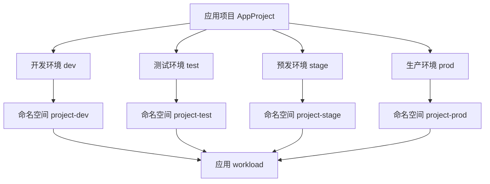
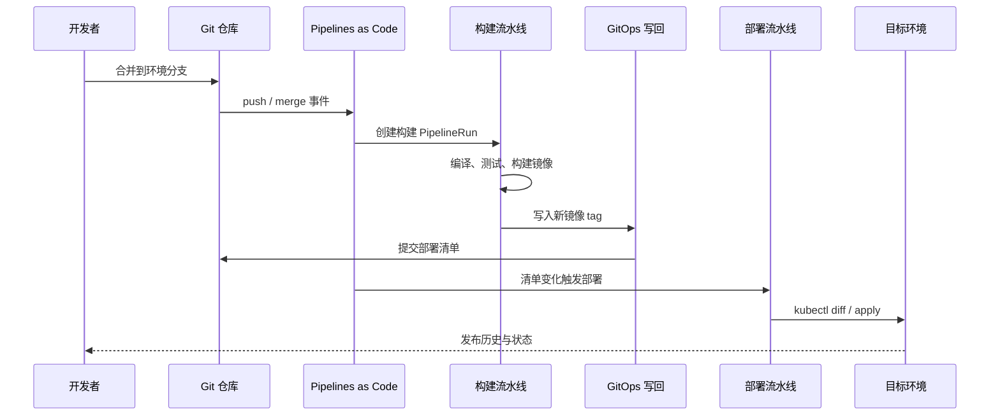

多环境交付的核心不是复制多套应用，而是让**同一份代码**经过不同的环境配置和发布策略，逐级验证后进入生产。KDO 通过应用项目、项目环境、分支流水线和 GitOps 写回把这些环节串起来。

## 适用场景

- 一个应用需要 dev、test、stage、prod 多个环境。
- 不同环境使用不同集群、命名空间、副本数、域名或中间件地址。
- 生产发布需要审批、灰度或可回滚。
- 希望代码合并到指定分支后自动部署对应环境。

## 环境模型

每个环境对应一个 Kubernetes 命名空间，通常命名为 `{project}-{env}`。应用通过分支流水线绑定到环境，构建产物写入该环境的部署清单，再由部署流水线应用到目标集群。

## 推荐分支策略

| 环境 | 推荐分支 | 触发方式 | 说明 |
|---|---|---|---|
| dev | `develop` | push 自动触发 | 开发联调，允许频繁发布 |
| test | `testing` | 合并后自动触发 | 功能测试和集成测试 |
| stage | `release/*` | 合并或手动触发 | 接近生产配置，用于验收 |
| prod | `main` / `master` | 合并后自动触发或人工审批 | 只接受已验证版本 |

分支策略不是固定的。团队规模较小时，也可以让一个分支部署到多个环境，但生产环境仍建议保留独立的分支或人工确认。

## 交付流程

## 配置多环境

### 1. 创建项目和环境

管理员在 **管理 → 命名空间 / 应用项目** 中创建应用项目，并为项目创建 dev、test、stage、prod 环境。环境创建后会生成对应命名空间和资源配额。

### 2. 创建 Git 应用

在 **开发 → 应用管理 → 应用** 中创建 Git 应用，选择目标应用项目。平台会根据仓库语言生成 `devfile.yaml`、`Dockerfile`、`kubernetes/deploy-*.yaml` 和 `.tekton` 流水线定义。

### 3. 配置分支流水线

进入应用的 **分支流水线**，为每个环境添加一条流水线：

| 字段 | 示例 |
|---|---|
| 环境 | `test` |
| 集群 | `prod-cluster` |
| 分支 | `testing` |
| 流水线模板 | 对应语言的构建模板 |
| 自动触发 | 开启 |

一个分支可以部署到多个环境，一个环境也可以接收多个分支，但生产环境建议只绑定一个受保护分支。

### 4. 配置环境差异

不要把环境差异写死在镜像里。推荐按环境拆分：

- **ConfigMap**：普通配置，如日志级别、功能开关。
- **Secret**：数据库密码、Token、证书。
- **Helm values**：使用 Helm 部署时，为每个环境维护独立 values 文件。
- **镜像 tag**：由流水线写回，不在部署清单中手工修改。

### 5. 发布与验证

1. 合并代码到 `testing`，触发测试环境构建。
2. 在 **流水线运行** 中确认构建和部署成功。
3. 在环境概览中检查工作负载、事件、日志和监控。
4. 验证通过后，合并到 `release/*` 或 `main`，进入预发/生产。
5. 生产发布后检查发布历史和关键指标。

### 6. 回滚

在应用的 **分支流水线 → 发布历史** 中选择目标环境的历史版本，回滚到指定镜像 tag。回滚只影响当前环境，不会修改其他环境。

## 权限与审批

- 开发人员通常只拥有 dev/test 环境权限。
- stage/prod 通过项目成员角色或独立审批控制。
- 生产环境建议关闭普通成员的直接部署权限，只允许流水线 ServiceAccount 执行。
- 关键环境可以增加人工审批 Task，审批通过后继续部署。

## 常见问题

### Q: 同一个分支可以部署到多个环境吗？

可以。为同一分支创建多条分支流水线，分别选择不同环境和集群。配置差异通过 ConfigMap、Secret 或 Helm values 区分。

### Q: 环境之间如何共享镜像？

构建流水线把镜像推送到统一 Harbor 项目，目标环境只拉取镜像。跨集群时，确保每个集群都能访问该 Harbor，并配置正确的镜像拉取 Secret。

### Q: 回滚后发现仍是新版本？

检查是否有其他流水线、HPA 或 GitOps 控制器在覆盖镜像或副本数。回滚后确认发布历史和部署清单都已更新。

### Q: 生产环境可以只手动发布吗？

可以。关闭分支流水线的自动触发，保留手动运行；或在流水线中增加审批 Task。手动运行仍会生成完整的 PipelineRun 和发布记录。

## 相关文档

- [项目管理](/docs/developer/projects/)
- [创建 Git 应用](/docs/developer/applications/git/)
- [源码持续交付](/docs/developer/best-practices/continuous-delivery/source-code/)
- [流水线](/docs/developer/delivery/pipelines/)
- [Pipelines as Code](/docs/developer/delivery/pac/)
- [发布历史与回滚](/docs/developer/applications/git/#发布历史与回滚)
- [应用模板与复用](/docs/developer/best-practices/continuous-delivery/application-templates/)
