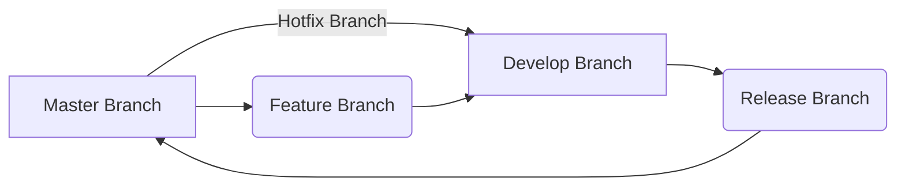

上级：[分支策略与协作规范](/docs/developer/best-practices/gitflow/)

## Git Flow

Git Flow 是 Vincent Driessen 于 2010 年提出的分支模型。它基于两个长期分支（`master` 和 `develop`），并引入了多个短期分支用于不同的开发任务。

**主要分支：**
- `master` 分支：生产环境的主分支，始终保持可发布的状态。
- `develop` 分支：开发分支，所有新功能的开发都会在此分支进行。

**短期分支：**
- `feature` 分支：用于开发新功能，通常从 `develop` 分支创建，完成后合并回 `develop`。
- `release` 分支：在发布前创建的分支，主要用于准备发布版本，进行最后的测试和修复。
- `hotfix` 分支：用于紧急修复生产环境的问题，直接从 `master` 创建并最终合并回 `master` 和 `develop`。

**Git Flow 流程图：**



**示例代码：**
假设我们需要为项目开发一个新功能，使用 `Git Flow` 创建 `feature` 分支并完成开发：

```shell
# 切换到 develop 分支并确保最新
git checkout develop
git pull origin develop

# 创建一个新功能分支
git checkout -b feature/new-feature

# 开发新功能
# git add 和 git commit 提交代码

# 完成后，合并回 develop 分支
git checkout develop
git merge feature/new-feature

# 删除 feature 分支
git branch -d feature/new-feature
```

**优点：**
- 清晰的结构，适用于较大团队和发布频率较低的项目。
- 明确的发布准备阶段（`release` 分支）和紧急修复通道（`hotfix` 分支）。

**缺点：**
- 分支管理较为复杂，适合中大型项目，不适合需要频繁发布的小型项目。

## Git Flow 的最佳实践

Git Flow 的分支管理较为复杂，但它在处理大型项目和有明确发布周期的项目中非常有效。以下是 Git Flow 中一些行之有效的实践方法，帮助团队优化开发流程。

### 1. 合理使用 `feature` 分支
在 Git Flow 中，`feature` 分支用于新功能开发，分支命名应清晰、易于识别。团队可以使用带有功能描述的分支名称，并在开发结束后及时删除以保持代码库的整洁。

```shell
# 创建 feature 分支，命名清晰
git checkout develop
git checkout -b feature/user-authentication

# 开发功能
# 提交代码

# 合并完成后删除分支
git checkout develop
git merge feature/user-authentication
git branch -d feature/user-authentication
```

#### 2. 严格的发布流程
Git Flow 的一个核心优势在于 `release` 分支。通过在发布前创建 `release` 分支，团队可以专注于修复 bug 和测试，而不再添加新的功能，从而确保发布的稳定性。

```shell
# 从 develop 创建 release 分支
git checkout develop
git checkout -b release/1.0.0

# 进行最后的 bug 修复和优化

# 测试完成后合并回 master 和 develop
git checkout master
git merge release/1.0.0
git checkout develop
git merge release/1.0.0

# 删除 release 分支
git branch -d release/1.0.0
```

### 3. `hotfix` 分支的紧急修复

生产环境遇到紧急问题时，可以直接从 `master` 分支创建 `hotfix` 分支，进行快速修复后立即发布。


```shell
# 从 master 创建 hotfix 分支
git checkout master
git checkout -b hotfix/critical-bugfix

# 修复问题并提交
# git add 和 git commit

# 修复后合并回 master 和 develop
git checkout master
git merge hotfix/critical-bugfix
git checkout develop
git merge hotfix/critical-bugfix

# 删除 hotfix 分支
git branch -d hotfix/critical-bugfix
```

这种紧急修复策略保证了项目的灵活性，确保团队能迅速响应生产问题。

### 4. 自动化测试和持续集成
无论是 Git Flow 还是其他分支策略，自动化测试和持续集成都非常重要。在 Git Flow 中，可以为 `develop` 分支设置自动化测试，确保功能开发期间代码的稳定性，同时为 `release` 和 `master` 分支设置严格的测试与部署流水线。

```yaml
# Jenkinsfile 示例
pipeline {
    agent any
    stages {
        stage('Test on Develop') {
            when {
                branch 'develop'
            }
            steps {
                sh 'make test'
            }
        }
        stage('Deploy on Master') {
            when {
                branch 'master'
            }
            steps {
                sh 'make deploy'
            }
        }
    }
}
```


自动化测试与持续集成可以减少人为错误，并提高开发流程的效率。
