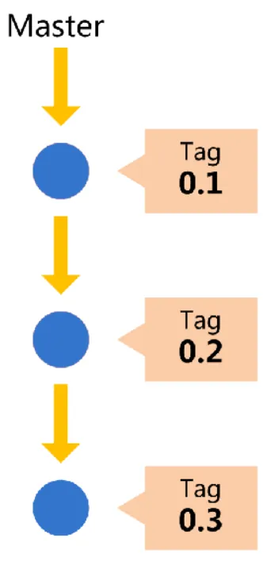

上级：[分支策略与协作规范](/docs/developer/best-practices/gitflow/)

## GitHub Flow

GitHub Flow 是 GitHub 提出的轻量化分支模型，主要适用于需要持续集成和持续交付（CI/CD）的团队。它的主要原则是保持 `main` 分支（或 `master` 分支）始终可发布。

**GitHub Flow 的特点：**
- 只有一个长期分支，即 `main` 分支。
- 所有功能和修复都通过创建分支进行开发，并通过 `Pull Request` 进行代码审查和合并。
- 功能完成并通过测试后，直接合并回 `main` 分支并自动部署。
<div align=center>

</div>

**示例代码：**

假设我们使用 GitHub Flow 开发一个新功能：

```shell
# 切换到 main 分支并确保最新
git checkout main
git pull origin main

# 创建一个新功能分支
git checkout -b new-feature

# 开发新功能
# git add 和 git commit 提交代码

# 提交 Pull Request 进行代码审查

# 合并 Pull Request 后，删除本地分支
git checkout main
git pull origin main
git branch -d new-feature
```

**优点：**
- 简单易用，适合小型团队和需要频繁发布的项目。
- 持续交付友好，每次合并都会触发自动部署。

**缺点：**
- 缺乏发布准备阶段，可能不适合复杂的项目。
- 适合 CI/CD 集成度高的项目，但对于大团队可能略显简单。

## GitHub Flow 的最佳实践

GitHub Flow 是一个轻量化的流程，适合频繁发布的小型团队。虽然流程简单，但也有一些关键的最佳实践可以帮助团队最大化利用这一策略。

### 1. 保持 `main` 分支的清洁
GitHub Flow 的核心是保持 `main` 分支始终可发布。因此，团队应确保 `main` 分支上的代码质量，并在每次合并前通过代码审查与自动化测试来确保稳定性。

```shell
# 在本地更新 main 分支
git checkout main
git pull origin main

# 确保代码可以发布
```

### 2. 小步快跑
GitHub Flow 倡导通过小步提交和频繁合并来保持项目的快速迭代。团队应避免大型功能一次性开发完成后再合并，而是应将功能拆分为多个小任务，分别开发并逐步合并。


```shell
# 开发小功能分支
git checkout -b feature/small-task

# 完成小功能并合并回 main
git checkout main
git merge feature/small-task
```

### 3. Pull Request 的高效使用
在 GitHub Flow 中，所有代码的变更都应通过 Pull Request 进行合并。Pull Request 不仅是代码审查的工具，也是团队沟通和协作的重要方式。


```shell
# 创建 Pull Request 并请求代码审查
git push origin feature/new-feature
# 在 GitHub 上提交 PR，等待审查和反馈
```

通过 Pull Request，团队可以保持代码库的高质量，同时确保每个成员都了解最新的代码变更。

### 4. 自动化部署
由于 GitHub Flow 通常用于持续集成和持续交付，自动化部署是一个关键环节。团队可以通过 CI/CD 管道在每次合并到 `main` 分支时自动部署新版本。

```yaml
# GitLab CI 配置
deploy:
  script:
    - make deploy
  only:
    - main
```

这样可以确保每次合并到 `main` 分支时，代码立即部署到生产环境，减少人工发布带来的风险。
