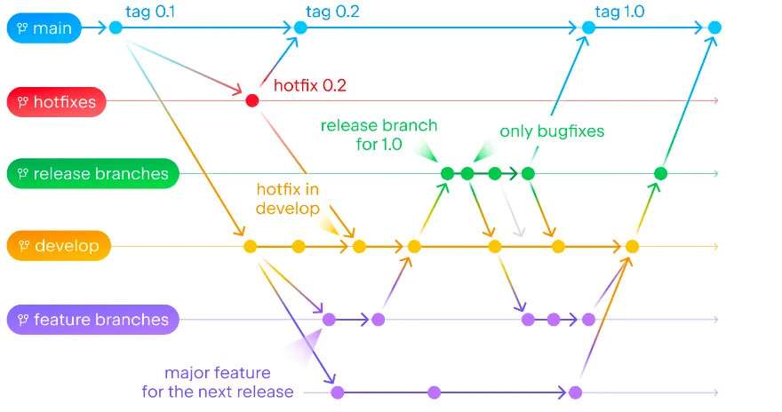

## 介绍

:::note

在现代软件开发中，特别是多人协作的开发环境中，选择适合的 Git 分支策略对项目的成功至关重要。
不同的团队规模、项目复杂度和发布频率都可能需要不同的分支策略。
常见的 Git 分支策略包括 [Git Flow](#1-git-flow)、[GitHub Flow](#2-github-flow) 和 [Trunk Based Development (主干开发)](#3-trunk-based-development-主干开发)。
本文将深入分析这些分支策略的优缺点，并探讨如何根据团队规模和项目需求选择合适的工作流程。
我们还通过KDO平台和对应的 Git 分支策略进行结，同时，我们将提供相应的代码示例和最佳实践，帮助团队避免常见的协作问题。

:::

## 三种分支策略

| 策略 | 适用场景 | 发布节奏 | 复杂度 |
|---|---|---|---|
| Git Flow | 多版本并行、正式发布周期长 | 按 release 分支发布 | 高 |
| GitHub Flow | 持续部署、单一主分支 | 合并即发布 | 低 |
| Trunk Based Development | 高频集成、强自动化测试 | 持续发布 | 中 |

### Git Flow

适合有明确版本发布周期、需要同时维护多个版本的团队。

- [Git Flow 分支模型与最佳实践](/docs/developer/best-practices/gitflow/git-flow/)

### GitHub Flow

适合以 `main` 为唯一长期分支、合并后立即部署的团队。

- [GitHub Flow 分支模型与最佳实践](/docs/developer/best-practices/gitflow/github-flow/)

### Trunk Based Development（主干开发）

适合高频提交、依赖自动化测试和特性开关的团队。

- [Trunk Based Development 与最佳实践](/docs/developer/best-practices/gitflow/trunk-based/)

## 如何选择分支策略

### 根据团队规模
- **小团队（1-5人）：** 推荐使用 `GitHub Flow` 或 `Trunk Based Development`。这些策略简洁易用，分支管理成本低，非常适合小团队的快速迭代。
- **中型团队（5-20人）：** 推荐使用 `Git Flow`，因为它提供了明确的功能开发、测试、发布流程，适合有明确发布计划的中型项目。
- **大型团队（20+人）：** 推荐使用 `Git Flow` 或主干开发。`Git Flow` 适合有明确发布周期的大型团队，而主干开发则适合自动化测试和持续交付非常成熟的团队。

### 根据项目需求
- **持续集成项目：** 如果项目需要频繁发布并且已经集成了 CI/CD 系统，推荐使用 `GitHub Flow` 或 `Trunk Based Development`。它们支持快速迭代和自动部署。 
- **复杂项目：** 对于具有多个发布阶段或功能复杂度较高的项目，`Git Flow` 提供了更加详细的分支管理，有助于确保项目的稳定性。

### 根据发布频率
- **频繁发布：** 对于每日、每周频繁发布的项目，推荐使用 `GitHub Flow` 或 `Trunk Based Development`。
- **较长发布周期：** 对于有明确的发布周期，且每次发布包含多个功能的项目，推荐使用 `Git Flow`。

## 通用最佳实践
1. **持续集成：** 无论选择哪种分支策略，持续集成（CI）都是保证代码质量的关键。建议在每次提交代码时自动运行测试。
2. **代码审查：** 通过 Pull Request 进行代码审查可以减少错误和提升代码质量，特别是在多人协作开发时。
3. **自动化部署：** 对于使用 `GitHub Flow` 或 `Trunk Based Development` 的团队，自动化部署可以大大减少发布风险。

## 总结
不同的 Git 分支策略适合不同规模的团队和项目需求。通过分析 Git Flow、GitHub Flow 和 Trunk Based Development 这三种常见的工作流程，可以看到每种策略各有优缺点。在选择适合团队的分支策略时，应考虑以下因素：

1. **团队规模：** 小团队可以选择 GitHub Flow 这样简单且高效的工作流程，大团队可能更倾向于使用 Git Flow 来应对复杂的功能和发布需求。
2. **发布频率：** 如果项目需要频繁发布和快速响应问题，Trunk Based Development 或 GitHub Flow 可能更合适。而有明确发布周期的项目，Git Flow 则能很好地管理版本和发布流程。
3. **自动化工具的支持：** 无论选择哪种分支策略，持续集成、自动化测试和部署工具都是提高效率和减少错误的重要保障。选择适合团队的自动化工具，并构建相应的管道，是确保分支策略成功实施的关键。

### 最佳实践总结
1. **Git Flow：** 适合大型项目和团队，注重稳定地发布流程，但分支管理较为复杂。
2. **GitHub Flow：** 轻量、灵活，适合小型团队和快速发布的项目，但要求高效的自动化测试和部署。
3. **Trunk Based Development：** 通过频繁集成和短期分支加速开发节奏，适合快速迭代的项目，特别需要强大的自动化测试和持续交付工具的支持。

根据项目的复杂性、团队的协作习惯、发布周期和工具支持，选择最适合的 Git 分支策略，能够显著提高开发效率，减少合并冲突，确保代码质量和发布稳定性。
无论选择哪种策略，关键在于团队的执行力和流程的规范化。团队应根据实际需求不断调整和优化工作流程，确保分支策略与项目发展相适应。

### 代码库管理的未来方向
随着 DevOps 和自动化技术的发展，未来的代码库管理可能会进一步自动化和智能化。团队可以借助 AI 驱动的工具来优化代码合并、冲突解决和自动化测试流程，减少人工干预，提升效率。
此外，像 GitOps 这样的新兴策略也将进一步推动代码管理与基础设施自动化的深度结合，帮助团队在更大规模、更复杂的环境中保持代码的高质量和可持续交付。
在选择分支策略时，不仅要考虑当前的需求，还要关注技术发展趋势和团队未来的扩展性，以确保开发流程能够持续支持项目的长期成功。
