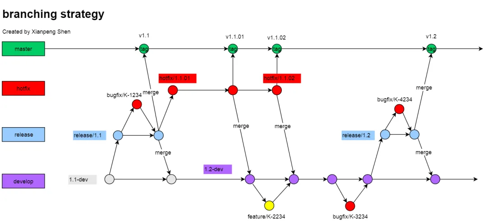
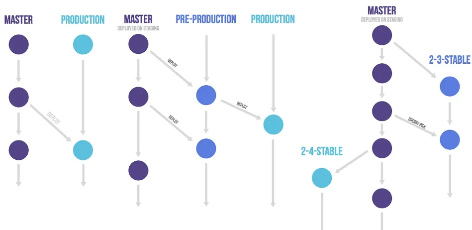
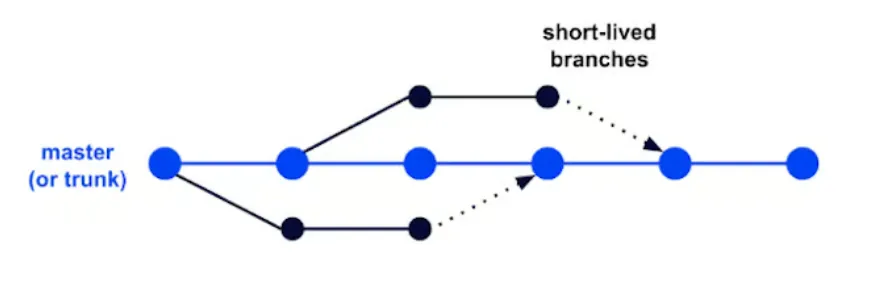

上级：[分支策略与协作规范](/docs/developer/best-practices/gitflow/)

## Trunk Based Development

Trunk Based Development 是一种更为简单、激进的分支策略，开发人员尽量将所有代码直接提交到 `main`（或 `trunk`）分支，避免长期的分支开发。开发人员通过频繁的小规模提交和自动化测试确保代码质量。

**Trunk Based Development 的特点：**
- 代码频繁提交到 `main` 分支。
- 短期开发分支（如 `feature` 分支）存在时间非常短，通常只存在几小时到几天。
- 需要强大的自动化测试体系和严格的代码审查流程。

**示例代码：**
在主干开发中，开发人员直接在主分支上进行小的功能迭代：

```shell
# 切换到 main 分支并确保最新
git checkout main
git pull origin main

# 创建一个短期开发分支
git checkout -b short-feature

# 开发小功能或修复
# git add 和 git commit 提交代码

# 迅速合并回 main 分支
git checkout main
git merge short-feature

# 删除分支
git branch -d short-feature
```

**优点：**
- 极简分支模型，适合需要频繁集成的小团队。
- 强调持续集成，代码提交频率高，有助于保持项目的高迭代速度。

**缺点：**
- 对代码质量和自动化测试要求极高，适合经验丰富的团队。
- 如果没有良好的测试和审查机制，容易引入问题。

<div align=center>

</div>

## Trunk Based Development 的最佳实践

虽然 Trunk Based Development 是一种相对简单的分支策略，但它依赖于高效的流程和工具支持。
下面介绍一些具体的最佳实践，帮助团队在采用该策略时确保代码质量和开发速度。

### 1. 频繁集成和快速提交

在 Trunk Based Development 中，开发人员应尽量保持频繁的小规模提交，而不是等待功能完全开发完成后才提交。这种方式可以减少合并冲突，并确保代码库始终保持最新状态。

```shell
# 切换到短期开发分支
git checkout -b short-lived-feature

# 开发小功能
# 提交时可以只提交完成的部分代码
git add .
git commit -m "Partial implementation of feature X"

# 频繁合并到 main 分支
git checkout main
git pull origin main
git merge short-lived-feature

# 删除短期分支
git branch -d short-lived-feature
```

### 2. 自动化测试

为了确保频繁提交的代码不会引入错误，团队应构建强大的自动化测试体系。在每次提交代码时，自动化测试应该立即运行。Jenkins、CircleCI 等持续集成工具可以帮助团队实现这一点。

```yaml
# 示例 Jenkinsfile 配置
pipeline {
    agent any
    stages {
        stage('Build') {
            steps {
                sh 'make build'
            }
        }
        stage('Test') {
            steps {
                sh 'make test'
            }
        }
    }
}
```

在这种开发模式下，任何失败的测试都应该立即修复，避免问题积累。

<div align=center>

</div>

### 3. 特性开关（Feature Toggles）

为了避免未完成的功能影响生产环境，Trunk Based Development 鼓励使用特性开关（Feature Toggles）。通过这种技术，开发人员可以将未完成的代码合并到主干，但不影响用户体验。

```python
# 示例特性开关代码
def new_feature_enabled():
    return os.getenv("NEW_FEATURE_FLAG") == "true"

def main_logic():
    if new_feature_enabled():
        print("New feature is enabled!")
    else:
        print("Running old logic.")

# 设置环境变量以启用或禁用新功能
# export NEW_FEATURE_FLAG=true
```

通过控制特性开关，团队可以在不破坏现有功能的前提下快速发布新代码。

### 4. 代码审查

尽管 Trunk Based Development 提倡频繁提交，团队仍需通过 Pull Request 或代码审查机制来确保代码质量。代码审查不仅有助于发现潜在问题，还能提升团队成员的代码质量意识。

```shell
# 在开发分支上创建 Pull Request
git checkout -b short-feature
# 提交代码并创建 PR 供团队审查
git push origin short-feature
# 在 GitHub 上创建 Pull Request，等待其他开发人员的反馈
```

代码审查不应阻碍频繁集成，而是确保在小范围内对代码进行有效验证。

### 5. 持续交付
Trunk Based Development 的一个核心思想是尽量保持主分支始终可部署。因此，团队应搭建自动化部署管道，在合并到 `main` 分支后，立即部署到测试或生产环境。

以下是基于 GitLab CI 的持续交付配置示例：

```shell
stages:
  - build
  - test
  - deploy

build:
  script:
    - make build

test:
  script:
    - make test

deploy:
  script:
    - make deploy
  only:
    - main
```

在合并代码后，系统会自动运行构建、测试、部署流程，确保主分支始终保持稳定且可用。

<div align=center>

</div>
