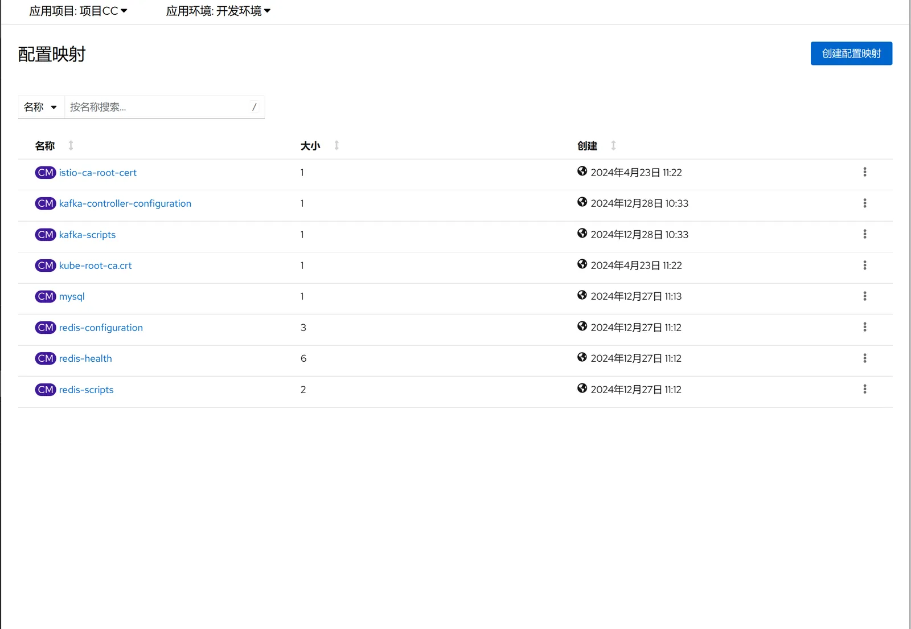
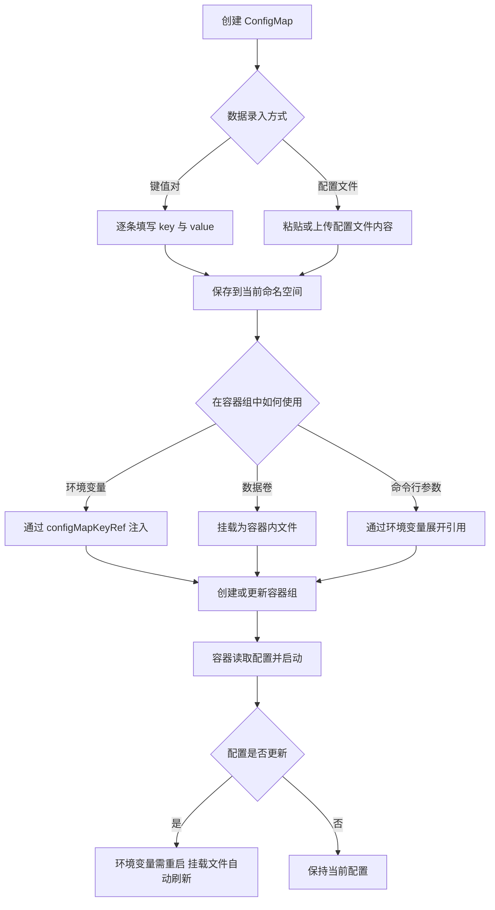
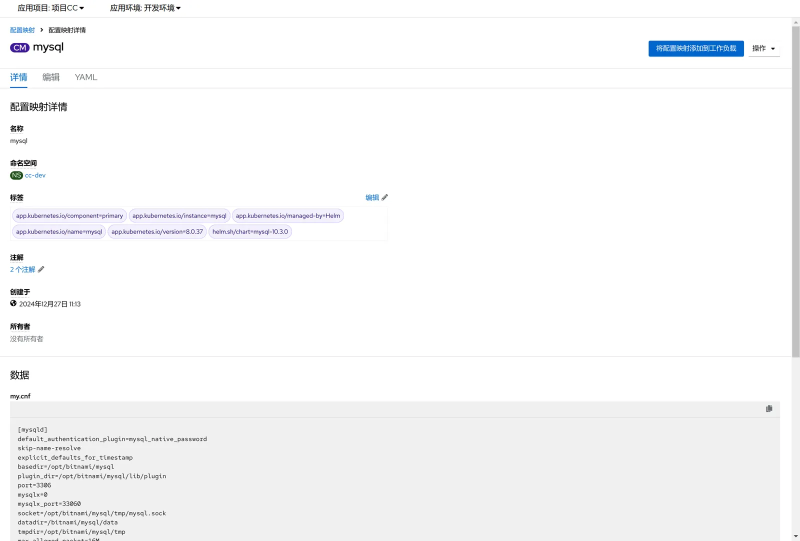
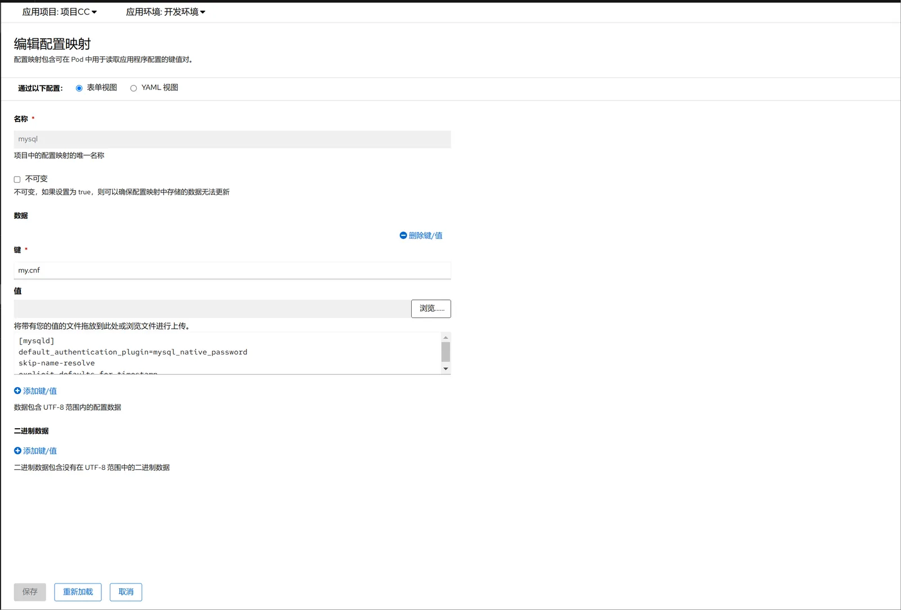
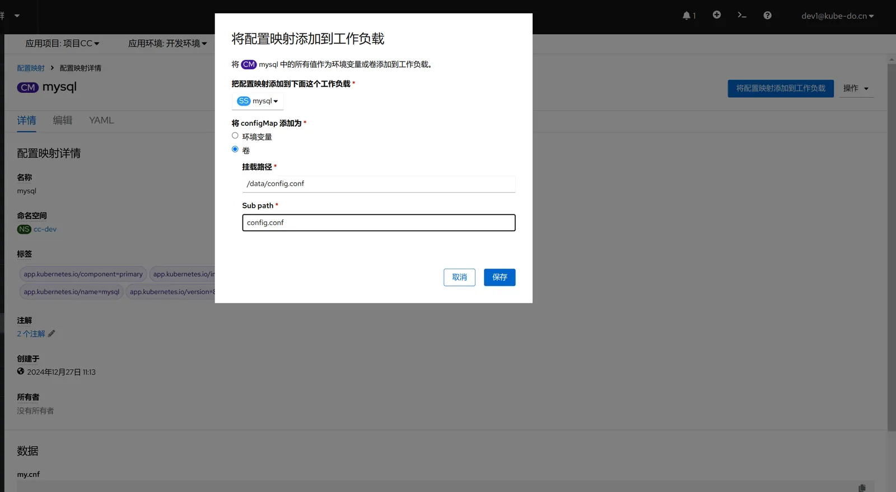

## 介绍

:::note

`配置映射(ConfigMap)` 是一种API对象，用于以键值对的形式存储非敏感数据。它可以在容器组中作为环境变量、命令行参数或存储卷内的配置文件使用，从而便于应用程序的配置管理。
`配置映射(ConfigMap)`能够将环境配置信息与容器镜像分离，从而简化应用配置的修改和管理。通过这种方式，不仅可以灵活调整配置参数，还能够在不影响容器镜像的情况下快速响应变化的需求。

:::



:::warning

`配置映射(ConfigMap)` 并不提供保密或者加密功能。如果你想存储的数据是机密的，请使用[保密字典(Secret)](/docs/developer/configuration/secrets/)， 或者使用其他第三方工具来保证你的数据的私密性，而不是用`配置映射(ConfigMap)`。

:::

## 使用流程



## 查看配置映射


## 编辑配置映射

:::note

`配置映射(ConfigMap)`采用键值对的形式存储数据，提供了灵活的管理方式，您既可以通过直观的图形界面进行编辑，也可以利用YAML文件的形式来进行配置。

:::




## 使用配置映射

:::note

`配置映射(ConfigMap)`可以作为数据卷挂载。`配置映射(ConfigMap)`也可被系统的其他组件使用， 而不一定直接暴露给容器组。
例如，`配置映射(ConfigMap)`可以保存系统中其他组件要使用的配置数据。`配置映射(ConfigMap)`最常见的用法是为同一命名空间里某容器组中运行的容器执行配置。 你也可以单独使用`配置映射(ConfigMap)`。

:::



## 创建配置映射

### 通过控制台

1. 进入目标项目和环境。
2. 打开 **配置管理 → 配置映射**，点击 **创建配置映射**。
3. 选择键值对或配置文件方式录入数据。
4. 保存后，在配置映射详情中确认键值内容。

### 通过 YAML

```yaml
apiVersion: v1
kind: ConfigMap
metadata:
  name: app-config
  namespace: demo-dev
data:
  LOG_LEVEL: info
  APP_MODE: production
  application.yaml: |
    server:
      port: 8080
    feature:
      enabled: true
```

`data` 中的值必须是字符串。多行配置文件可以作为单个键的值保存。

## 在容器组中使用

### 注入环境变量

```yaml
envFrom:
  - configMapRef:
      name: app-config
```

也可以只注入单个键：

```yaml
env:
  - name: LOG_LEVEL
    valueFrom:
      configMapKeyRef:
        name: app-config
        key: LOG_LEVEL
```

### 挂载为文件

```yaml
volumes:
  - name: app-config
    configMap:
      name: app-config
containers:
  - name: app
    volumeMounts:
      - name: app-config
        mountPath: /etc/app
```

挂载后，`data` 中的每个键会变成文件。使用 `items` 可以只挂载指定键并重命名文件。

## 更新与生效

- **环境变量**：Pod 创建时读取，修改 ConfigMap 后需要重启工作负载。
- **数据卷挂载**：kubelet 会定期同步更新后的文件，但应用需要自行重新加载配置。
- **subPath 挂载**：不会自动更新，必须重建 Pod。
- 修改配置前先确认应用是否支持热加载，避免配置变更导致启动失败。

## 常见问题

### Q: 修改 ConfigMap 后应用没有变化

检查使用方式。环境变量和 `subPath` 挂载不会自动更新，需要重启 Pod；普通数据卷挂载会延迟同步。

### Q: ConfigMap 可以存二进制文件吗

可以存文本配置，二进制数据建议使用 Secret 或对象存储。ConfigMap 不适合存储大文件。

### Q: 为什么 Pod 启动时报找不到 key

确认 `configMapKeyRef.name` 和 `key` 与实际 ConfigMap 一致，并确认 ConfigMap 与 Pod 在同一命名空间。

### Q: ConfigMap 能跨命名空间使用吗

不能。Pod 只能引用同一命名空间内的 ConfigMap。

## 最佳实践

- 配置与镜像分离，同一镜像在不同环境使用不同 ConfigMap。
- 敏感信息使用 [保密字典（Secret）](/docs/developer/configuration/secrets/)，不要放入 ConfigMap。
- 键名使用大写字母、数字和下划线，保持跨语言兼容。
- 对配置文件使用明确的挂载路径，避免覆盖镜像内已有文件。
- 变更前在测试环境验证，并保留上一版本配置以便回滚。

## 相关文档

- [保密字典（Secret）](/docs/developer/configuration/secrets/)
- [无状态应用（Deployment）](/docs/developer/workloads/deployments/)
- [容器组（Pod）](/docs/developer/workloads/pods/)
- [Kubernetes ConfigMap 官方文档](https://kubernetes.io/zh-cn/docs/concepts/configuration/configmap/)
