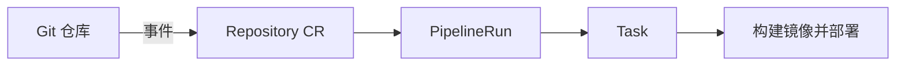

Repository CR 负责告诉 Pipelines as Code 监听哪个仓库、使用什么凭据、在哪个命名空间运行；PipelineRun 则定义一次流水线执行的具体内容和触发条件。

## 两者关系

## 配置入口

- [Repository CR 配置](/docs/developer/delivery/pac/repository-and-pipelinerun/repository/)：事件匹配、命名空间、认证、并发限制、源分支、自定义参数。
- [PipelineRun 配置](/docs/developer/delivery/pac/repository-and-pipelinerun/pipelinerun/)：创建流程、完整示例、动态变量、解析器注解、事件匹配与过滤、自动取消。

## 推荐阅读顺序

1. 先创建 Repository CR，确认仓库连接和事件匹配正常。
2. 再编写 `.tekton` 目录下的 PipelineRun，配置事件注解。
3. 推送代码或创建 PR，验证 PipelineRun 是否按预期触发。
