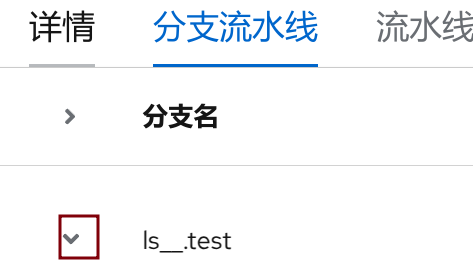

上级：[流水线](/docs/developer/delivery/pipelines/)

:::note

**嵌入流水线**和标准流水线不一样，它不是[Pipeline](../#pipeline)资源对象，是一个[PipelineRun](../#pipelinerun)资源对象，通过模板把这个PipelineRun对象实例化，就可以实现流水线的运行。
主要用于kdo平台的[应用](/docs/developer/applications/git/)，创建应用时它会根据模板自动生成。

:::


```yaml
apiVersion: tekton.dev/v1
kind: PipelineRun
metadata:
  name: spring-boot-docker-dev-ls-test
  namespace: cc
spec:
  params:
    - name: repo_url
      value: '{{ repo_url }}'
    - name: revision
      value: '{{ revision }}'
  pipelineSpec:
    tasks:
      - name: fetch-repository
        taskRef:
          name: git-clone
          kind: ClusterTask
        workspaces:
          - name: output
            workspace: workspace
          - name: basic-auth
            workspace: basic-auth
        params:
          - name: url
            value: $(params.repo_url)
          - name: revision
            value: $(params.revision)
      - name: maven
        params:
          - name: MAVEN_IMAGE
            value: 'registry.cn-shenzhen.aliyuncs.com/kubedo/maven:3-openjdk-8'
          - name: GOALS
            value:
              - 'dependency:go-offline'
              - '-DskipTests'
              - clean
              - package
        runAfter:
          - fetch-repository
        taskRef:
          kind: ClusterTask
          name: maven
        workspaces:
          - name: source
            workspace: workspace
          - name: maven-settings
            workspace: maven-repo
          - name: maven-local-repo
            workspace: maven-repo
      - name: buildah
        params:
          - name: IMAGE
            value: 'hub-k8s.kube-do.cn/cc-dev/spring-boot-docker:$(params.image_tag)'
          - name: DOCKERFILE
            value: docker/Dockerfile
        runAfter:
          - maven
        taskRef:
          kind: ClusterTask
          name: buildah
        workspaces:
          - name: source
            workspace: workspace
          - name: dockerconfig
            workspace: dockerconfig-ws
      - name: deploy
        params:
          - name: script
            value: >
              kubectl set image deployment/$DEPLOYMENT_NAME $APP_NAME=hub-k8s.kube-do.cn/cc-dev/spring-boot-docker:$(params.image_tag) -n $NAMESPACE
        runAfter:
          - buildah
        taskRef:
          kind: ClusterTask
          name: kubernetes-actions
        workspaces:
          - name: kubeconfig-dir
            workspace: workspace
          - name: manifest-dir
            workspace: workspace
        status:
          reason: Skipped
  workspaces:
    - name: workspace
      persistentVolumeClaim:
        claimName: workspace
    - name: maven-repo
      persistentVolumeClaim:
        claimName: maven-repo
    - name: dockerconfig-ws
      secret:
        secretName: registry
```

## 和标准流水线的区别
`嵌入流水线`和`标准流水线`的主要区别，标准流水线的`参数(Params)`和`工作区(Workspaces)`默认需要手动输入，嵌入流水线可以通过平台从应用信息里面自动生成，实现了流水线的自动化。

## 编辑嵌入流水线

在分支流水线选择对应的分支，扩展后就能编辑嵌入流水线流水线了。



嵌入流水线的编辑提供了两种主要方式：流水线运行构建器（图形化界面）和YAML视图。
对于大多数用户而言，通常推荐采用图形化界面来进行编辑，因为它通过直观的操作流程和友好的用户界面大大降低了使用门槛，使得创建和修改流水线变得简便快捷，无需深入了解YAML语法及其复杂性。

在**流水线运行构建器**的页面，主要有三部分： [任务](../#task)、[参数](../#params)、[工作区](../#workspaces)，其中`工作区`和`参数`主要用于传递信息，
`任务`可以通过图形化拖拽各种`组件模板`实现流水线任务的编辑。
<video class="doc-video" controls muted loop autoplay playsinline preload="metadata" poster="/media/docs/developer/delivery/pipelines/imgs/edit-tasks-poster.webp" aria-label="edit-tasks.gif"><source src="/media/docs/developer/delivery/pipelines/imgs/edit-tasks.mp4" type="video/mp4" /></video>

---
